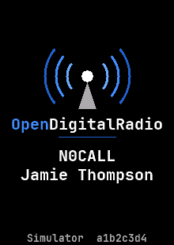
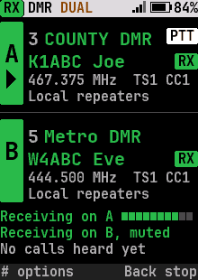
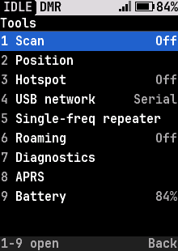
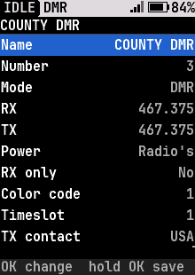
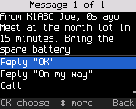
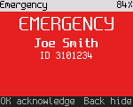
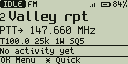
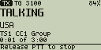
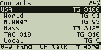
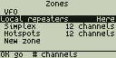

# RadioFoundry

**Free, MIT-licensed firmware for affordable DMR radios.** One shared core runs the DMR stack, the UI, the codeplug and
the host tools; each radio adds a thin board layer. It brings the FM and DMR features low-cost stock firmware leaves
out, with a UI designed from first principles. Anyone can use it for anything, commercial products included.

**[Install](docs/user/02-installing.md)** · **[User manual](docs/user/README.md)** · **[Radios](#radios-and-status)** ·
**[Features](#features)** · **[Developer docs](docs/dev/README.md)**

<p>




</p>
<p>




</p>
<p>




</p>

<sub>Top to bottom: DM-32UV (240x320 color), DM-1701 (160x120 color) and DM-1801 Pro (128x64 mono) screens, rendered
by the UI simulator (`make -C tests/host ui-gallery`).</sub>

## Radios and status

<!-- generated: tools/boards.py docs radios; edit boards/*/board.toml [status] and docs/spec/radios.md -->
| Radio | Builds | Host tests | On the radio | Support |
|---|:---:|:---:|:---:|---|
| [Baofeng DM-32UV](docs/testing/dm32-bringup.md) | ● | ● | ● | FM and DMR voice both ways, CTCSS/DCS, APRS both ways, GPS data, the hotspot and each split duplex half work on air. Open: FM deviation at 12.5 kHz and an outdoor GPS fix. |
| [Baofeng DM-1701](docs/spec/hardware-dm1701.md), Retevis RT84 | ● | ● | ● | FM, DMR voice and data, text messages, alerts, emergency, scan, the hotspot, single frequency repeating, each split duplex half and the USB network services work on air. Open: standalone SFR and a two-radio split duplex pair. |
| [Baofeng DM-1801 Pro](docs/testing/dm1801pro-bringup.md), DM-1801 | ● | ● | ● | FM with CTCSS/DCS, DMR voice with the radio's own codec, DMR data and text, the hotspot, single frequency repeating, the PPP network services and each split duplex half work on air. Open: VHF transmit and VOX. |
| [Radioddity DB25-D PRO](docs/spec/hardware-db25d.md), Kydera CDR-300UV (mobile) | ● | ● | ● | FM and DMR voice both ways, the hotspot, the DMR VFO, the PPP network services, cable programming and settings storage work on the radio. Open: the older FD6818 batches and the Retevis RT73. |
| [TYT MD-380](docs/testing/md380-bringup.md), MD-390, Retevis RT3 | ● | ● | ● | FM with CTCSS both ways, DMR voice and SMS in simplex and through a repeater or hotspot on either slot, and codeplug and ID database programming work on a UHF radio. Open: DCS, the tone deviation and the untested VHF image. |
| TYT MD-9600, Retevis RT90 (mobile) | ◐ | ◐ | ○ | In progress ([#112](https://github.com/radiofoundry/radiofoundry/pull/112)). Mobile radio on the same STM32F405 and HR_C6000 pair, with SKY72310 synthesizers (older boards) and a 128x64 mono LCD. |
| Radioddity GD-77, TYT MD-760, GD-77S, Baofeng DM-1801 v1 / DM-860, RD-5R | ◐ | ◐ | ◐ | In progress ([#111](https://github.com/radiofoundry/radiofoundry/pull/111)). A new platform: a different MCU (NXP MK22FN512), the same HR_C6000 and AT1846S, a 128x64 mono LCD. A DM-1801 bought new today is not v1, and the look-alike DR-1801 is unrelated. |
| Radioddity GD-88 | ◐ | ◐ | ○ | In progress ([#132](https://github.com/radiofoundry/radiofoundry/pull/132)). Hardware needed. Dual receiver on the HR_C7000 platform (chip count not confirmed yet); should reuse much of the DM-32UV port. |
| TYT MD-UV380 / MD-UV390, Retevis RT3S | ○ | ○ | ○ | Planned. Same board family as the DM-1701 (STM32F405, HR_C6000, AT1846S), so it should be the next port ([hardware-mduv380.md](docs/spec/hardware-mduv380.md)). |
| Radioddity DB40-D, Kydera CDR-700UV (mobile) | ○ | ○ | ○ | Planned. Hardware needed. Two HR_C7000-class processors (A and B), like the GD-88, so it follows the GD-88 port. |
| TYT MD-2017 / Retevis RT82 | ○ | ○ | ○ | Planned. The DM-1701's STM32 and HR_C6000 pair with two receivers, so it should reuse the STM32F4 platform. The hardware can receive two channels at once. |
| Anytone AT-D868UV / AT-D878UV / AT-D878UVII Plus, BTECH DMR-6X2, Alinco DJ-MD5, Radioddity GD-AT10G | ○ | ○ | ○ | Planned. A new platform (GD32F30x) and a new DMR chip (SCT3258, which runs the vocoder itself), so it starts the Anytone family ([hardware-anytone.md](docs/spec/hardware-anytone.md)). |
| BTECH DMR-6X2 PRO | ○ | ○ | ○ | Planned. Built on the AT-D878UVII Plus, so it should follow the Anytone port. |
| Anytone AT-D578UV (mobile) | ○ | ○ | ○ | Planned. The 878's chips in a mobile, with a mid-run MCU change: two platforms ([hardware-anytone.md](docs/spec/hardware-anytone.md)). |
| BridgeCom Maverick | ○ | ○ | ○ | Planned. Sold as an upgraded AT-D878UV, so it likely follows the Anytone port. |
| Retevis RT10 (902-928 MHz) | ○ | ○ | ○ | Planned. A DMR and FM handheld for 902-928 MHz, a band no other radio here covers; the chips aren't known yet. |
<!-- end generated -->

● done&nbsp;&nbsp; ◐ partly, or only in the linked pull request so far&nbsp;&nbsp; ○ not yet

- **Releases** carry firmware for the supported radios (without the codec), `rfoundry` for Windows, macOS and Linux,
  and the user manual as a PDF. Nothing to build: see [Installing](docs/user/02-installing.md).
- **What has been checked on the air**, per feature and per radio: [on-air coverage](docs/testing/on-air-coverage.md)
  and the [feature matrix](docs/feature-matrix.md#checked-on-each-radio). "Host-tested" means it works against
  simulated chips, not yet on air.
- **Check TX frequency** against an external reference (counter, service monitor or MMDVMCal) before relying on it:
  accuracy comes from each radio's factory calibration, and one MD-380 measured 1.9 kHz high
  ([#108](https://github.com/radiofoundry/radiofoundry/issues/108)).
- The chips in each radio and the planned port order: [docs/spec/radios.md](docs/spec/radios.md).

## Features

| Feature | What it does |
|---|---|
| **DMR voice** | Group and private calls, talker alias, basic privacy ([dmr-voice](docs/spec/dmr-voice.md)) |
| **DMR data** | Text messages, ARS, LRRP, call alert, radio check ([dmr-data](docs/spec/dmr-data.md)) |
| **Emergency** | Alarm, emergency call with hot mic, alerts ([dmr-emergency](docs/spec/dmr-emergency.md)) |
| **FM** | CTCSS/DCS, roger beep, 1750 Hz burst ([radio-features](docs/spec/radio-features.md)) |
| **Dual watch, scan, VFO** | Two channels at once; zone, VFO and dual watch scan that stops for DMR calls in progress; any frequency by hand in FM or DMR ([radio-features](docs/spec/radio-features.md)) |
| **Roaming** | Moves to the strongest repeater of a zone, surveying sites during idle beacons ([dmr-roaming](docs/spec/dmr-roaming.md)) |
| **APRS** | Position, status and messages on FM, positions over DMR to an APRS gateway, KISS TNC ([aprs](docs/spec/aprs.md)) |
| **Hotspot** | The radio is an MMDVM modem over USB, including MMDVM single frequency repeating ([mmdvm-protocol](docs/spec/mmdvm-protocol.md), [sfr](docs/spec/sfr.md)) |
| **USB network** | The radio is a USB network adapter that routes IP over DMR, with a status page, rigctld, KISS over TCP, APRS-IS, mDNS, TFTP and SNMP on the link ([usb-network](docs/spec/usb-network.md), [tcp-services](docs/spec/tcp-services.md)) |
| **Split duplex repeater** | Experimental: two radios on one MMDVM host as a full duplex repeater ([split-duplex](docs/spec/split-duplex.md)) |
| **Programming** | qdmr, or the Codeplug Editor on the web site ([cps-protocol](docs/spec/cps-protocol.md)) |
| **UI** | Designed from first principles, the same on a 128x64 mono LCD or a 240x320 color panel, keypad or knob, with press budgets checked by the host tests ([principles](docs/ux/principles.md), [screens](docs/ux/screens/)) |

What each radio supports is in the [feature matrix](docs/feature-matrix.md). Every feature that costs flash has a
build switch ([build-config](docs/build-config.md)).

## Interoperability

**Across hardware.** One core runs on every radio, and never checks which radio it's on. A board file picks the chips
and describes the bands, power levels, screen and keys. Today that's two MCUs (STM32F405, C-SKY CK803S), three DMR
modems (HR_C5000, HR_C6000, HR_C7000) and four RF chips (AT1846S, BK4819, FD6818, SKY72310) under the same code.

**With the radios and software people already have.** We support the formats other radios use:

| Area | Supported now | Planned |
|---|---|---|
| Air interface | ETSI DMR Tier II: simplex, repeater, MMDVM SFR (single frequency repeater), repeater roaming | Standalone SFR (repeater and user roles on a channel); ETSI Tier III trunking ([plan](docs/spec/dmr-tier3-plan.md)) |
| Text messages | ETSI IP text (the default; individual texts confirmed); Motorola TMS; ETSI short data in 7-bit, ISO 8859, UTF-8 and UTF-16; ETSI UDT text | Hytera text format |
| Location | Motorola LRRP location answers and ARS registration; ETSI GPS Info in voice calls (the caller's position shown with distance and bearing, ours sent from the APRS position); APRS position, status and messages on FM (Bell 202 AFSK) and positions over DMR to an APRS gateway ID; KISS TNC on USB | NMEA from the radio's GPS receiver, ETSI UDT location reports, APRS receive and iGate on radios that can sample received audio |
| Signaling | call alert, radio check and emergency, each in the Motorola and ETSI forms; talker alias in all four ETSI formats | DTMF and 5-tone on FM |
| Privacy and encryption | Motorola Basic Privacy, Anytone 16-bit Basic Privacy | ARC4 and AES-256 per the DMR Association interoperability profiles |
| Programming | qdmr, over the GD-77-style CPS protocol. The Codeplug Editor on the web site: every RadioFoundry radio over USB or the programming cable, CSV and qdmr YAML import and export, DMR ID database and contacts from RadioID.net | an open, published native codeplug format with its own qdmr driver |
| Hotspot and network | MMDVM modem protocol (MMDVMHost, Pi-Star, WPSD and the networks behind them); IP over DMR with the radio as a USB network adapter (confirmed data, SAP 3 compressed UDP headers, control station mode for dispatch software); HTTP status, Hamlib rigctld, KISS over TCP, APRS-IS, mDNS, TFTP and SNMPv2c on the USB link; two radios as one full duplex repeater (experimental, build switch; each half passes on air, one pair checked on the bench) | the split duplex host side (`tools/split_duplex_host.py` is a test host) |
| Audio to a computer | | USRP over UDP (AllStarLink, DVSwitch), USB sound card with serial-line PTT ([usb-audio](docs/spec/usb-audio.md)) |

"Supported now" means built and passing its tests; [Radios and status](#radios-and-status) says what is checked on air.
Every format is specified in [docs/spec](docs/spec), so other projects can implement the same thing.

## The AMBE codec

DMR voice needs DVSI's proprietary AMBE+2 vocoder. RadioFoundry never ships it, in this repository or in any binary.

Each radio runs the codec from its own stock firmware. [rfoundry](tools/rfoundry/README.md) takes it from the stock
firmware file you downloaded, on your machine, checks that file by SHA-256 and writes the codec with RadioFoundry. If the radio
already holds the right codec, it writes only RadioFoundry's own sectors. Without a codec the firmware runs FM only. Details
and supported stock files: [the codec](docs/dev/codec.md).

## Building

You need make, Python 3.11 or later, and `arm-none-eabi-gcc` (STM32F405 radios) or a `csky-elf` GCC (HR_C7000
radios).

```
tools/boards.py list        # the board ids
make BOARD=dm1701           # one board's image; there is no default board
make -C tests/host          # host tests
tools/ci.sh                 # everything a pull request must pass
```

Toolchains, make targets and each radio's flashing route: [building](docs/dev/building.md).

## Documentation

| | |
|---|---|
| [User manual](docs/user/README.md) | Installing, keys and screens, FM, DMR, messages, hotspot, settings, troubleshooting (also a PDF in each release) |
| [Developer docs](docs/dev/README.md) | Architecture, building, adding a radio, testing, the debug link, CPS, the codec, contributing, releases |
| [Specs](docs/spec/README.md), [UX](docs/ux/), [Testing](docs/testing/README.md) | Behavior, hardware and protocols; UI design; test procedures. Everything: [docs/README.md](docs/README.md) |

## How it's tested

| Level | What it does |
|---|---|
| Unit | Single pieces (error correction, encoders, the settings format) against answers from the standards or real radios |
| Software in the loop | The real firmware code, built for the host, runs whole features (calls, messages, codeplug writes) against simulated chips |
| UI simulator | Draws the real screens at every display size, walks the menus with scripted keys, and renders every screenshot here |
| Hardware in the loop | The same kind of scripts against a radio on USB over the [debug link](docs/spec/debuglink.md), with an SDR bench as the other station ([tests/hil](tests/hil/README.md)) |

`tools/ci.sh` builds every radio with each feature switch on and off, checks that every image fits, and runs the
license and clean-room checks. CI runs the host tests (also under ASan and UBSan) and every default build on each
push, and the full matrix nightly ([CI](docs/dev/ci.md), [testing](docs/dev/testing.md)).

## FAQ

**Why allow commercial use?**

Why not? Commercial use is the reason we can buy $40 DMR radios. If everything DMR were ham-only, we would still be
paying $500 for a decent radio. Nobody "loses" here, because the project authors aren't trying to make any money off
of this. If someone can figure out a way to use it in their product and make money, great! We're not in the business
of selling DMR firmware, we just want everyone to have access to a decent one.

**Why reinvent the wheel?**

There is no current truly open source effort to make a firmware for most of these radios, and definitely not one
that tries to share this much code across all makes and models. Any prior major "open" firmware efforts have ended up
with source code being taken down by authors, licensing issues, arguments and fights, or key authors closed-sourcing
their additions to the project.

**Why another radio firmware?**

DMR has features that cheaper radios almost never implement: data, location, emergency, roaming, IP. They are
useful in commercial service and to hams alike.

**How can I help?**

Any way you can:

- **Test and report.** Run RadioFoundry on your radio and [report what breaks](https://github.com/radiofoundry/radiofoundry/issues/new?template=bug_report.yml). If the radio restarted,
  include the crash log from **Settings > Advanced > Crash log** ([settings](docs/user/12-settings.md#crash-log)).
- **Ask.** [Request a feature](https://github.com/radiofoundry/radiofoundry/issues/new?template=feature_request.yml) or [a radio](https://github.com/radiofoundry/radiofoundry/issues/new?template=radio_request.yml) you'd like supported.
- **Contribute.** Send pull requests for code or docs ([contributing](docs/dev/contributing.md)).
- **Donate or lend a radio.** This helps the most, especially older models that are hard to find now, because every
  port needs the hardware on the bench.

**Was this project AI-generated?**

No. This project is the result of thousands of hours of combined human effort from several contributors, spent on
radio teardowns, reverse engineering, software architecture, and testing. AI was used as a pair programmer to speed up
support for additional radios and to make the project's ambitious scope possible and sustainable.

## Clean room and licensing

RadioFoundry is MIT licensed ([LICENSE](LICENSE)) and a clean-room project: code is written from prose specs, datasheets and
public standards, independent of earlier radio firmwares. No GPL code, no non-commercial code, no vendor SDKs. The
rules and checks: [docs/CLEANROOM.md](docs/CLEANROOM.md). Third-party code in `third_party/` (FreeRTOS, TinyUSB, ST's
HAL and CMSIS) keeps its own permissive license ([LICENSES/](LICENSES/)).

## Acknowledgements

RadioFoundry builds on years of community work that opened these radios up. None of that code is in RadioFoundry (see above), but
the reverse engineering and documentation behind it made this project possible. Thanks to:

- Travis Goodspeed KK4VCZ and the md380tools contributors, for the first open work on the MD-380 family.
- Warren Merkel KD4Z, for md380tools-vm and for support of the open DMR software development community.
- Roger Clark VK3KYY, Kai Ludwig DG4KLU, Daniel Caujolle-Bert F1RMB and the OpenGD77 contributors, for open
  firmware on the GD-77, MD-UV380, DM-1701, MD-9600 and others.
- The OpenRTX team, for their hardware documentation.
- The OpenDM32 project, for its DM-32UV research.
- Jonathan Naylor G4KLX and the MMDVM and MMDVMHost contributors, for open hotspots and repeaters.
- Cort Buffington N0MJS and the HBlink contributors, for open DMR networking.
- Hannes Matuschek DM3MAT and the qdmr contributors, for qdmr, RadioFoundry's main programming software.

## Contributing

Issues and pull requests are welcome. Read [docs/CLEANROOM.md](docs/CLEANROOM.md) first, keep radio-specific code out
of `core/`, put anything that costs flash behind a `CONFIG_` switch, and make sure `tools/ci.sh` passes. Details:
[contributing](docs/dev/contributing.md).

## Layout

| Path | What |
|---|---|
| `core/` | Radio-independent code: DMR stack (`core/dmr`), radio state machine (`core/radio`), UI (`core/ui`), hotspot, host link, codeplug, settings, CPS, debug link |
| `hal/` | Interfaces the core uses (modem, RF, audio, codec, flash, display, input), and the `board_t` descriptor |
| `drivers/` | Chip drivers shared across radios |
| `platform/` | Per-SoC startup, clocks, interrupts and RTOS glue (`stm32f4`, `hrc7000`) |
| `boards/` | One directory per radio: board descriptor, pins, feature defaults, linker script, codec hosting |
| `boot/` | First stages in front of the application, for radios whose loader starts it directly (`boot/db25d`) |
| `config/` | Build-time feature switches |
| `third_party/` | Permissively licensed upstream code, as submodules (FreeRTOS, ST HAL and CMSIS, TinyUSB) |
| `tools/` | Flashing (`rfoundry`), release packaging, codec merge, CPS client, debug link client (`rfoundry_debug.py`), CI, SDR bench tools |
| `tests/host/` | Unit and SIL tests, the UI simulator (`tests/host/sim`) |
| `tests/hil/` | HIL tests: pytest against a radio and the SDR bench |
| `docs/spec/` | Behavior, hardware facts and protocols; `gotchas.md` lists past bugs by subsystem |
| `docs/ux/` | UI principles, flows, the screenshot gallery |
| `docs/user/`, `docs/dev/`, `docs/testing/` | User manual (built to PDF on release tags), developer documentation, test procedures |
