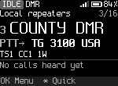
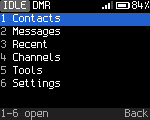
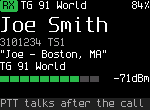

# OpenDigitalRadio

OpenDigitalRadio (ODR) is free, MIT-licensed firmware for inexpensive DMR radios. One radio-independent software core handles
the DMR stack, the UI, the codeplug and the host tools, and each radio adds a thin board layer underneath.

The goal is one framework that can build firmware for any of these radios, with a UI designed from first principles
and the FM and DMR features low-cost stock firmware usually omits. Anyone can use it for anything, commercial
products included.

It's early. Read the status section before you flash anything.

<p>




</p>

<sub>DM-1701 screens, rendered by the UI simulator (`make -C tests/host ui-gallery`).</sub>

## Radios and status

<!-- generated: tools/boards.py docs radios; edit boards/*/board.toml [status] and docs/spec/radios.md -->
| Radio | Builds | Host tests | On the radio | Support |
|---|:---:|:---:|:---:|---|
| [Baofeng DM-1701](docs/spec/hardware-dm1701.md), Retevis RT84 | ● | ● | ● | FM, DMR voice and data, text messages, alerts, emergency, scan, the hotspot, single frequency repeating, each split duplex half and the USB network services work on air. Open: standalone SFR and a two-radio split duplex pair. |
| [Baofeng DM-1801 Pro](docs/testing/dm1801pro-bringup.md), DM-1801 | ● | ● | ● | FM with CTCSS/DCS, DMR voice with the radio's own codec, DMR data and text, the hotspot, single frequency repeating, the PPP network services and each split duplex half work on air. Open: VHF transmit and VOX. |
| [Baofeng DM-32UV](docs/testing/dm32-bringup.md) | ● | ● | ● | FM and DMR voice both ways, CTCSS/DCS, APRS both ways, GPS data, the hotspot and each split duplex half work on air. Open: FM deviation at 12.5 kHz and an outdoor GPS fix. |
| [Radioddity DB25-D PRO](docs/spec/hardware-db25d.md), Kydera CDR-300UV (mobile) | ● | ● | ● | FM and DMR voice both ways, the hotspot, the DMR VFO, the PPP network services, cable programming and settings storage work on the radio. Open: the older FD6818 batches and the Retevis RT73. |
| [TYT MD-380](docs/testing/md380-bringup.md), MD-390, Retevis RT3 | ● | ● | ● | FM with CTCSS both ways, DMR voice and SMS in simplex and through a repeater or hotspot on either slot, and codeplug and ID database programming work on a UHF radio. Open: DCS, the tone deviation and the untested VHF image. |
| [TYT MD-9600](docs/spec/hardware-md9600.md), Retevis RT90 (mobile) | ● | ● | ◐ | Builds for every board revision (SKY72310, "PLL1590" and LMX2571 synthesizers) and is offered to testers through the bootloader and the flash stub. Open: everything on a radio; nothing has run on an MD-9600 yet, and transmit is off. |
| TYT MD-UV380 / MD-UV390, Retevis RT3S | ○ | ○ | ○ | Planned. Same board family as the DM-1701 (STM32F405, HR_C6000, AT1846S), so it should be the next port ([hardware-mduv380.md](docs/spec/hardware-mduv380.md)). |
| Radioddity GD-77, TYT MD-760, GD-77S, Baofeng DM-1801 v1 / DM-860, RD-5R | ○ | ○ | ○ | In progress ([#111](https://github.com/sfowlr/OpenDigitalRadio/pull/111)). Hardware needed. A new platform: a different MCU (NXP MK22FN512), the same HR_C6000 and AT1846S, a 128x64 mono LCD. A DM-1801 bought new today is not v1, and the look-alike DR-1801 is unrelated. |
| Radioddity GD-88 | ○ | ○ | ○ | In progress ([#132](https://github.com/sfowlr/OpenDigitalRadio/pull/132)). Hardware needed. Dual receiver on the HR_C7000 platform (chip count not confirmed yet); should reuse much of the DM-32UV port. |
| Radioddity DB40-D, Kydera CDR-700UV (mobile) | ○ | ○ | ○ | Planned. Hardware needed. Two HR_C7000-class processors (A and B), like the GD-88, so it follows the GD-88 port. |
<!-- end generated -->

● done&nbsp;&nbsp; ◐ partly&nbsp;&nbsp; ○ not yet

TX frequency accuracy depends on each radio's factory calibration: confirm it against an external reference (frequency counter, service monitor, or a hotspot's MMDVMCal BER test) before relying on it. One MD-380 measured +1.9 kHz high, too far for an MMDVM hotspot's narrow decode window ([#108](https://github.com/sfowlr/OpenDigitalRadio/issues/108)).

The chips in each radio, their sources and the planned port order: [docs/spec/radios.md](docs/spec/radios.md).

On the DM-1701, the automated tests against the SDR bench pass on air for FM, DMR calls, data, emergency, the hotspot,
MMDVM SFR, scan and each half of the split duplex repeater. qdmr, the USB network adapter and its services are checked
on the radio. Still open: Standalone SFR, the MMDVM SFR repeat delay and a split duplex test with two radios. Results
per feature: [on-air coverage](docs/testing/on-air-coverage.md). What is checked on each radio, and what is only built in:
[feature matrix](docs/feature-matrix.md#checked-on-each-radio).
"Host-tested" means it works against simulated chips, not that anyone has heard it on air yet.

Releases carry the DM-1701 firmware (everything except the codec), `odrflash` to flash it on Windows, macOS and
Linux, and the user manual as a PDF. You don't build anything; see [Installing](docs/user/02-installing.md).

## What it does

- **DMR voice:** group and private calls, talker alias, basic privacy ([dmr-voice](docs/spec/dmr-voice.md))
- **DMR data:** text messages, ARS, LRRP, call alert, radio check ([dmr-data](docs/spec/dmr-data.md))
- **Emergency:** alarm, emergency call with hot mic, alerts ([dmr-emergency](docs/spec/dmr-emergency.md))
- **Hotspot:** the radio works as an MMDVM modem over USB ([mmdvm-protocol](docs/spec/mmdvm-protocol.md))
- **SFR (single frequency repeater):** MMDVM SFR is the hotspot repeating on one frequency, turned on by the MMDVM
  host. Standalone SFR, the repeater and user roles on a channel without a host, is not built yet ([sfr](docs/spec/sfr.md))
- **USB network mode:** the radio becomes a USB network adapter and routes IP over DMR, with confirmed data and
  compressed headers; control station mode for PC dispatch software ([usb-network](docs/spec/usb-network.md))
- **Services on the USB network link:** HTTP status page (port 80), Hamlib rigctld (4532), KISS over TCP (8001), an
  APRS-IS client, mDNS (`odr-<DMR ID>.local`), TFTP codeplug read and write, and an SNMPv2c agent
  ([tcp-services](docs/spec/tcp-services.md), [mdns](docs/spec/mdns.md), [tftp](docs/spec/tftp.md),
  [snmp](docs/spec/snmp.md))
- **Roaming:** moves to the strongest repeater of a zone when the one it's on gets weak, surveying the other sites
  during the repeaters' idle beacons; turned on per zone
  ([dmr-roaming](docs/spec/dmr-roaming.md))
- **APRS:** position, status and messages on FM (1200 baud AFSK), positions over DMR to an APRS gateway, KISS TNC;
  transmit only on the DM-1701, DMR positions only on the MD-380 ([aprs](docs/spec/aprs.md))
- **Split duplex repeater (experimental; DM-1701, DM-32UV, DM-1801 Pro):** two radios on one MMDVM host as a full duplex repeater, idle until the host assigns roles;
  each half passes on air, and a pair (DM-1801 Pro transmitting, DM-32UV receiving) carried a subscriber's calls on
  both slots on the bench. The host must reach both radios on its own ports. The DB25-D offers no role yet
  ([split-duplex](docs/spec/split-duplex.md))
- **FM:** CTCSS/DCS, roger beep, 1750 Hz burst, dual watch ([radio-features](docs/spec/radio-features.md))
- **VFO:** tune any frequency by hand, in FM or DMR (the DMR VFO has its own color code, timeslot and talk target)
  ([dmr-voice](docs/spec/dmr-voice.md) 2.1)
- **Scan:** zone, VFO and dual watch scan; on DMR it stops for calls in progress, using late entry
  ([radio-features](docs/spec/radio-features.md))
- **qdmr as the CPS:** program the radio with qdmr ([cps-protocol](docs/spec/cps-protocol.md))
- **A UI designed from first principles**, not copied from anyone's menus, with press budgets checked by the host
  tests ([principles](docs/ux/principles.md), [screens](docs/ux/screens/))

Each feature that costs flash has a build switch. See [docs/build-config.md](docs/build-config.md); sizes and per-radio defaults are in [docs/feature-matrix.md](docs/feature-matrix.md).

## Interoperability

Interoperability is a priority, in two directions.

**Across hardware.** One core runs on every radio. A radio is a board file that picks its chips (DMR modem, RF
chip, display, keypad or encoder, flash) and describes its bands, power levels and screen. The core never checks
which radio it's on. The same UI lays itself out on a 128x64 monochrome LCD or a 240x320 color panel, and works
with a full keypad or just a knob and a couple of buttons. Today that's two MCUs (STM32F405 and C-SKY CK803S),
three DMR modems (HR_C5000, HR_C6000 and HR_C7000) and four RF chips (AT1846S, BK4819, FD6818 and the SKY72310
synthesizer) sharing all the code above them.

**With everything else on the air and on your desk.** A radio is only useful if it talks to the radios and software
people already have. We support the formats other radios use, not just our favorite:

| Area | Supported now | Planned |
|---|---|---|
| Air interface | ETSI DMR Tier II: simplex, repeater, MMDVM SFR (single frequency repeater), repeater roaming | Standalone SFR (repeater and user roles on a channel); ETSI Tier III trunking ([plan](docs/spec/dmr-tier3-plan.md)) |
| Text messages | ETSI IP text (the default; individual texts confirmed); Motorola TMS; ETSI short data in 7-bit, ISO 8859, UTF-8 and UTF-16; ETSI UDT text | Hytera text format |
| Location | Motorola LRRP location answers and ARS registration; ETSI GPS Info in voice calls (the caller's position shown with distance and bearing, ours sent from the APRS position); APRS position, status and messages on FM (Bell 202 AFSK) and positions over DMR to an APRS gateway ID; KISS TNC on USB | NMEA from the radio's GPS receiver, ETSI UDT location reports, APRS receive and iGate on radios that can sample received audio |
| Signaling | call alert, radio check and emergency, each in the Motorola and ETSI forms; talker alias in all four ETSI formats | DTMF and 5-tone on FM |
| Privacy and encryption | Motorola Basic Privacy, Anytone 16-bit Basic Privacy | ARC4 and AES-256 per the DMR Association interoperability profiles |
| Programming | qdmr, over the GD-77-style CPS protocol. The Codeplug Editor on the web site: every ODR radio over USB or the programming cable, CSV and qdmr YAML import and export, DMR ID database and contacts from RadioID.net | an open, published native codeplug format with its own qdmr driver |
| Hotspot and network | MMDVM modem protocol (MMDVMHost, Pi-Star, WPSD and the networks behind them); IP over DMR with the radio as a USB network adapter (confirmed data, SAP 3 compressed UDP headers, control station mode for dispatch software); HTTP status, Hamlib rigctld, KISS over TCP, APRS-IS, mDNS, TFTP and SNMPv2c on the USB link; two radios as one full duplex repeater (experimental, build switch; each half passes on air, one pair checked on the bench) | the split duplex host side (`tools/split_duplex_host.py` is a test host) |
| Audio to a computer | | USRP over UDP (AllStarLink, DVSwitch), USB sound card with serial-line PTT ([usb-audio](docs/spec/usb-audio.md)) |

"Supported now" means built and passing its tests; see [Radios and status](#radios-and-status) for what has been
checked on the air. Specs for every format are in [docs/spec](docs/spec), written so other projects can implement
the same thing.

## The AMBE codec

DMR voice needs DVSI's proprietary AMBE+2 vocoder. ODR never ships it, not in this repo and not in any binary.

Each radio runs the codec its own stock firmware came with. Release images leave it out, and
[odrflash](tools/odrflash/README.md) handles it when you flash. If the radio already holds the right codec, odrflash
writes only ODR's own flash sectors. Otherwise it extracts the codec from the stock firmware file you downloaded, on
your own machine, and writes it to the radio. It checks the stock file by SHA-256 and refuses anything it doesn't
recognize. Without a codec the firmware runs FM only. Which stock files work, and the tools for radios not in the
releases: [The codec](docs/dev/codec.md).

## Building and flashing

You need make, Python 3.11 or later, and `arm-none-eabi-gcc` (STM32F405 radios) or a `csky-elf` GCC (HR_C7000
radios).

```
tools/boards.py list        # the board ids
make BOARD=dm1701           # one board's image; there is no default board
make -C tests/host          # host tests
tools/ci.sh                 # everything a pull request must pass
```

Toolchains, make targets and the flashing route for each radio: [building](docs/dev/building.md). Moving a radio from
stock firmware with its codeplug: [the user manual](docs/user/README.md).

## Documentation

- [User manual](docs/user/README.md): installing, the keys and screens, FM, DMR, messages, hotspot, settings,
  troubleshooting. Each release also carries it as a PDF.
- [Developer documentation](docs/dev/README.md): architecture, building, adding a radio, testing, the debug link,
  CPS, the codec, contributing, releases.
- Specs and design: [docs/spec](docs/spec/README.md), [docs/ux](docs/ux/), [docs/testing](docs/testing/README.md).
  All of it: [docs/README.md](docs/README.md).

## How it's tested

Most of the testing runs on any computer, with no radio:

- **Unit tests** check single pieces (error correction, encoders, the settings format) against known answers from
  the standards or from real radios.
- **Software-in-the-loop (SIL) tests** compile the real firmware code for the host and run whole features (calls,
  text messages, codeplug writes) against simulated chips.
- **The UI simulator** draws the real screens into images at every supported display size, walks the menus with
  scripted key presses and renders every screenshot in these docs.
- **Hardware-in-the-loop (HIL) tests** run the same kind of scripts against a radio on USB, through the
  [debug link](docs/spec/debuglink.md), with an SDR bench as the other station ([tests/hil](tests/hil/README.md)).

`tools/ci.sh` builds every radio with each feature switch on and off, checks that each image fits, and runs the
license and clean-room checks. CI runs the host tests (also under ASan and UBSan) and every radio's default build on
each push, and the full matrix nightly ([CI](docs/dev/ci.md)). How to run each level and where a new test goes:
[testing](docs/dev/testing.md) and [docs/testing](docs/testing/README.md).

## FAQ

**Why allow commercial use?**

Why not? Commercial use is the reason we can buy $40 DMR radios. If everything DMR were ham-only, we would still be
paying $500 for a decent radio. Nobody "loses" here, because the project authors aren't trying to make any money off
of this. If someone can figure out a way to use it in their product and make money, great! We're not in the business
of selling DMR firmware, we just want everyone to have access to a decent one.

**Why reinvent the wheel?**

There is no current truly open source effort to make a firmware for most of these radios, and definitely not one
that tries to share this much code across all makes and models. Any prior major "open" firmware efforts have ended up
with source code being taken down by authors, licensing issues, arguments and fights, or key authors closed-sourcing
their additions to the project.

**Why another radio firmware?**

DMR has features that cheaper radios almost never implement: data, location, emergency, roaming, IP. They are
useful in commercial service and to hams alike.

**How can I help?**

Open an issue or pull request, or donate a new radio model for testing.

## Clean room and licensing

ODR is MIT licensed ([LICENSE](LICENSE)). It's a clean-room project, independent of earlier radio firmwares: code is
written from prose specs, datasheets and public standards. No GPL code, no non-commercial code, no vendor SDKs. The
rules and the checks behind them are in [docs/CLEANROOM.md](docs/CLEANROOM.md).

Third-party code in `third_party/` (FreeRTOS, TinyUSB, ST's HAL and CMSIS) keeps its own permissive license; see
[LICENSES/](LICENSES/) and each submodule.

## Acknowledgements

ODR builds on years of community work that opened these radios up. None of that code is in ODR (see above), but
the reverse engineering and documentation behind it made this project possible. Thanks to:

- Travis Goodspeed KK4VCZ and the md380tools contributors, for the first open work on the MD-380 family.
- Warren Merkel KD4Z, for md380tools-vm and for support of the open DMR software development community.
- Roger Clark VK3KYY, Kai Ludwig DG4KLU, Daniel Caujolle-Bert F1RMB and the OpenGD77 contributors, for open
  firmware on the GD-77, MD-UV380, DM-1701, MD-9600 and others.
- The OpenRTX team, for their hardware documentation.
- The OpenDM32 project, for its DM-32UV research.
- Jonathan Naylor G4KLX and the MMDVM and MMDVMHost contributors, for open hotspots and repeaters.
- Cort Buffington N0MJS and the HBlink contributors, for open DMR networking.
- Hannes Matuschek DM3MAT and the qdmr contributors, for qdmr, ODR's main programming software.

## Contributing

Issues and pull requests are welcome. Read [docs/CLEANROOM.md](docs/CLEANROOM.md) first, keep radio-specific code out
of `core/`, put anything that costs flash behind a `CONFIG_` switch, and make sure `tools/ci.sh` passes. Details: [contributing](docs/dev/contributing.md).

## Layout

| Path | What |
|---|---|
| `core/` | Radio-independent code: DMR stack (`core/dmr`), radio state machine (`core/radio`), UI (`core/ui`), hotspot, host link, codeplug, settings, CPS, debug link |
| `hal/` | Interfaces the core uses (modem, RF, audio, codec, flash, display, input), and the `board_t` descriptor |
| `drivers/` | Chip drivers shared across radios |
| `platform/` | Per-SoC startup, clocks, interrupts and RTOS glue (`stm32f4`, `hrc7000`) |
| `boards/` | One directory per radio: board descriptor, pins, feature defaults, linker script, codec hosting |
| `boot/` | First stages in front of the application, for radios whose loader starts it directly (`boot/db25d`) |
| `config/` | Build-time feature switches |
| `third_party/` | Permissively licensed upstream code, as submodules (FreeRTOS, ST HAL and CMSIS, TinyUSB) |
| `tools/` | Flashing (`odrflash`), release packaging, codec merge, CPS client, debug link client (`odr_debug.py`), CI, SDR bench tools |
| `tests/host/` | Unit and SIL tests, the UI simulator (`tests/host/sim`) |
| `tests/hil/` | HIL tests: pytest against a radio and the SDR bench |
| `docs/spec/` | Behavior, hardware facts and protocols; `gotchas.md` lists past bugs by subsystem |
| `docs/ux/` | UI principles, flows, the screenshot gallery |
| `docs/user/`, `docs/dev/`, `docs/testing/` | User manual (built to PDF on release tags), developer documentation, test procedures |
