<!-- SPDX-License-Identifier: MIT -->
<!-- Copyright (c) 2026 The RadioFoundry Authors -->

# RadioFoundry

**Free, MIT-licensed multi-mode firmware for affordable digital radios: DMR, P25, NXDN, and FM.** One shared core runs
the digital voice stacks, the UI, the codeplug, and the host tools; each radio adds a thin board layer. RadioFoundry
adds the features low-cost radios usually leave out, with a UI designed from first principles. Anyone can use it for
anything, commercial products included.

**Use the website, [radiofoundry.org](https://radiofoundry.org), to install RadioFoundry and to edit your radio's codeplug.** In a Chromium browser (Chrome, Edge),
plug in the radio. Use the [web installer](https://radiofoundry.org/flash/index.html) to back up, install, update, and
restore, and the [Codeplug Editor](https://radiofoundry.org/codeplug/index.html) for channels, zones, contacts, and
the DMR ID database. You install nothing, and your files never leave your computer. The command-line tools and the
[manual steps](docs/user/02-installing.md) are for scripting and for browsers that can't talk to a radio.

**[Install](docs/user/02-installing.md)** · **[User manual](docs/user/README.md)** ·
**[Radios](#radios-and-status)** · **[Features](#features)** · **[Documentation](docs/README.md)**

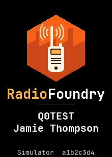
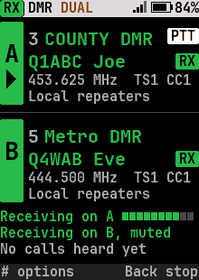
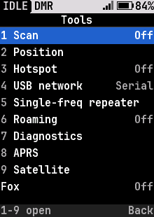
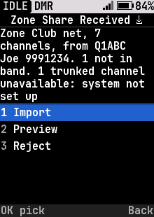

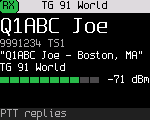
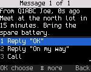
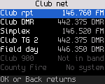
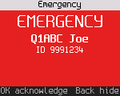

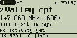
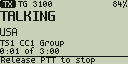
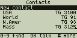
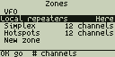

Top to bottom: DM-32UV (240x320 color), DM-1701 (160x120 color) and DM-1801 Pro (128x64 mono) screens, rendered
by the UI simulator (`make -C tests/host ui-gallery`).

## Radios and status

<!-- generated: tools/boards.py docs radios; edit boards/*/board.toml [status] and docs/spec/radios.md -->
| Radio | Builds | Host tests | On the radio | Support |
|---|:---:|:---:|:---:|---|
| [Baofeng DM-32UV](docs/user/23-radios.md#baofeng-dm-32uv) | ● | ● | ● | FM and DMR voice both ways, CTCSS/DCS, APRS both ways, GPS data, the hotspot and each split duplex half work on air. Open: FM deviation at 12.5 kHz and an outdoor GPS fix. |
| [Baofeng DM-1701](docs/user/23-radios.md#baofeng-dm-1701), Retevis RT84 | ● | ● | ● | FM, DMR voice and data, text messages, alerts, emergency, scan, the hotspot, single frequency repeating, each split duplex half and the USB network services work on air. Open: standalone SFR and a two-radio split duplex pair. |
| [Baofeng DM-1801 Pro](docs/user/23-radios.md#baofeng-dm-1801-pro), DM-1801 | ● | ● | ● | FM with CTCSS/DCS, DMR voice with the radio's own codec, DMR data and text, the hotspot, single frequency repeating, the PPP network services and each split duplex half work on air. Open: VHF transmit and VOX. |
| [Radioddity DB25-D PRO](docs/user/23-radios.md#radioddity-db25-d-pro), Kydera CDR-300UV (mobile) | ● | ● | ● | FM and DMR voice both ways, the hotspot, the DMR VFO, the PPP network services, cable programming and settings storage work on the radio. The older FD6818 batches run the same image, untested on a radio. Open: the Retevis RT73. |
| [TYT MD-380](docs/user/23-radios.md#tyt-md-380), MD-390, Retevis RT3 | ● | ● | ● | FM with CTCSS both ways, DMR voice and SMS in simplex and through a repeater or hotspot on either slot, and codeplug and ID database programming work on a UHF radio. Open: DCS, the tone deviation and the untested VHF image. |
| [TYT MD-UV380](docs/user/23-radios.md#tyt-md-uv380), MD-UV390, Retevis RT3S, MD-UV390 Plus 10 W | ● | ● | ● | Built on the UV380 family code, with the MD-UV380's keys, display, power tables and GPS. Run on radios by community testers. |
| [TYT MD-9600](docs/user/23-radios.md#tyt-md-9600), Retevis RT90 (mobile) | ● | ● | ● | One image serves every board revision. On a V1-V3 radio, FM and DMR on both bands, DMR voice and data, text messages, roaming, scan, dual watch, APRS, the hotspot, each split duplex half and the USB network services work on air, with every power level checked on a wattmeter on both bands. V4A/V5 boards are detected; on older boards the radio asks for the revision once. Open: V4 and V4A/V5 boards have not run on a radio, and SFR loses inbound voice frames. |
| [Retevis RT10](docs/user/23-radios.md#retevis-rt10) | ● | ● | ● | Boots from the boot ROM with the host link, stub entry, the watchdog and the crash log. FM receive with CTCSS/DCS decode, FM transmit, DMR transmit and receive with the radio's own codec, P25 (conventional, and trunked transmit) and NXDN at 4800 bit/s on stored channels, and APRS transmit work on the radio. |
| Anytone AT-D868UV / AT-D878UV / AT-D878UVII Plus, BTECH DMR-6X2, Alinco DJ-MD5, Radioddity GD-AT10G | ○ | ○ | ○ | In progress ([#291](https://github.com/radiofoundry/radiofoundry/pull/291)). A new platform (GD32F30x) and a new DMR chip (SCT3258, which runs the vocoder itself), so it starts the Anytone family. |
| Radioddity GD-77, TYT MD-760, GD-77S, Baofeng DM-1801 v1 / DM-860, RD-5R | ◐ | ◐ | ◐ | In progress ([#111](https://github.com/radiofoundry/radiofoundry/pull/111)). A new platform: a different MCU (NXP MK22FN512), the same HR_C6000 and AT1846S, a 128x64 mono LCD. A DM-1801 bought new today is not v1, and the look-alike DR-1801 is unrelated. |
| Radioddity GD-88 | ◐ | ◐ | ○ | In progress ([#132](https://github.com/radiofoundry/radiofoundry/pull/132)). Dual receiver on the HR_C7000 platform; it can reuse much of the DM-32UV port. |
| Baofeng DM-36 | ○ | ○ | ○ | In progress ([#607](https://github.com/radiofoundry/radiofoundry/pull/607)). Built on the DM-32UV's platform: FM, the display, keys and programming run; DMR voice on air and power levels open. |
| Anytone AT-D578UV (mobile) | ○ | ○ | ○ | In progress ([#291](https://github.com/radiofoundry/radiofoundry/pull/291)). The 878's chips in a mobile, with a mid-run MCU change: two platforms. |
| Radioddity DB40-D, Kydera CDR-700UV (mobile) | ○ | ○ | ○ | Planned. Hardware needed. Two HR_C7000-class processors (A and B), like the GD-88, so it follows the GD-88 port. |
| TYT MD-2017 / Retevis RT82 | ○ | ○ | ○ | Planned. The DM-1701's STM32 and HR_C6000 pair with two receivers, so it can reuse the STM32F4 platform. The hardware can receive two channels at once. |
| BTECH DMR-6X2 PRO | ○ | ○ | ○ | Planned. Built on the AT-D878UVII Plus, so it can follow the Anytone port. |
| BridgeCom Maverick | ○ | ○ | ○ | Planned. Sold as an upgraded AT-D878UV, so it likely follows the Anytone port. |
<!-- end generated -->

● done&nbsp;&nbsp; ◐ partly, or only in the linked pull request&nbsp;&nbsp; ○ not started

- **Releases** carry firmware for the supported radios (without the codec), `rfoundry` for Windows, macOS, and Linux,
  and the user manual as a PDF. To install, use the [web installer](https://radiofoundry.org/flash/index.html) or
  follow [Installing](docs/user/02-installing.md).
- **What each radio does:** the [radio reference](docs/user/23-radios.md) and the
  [feature matrix](docs/feature-matrix.md), which shows what's built and what's checked on each radio.

## Features

RadioFoundry does DMR Tier II voice and data (group and private calls, talker alias, basic privacy, text messages,
zone sharing, ARS, LRRP, call alert, radio check, emergency, and repeater roaming), DMR Tier III trunking, P25,
NXDN, and FM with CTCSS and DCS. It also does dual watch, scan, a VFO, APRS on FM and over DMR, and an MMDVM hotspot
with single-frequency repeating. Over USB, the radio can act as a network adapter that routes IP over DMR, with a
status page, rigctld, KISS, APRS-IS, mDNS, TFTP, and SNMP. You program it with the Codeplug Editor or qdmr. One UI runs
on every display, from a 128x64 monochrome LCD to a 240x320 color panel. For what each feature does, see
[Capabilities](docs/spec/capabilities.md). Every feature that costs flash has a build switch (see
[Build configuration](docs/build-config.md)).

DMR voice needs DVSI's proprietary AMBE+2 vocoder, which RadioFoundry never ships. Each radio runs the codec from its
own manufacturer firmware, which the installer takes from a file you download, on your computer. Without a codec, the
firmware runs FM only. For details, see [The AMBE codec](docs/user/01-introduction.md#the-ambe-codec).

## Documentation

The [documentation map](docs/README.md) lists every page. Start with the [user manual](docs/user/README.md) to use
the radio, or the [contributor guide](docs/dev/README.md) to build and change the firmware.

## Layout

For the source tree and what each directory holds, see
[Architecture, Source tree](docs/dev/architecture.md#source-tree).

## Contributing

Issues and pull requests are welcome. Read the rules in [Contributing](docs/dev/contributing.md) before you start.
RadioFoundry is a clean-room project: code is written from prose specs, datasheets, and public standards, independent
of earlier radio firmware (see [Clean-room rules](docs/CLEANROOM.md)). To build something on RadioFoundry in your own
project, see [Using RadioFoundry in your project](FORKING.md).

## License

RadioFoundry is MIT licensed ([LICENSE](LICENSE)). Third-party code in `third_party/` (FreeRTOS, TinyUSB, ST's HAL
and CMSIS) keeps its own permissive license ([LICENSES/](LICENSES/)). So do the few files ported from permissively
licensed code, each under its original notice: the full-rate voice decoder's dequantizer and tables come from mbelib
(ISC).

## Acknowledgements

RadioFoundry builds on years of community work that opened these radios up. None of that code is in RadioFoundry, but
the reverse engineering and documentation behind it made this project possible. Thanks to the following people and
projects:

- Travis Goodspeed KK4VCZ and the md380tools contributors, for the first open work on the MD-380 family.
- Warren Merkel KD4Z, for md380tools-vm and for support of the open DMR software development community.
- Roger Clark VK3KYY, Kai Ludwig DG4KLU, Daniel Caujolle-Bert F1RMB and the OpenGD77 contributors, for open
  firmware on the GD-77, MD-UV380, DM-1701, MD-9600 and others.
- The OpenRTX team, for their hardware documentation.
- The OpenDM32 project, for its DM-32UV research.
- Jonathan Naylor G4KLX and the MMDVM and MMDVMHost contributors, for open hotspots and repeaters.
- Cort Buffington N0MJS and the HBlink contributors, for open DMR networking.
- Hannes Matuschek DM3MAT and the qdmr contributors, for qdmr, which RadioFoundry radios work with.

And to the author of mbelib, whose ISC-licensed decoder the full-rate voice decoder's dequantizer is ported from.
