# RadioFoundry

**Free, MIT-licensed firmware for affordable DMR radios.**

RadioFoundry brings advanced DMR, FM, messaging, GPS, APRS, hotspot and networking features to affordable radios, with a consistent, redesigned interface across supported models.

One shared firmware core supports multiple radio families, so improvements to one radio can benefit the others. Anyone can use RadioFoundry, including in commercial products.

**[Install](docs/user/02-installing.md)** · **[User manual](docs/user/README.md)** · **[Radios](#radio-compatibility)** ·
**[Features](#features)** · **[Developer docs](docs/dev/README.md)**

<p>
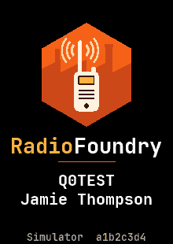
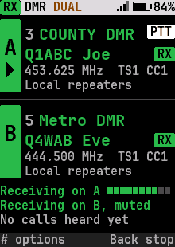
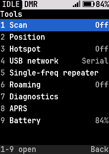
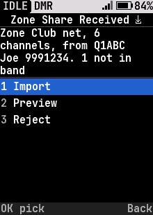
</p>
<p>
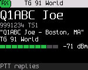
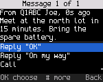
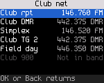
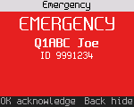
</p>
<p>
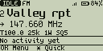
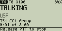
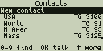
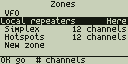
</p>
<sub>Top to bottom: DM-32UV (240x320 color), DM-1701 (160x120 color) and DM-1801 Pro (128x64 mono) screens, rendered
by the UI simulator (`make -C tests/host ui-gallery`).</sub>

## Get started: 🌐 [radiofoundry.org](https://radiofoundry.org)

**The recommended way to install and configure RadioFoundry is through the website.**

Connect your radio to your computer and [open the web installer](https://radiofoundry.org/flash/) in Chrome, Edge, Opera or Brave. It can back up your existing firmware, install RadioFoundry, update it, and restore your backup.

Use the [Codeplug Editor](https://radiofoundry.org/codeplug/) to configure channels, zones, contacts and your DMR ID database.

Both tools run locally in your browser. There's nothing to install, and your files never leave your computer.

Need scripting or using a browser without USB support? See the command-line tools and [manual installation instructions](docs/user/02-installing.md).


## Radio compatibility

<!-- generated: tools/boards.py docs radios; edit boards/*/board.toml [status] and docs/spec/radios.md -->
| Radio | Builds | Host tests | On the radio | Tested functionality and remaining work |
|---|:---:|:---:|:---:|---|
| [Baofeng DM-32UV](docs/testing/dm32-bringup.md) | ● | ● | ● | FM and DMR voice both ways, CTCSS/DCS, APRS both ways, GPS data, the hotspot and each split duplex half work on air. Open: FM deviation at 12.5 kHz and an outdoor GPS fix. |
| [Baofeng DM-1701](docs/spec/hardware-dm1701.md), Retevis RT84 | ● | ● | ● | FM, DMR voice and data, text messages, alerts, emergency, scan, the hotspot, single frequency repeating, each split duplex half and the USB network services work on air. Open: standalone SFR and a two-radio split duplex pair. |
| [Baofeng DM-1801 Pro](docs/testing/dm1801pro-bringup.md), DM-1801 | ● | ● | ● | FM with CTCSS/DCS, DMR voice with the radio's own codec, DMR data and text, the hotspot, single frequency repeating, the PPP network services and each split duplex half work on air. Open: VHF transmit and VOX. |
| [Radioddity DB25-D PRO](docs/spec/hardware-db25d.md), Kydera CDR-300UV (mobile) | ● | ● | ● | FM and DMR voice both ways, the hotspot, the DMR VFO, the PPP network services, cable programming and settings storage work on the radio. The older FD6818 batches run the same image, untested on a radio. Open: the Retevis RT73. |
| [TYT MD-380](docs/testing/md380-bringup.md), MD-390, Retevis RT3 | ● | ● | ● | FM with CTCSS both ways, DMR voice and SMS in simplex and through a repeater or hotspot on either slot, and codeplug and ID database programming work on a UHF radio. Open: DCS, the tone deviation and the untested VHF image. |
| [TYT MD-UV380](docs/testing/mduv380-bringup.md), MD-UV390, Retevis RT3S, MD-UV390 Plus 10 W | ● | ● | ○ | Built on the UV380 family code with the MD-UV380's keys, display, power tables and GPS; nothing has run on a radio yet. Open: every function on air. |
| [TYT MD-9600](docs/spec/hardware-md9600.md), Retevis RT90 (mobile) | ● | ● | ● | One image serves every board revision. On a V1-V3 radio, FM and DMR on both bands, DMR voice and data, text messages, roaming, scan, dual watch, APRS, the hotspot, each split duplex half and the USB network services work on air, with every power level checked on a wattmeter on both bands. V4A/V5 boards are detected; on older boards the radio asks for the revision once. Open: V4 and V4A/V5 boards have not run on a radio, and SFR loses inbound voice frames. |
| Radioddity GD-77, TYT MD-760, GD-77S, Baofeng DM-1801 v1 / DM-860, RD-5R | ◐ | ◐ | ◐ | In progress ([#111](https://github.com/radiofoundry/radiofoundry/pull/111)). A new platform: a different MCU (NXP MK22FN512), the same HR_C6000 and AT1846S, a 128x64 mono LCD. A DM-1801 bought new today is not v1, and the look-alike DR-1801 is unrelated. |
| Radioddity GD-88 | ◐ | ◐ | ○ | In progress ([#132](https://github.com/radiofoundry/radiofoundry/pull/132)). Dual receiver on the HR_C7000 platform (chip count not confirmed yet); should reuse much of the DM-32UV port. |
| AnyTone AT-D868UV / AT-D878UV / AT-D878UVII Plus, BTECH DMR-6X2, Alinco DJ-MD5, Radioddity GD-AT10G | ○ | ○ | ○ | Planned. A new platform (GD32F30x) and a new DMR chip (SCT3258, which runs the vocoder itself), so it starts the AnyTone family ([hardware-anytone.md](docs/spec/hardware-anytone.md)). |
| Radioddity DB40-D, Kydera CDR-700UV (mobile) | ○ | ○ | ○ | Planned. Hardware needed. Two HR_C7000-class processors (A and B), like the GD-88, so it follows the GD-88 port. |
| TYT MD-2017 / Retevis RT82 | ○ | ○ | ○ | Planned. The DM-1701's STM32 and HR_C6000 pair with two receivers, so it should reuse the STM32F4 platform. The hardware can receive two channels at once. |
| BTECH DMR-6X2 PRO | ○ | ○ | ○ | Planned. Built on the AT-D878UVII Plus, so it should follow the AnyTone port. |
| AnyTone AT-D578UV (mobile) | ○ | ○ | ○ | Planned. The 878's chips in a mobile, with a mid-run MCU change: two platforms ([hardware-anytone.md](docs/spec/hardware-anytone.md)). |
| BridgeCom Maverick | ○ | ○ | ○ | Planned. Sold as an upgraded AT-D878UV, so it likely follows the AnyTone port. |
| Retevis RT10 (902-928 MHz) | ○ | ○ | ○ | Planned. A DMR and FM handheld for 902-928 MHz, a band no other radio here covers; the chips aren't known yet. |
<!-- end generated -->

● done &nbsp;&nbsp;&nbsp; ◐ partly, or only in the linked pull request so far &nbsp;&nbsp;&nbsp; ○ not yet

- **Releases** carry firmware for the supported radios (without the codec), `rfoundry` for Windows, macOS and Linux,
  and the user manual as a PDF. Nothing to build: install with the [web installer](https://radiofoundry.org/flash/), or see [Installing](docs/user/02-installing.md).
- **What has been checked on the air**, per feature and per radio: [on-air coverage](docs/testing/on-air-coverage.md)
  and the [feature matrix](docs/feature-matrix.md#checked-on-each-radio). "Host-tested" means it works against
  simulated chips, not yet on air.
- **Check TX frequency** against an external reference (counter, service monitor or MMDVMCal) before relying on it:
  accuracy comes from each radio's factory calibration, and one MD-380 measured 1.9 kHz high
  ([#108](https://github.com/radiofoundry/radiofoundry/issues/108)).
- The chips in each radio and the planned port order: [docs/spec/radios.md](docs/spec/radios.md).

## Features

| Feature | What it does |
|---|---|
| **DMR voice** | Group and private calls, talker alias, basic privacy ([dmr-voice](docs/spec/dmr-voice.md)) |
| **DMR data** | Text messages, wireless zone & channel sharing, ARS, LRRP, call alert, radio check ([dmr-data](docs/spec/dmr-data.md), [zone-share](docs/spec/zone-share.md)) |
| **Emergency** | Alarm, emergency call with hot mic, alerts ([dmr-emergency](docs/spec/dmr-emergency.md)) |
| **FM** | CTCSS/DCS, roger beep, 1750 Hz burst ([radio-features](docs/spec/radio-features.md)) |
| **Dual watch, scan, VFO** | Monitor 2 channels simultaneously. Scan zones, VFO frequencies and dual-watch channels, pausing for active DMR calls. Enter frequencies manually in FM or DMR mode ([radio-features](docs/spec/radio-features.md)) |
| **Roaming** | Auto-selects the strongest repeater in a roaming zone by checking repeater signals during idle beacons ([dmr-roaming](docs/spec/dmr-roaming.md)) |
| **APRS** | Position, status and messages on FM, positions over DMR to an APRS gateway, KISS TNC ([aprs](docs/spec/aprs.md)) |
| **Hotspot** | The radio is an MMDVM modem over USB, including MMDVM single frequency repeating ([mmdvm-protocol](docs/spec/mmdvm-protocol.md), [sfr](docs/spec/sfr.md)) |
| **USB network** | The radio connects to a computer as a USB network adapter, to send IP traffic over DMR. Includes services such as APRS-IS, rigctld, KISS over TCP, mDNS, TFTP and SNMP ([usb-network](docs/spec/usb-network.md), [tcp-services](docs/spec/tcp-services.md)) |
| **Split duplex repeater** | Experimental: two radios on one MMDVM host as a full duplex repeater ([split-duplex](docs/spec/split-duplex.md)) |
| **Programming** | The Codeplug Editor on the web site, or qdmr ([cps-protocol](docs/spec/cps-protocol.md)) |
| **UI** | Designed from first principles, the same on a 128x64 mono LCD or a 240x320 color panel, keypad or knob, with press budgets checked by the host tests ([principles](docs/ux/principles.md), [screens](docs/ux/screens/)) |

The support for each specific radio is in the [feature matrix](docs/feature-matrix.md).
Every feature that costs flash storage can be enabled/disabled using a build switch ([build-config](docs/build-config.md)).

## Interoperability

**Across hardware.** One core runs on every radio, and never checks which radio it's on. A board file picks the chips
and describes the bands, power levels, screen and keys. Today that's two MCUs (STM32F405, C-SKY CK803S), three DMR
modems (HR_C5000, HR_C6000, HR_C7000) and four RF chips (AT1846S, BK4819, FD6818, SKY72310) under the same code.

**With the radios and software people already have.** We support the formats other radios use:

| Area | Supported now | Planned |
|---|---|---|
| Air interface | ETSI DMR Tier II: simplex, repeater, MMDVM SFR (single frequency repeater), repeater roaming | Standalone SFR (repeater and user roles on a channel); ETSI Tier III trunking |
| Text messages | ETSI IP text (the default; individual texts confirmed); Motorola TMS; ETSI short data in 7-bit, ISO 8859, UTF-8 and UTF-16; ETSI UDT text | Hytera text format |
| Location | Motorola LRRP location answers and ARS registration; ETSI GPS Info in voice calls (the caller's position shown with distance and bearing, ours sent from the APRS position); APRS position, status and messages on FM (Bell 202 AFSK) and positions over DMR to an APRS gateway ID; KISS TNC on USB | NMEA from the radio's GPS receiver, ETSI UDT location reports, APRS receive and iGate on radios that can sample received audio |
| Signaling | call alert, radio check and emergency, each in the Motorola and ETSI forms; talker alias in all four ETSI formats | DTMF and 5-tone on FM |
| Privacy and encryption | Motorola Basic Privacy, AnyTone 16-bit Basic Privacy | ARC4 and AES-256 per the DMR Association interoperability profiles |
| Programming | The Codeplug Editor on the web site: every RadioFoundry radio over USB or the programming cable, CSV and qdmr YAML import and export, DMR ID database and contacts from RadioID.net. qdmr, over its open-firmware codeplug protocol | an open, published native codeplug format with its own qdmr driver |
| Hotspot and network | MMDVM modem protocol (MMDVMHost, Pi-Star, WPSD and the networks behind them); IP over DMR with the radio as a USB network adapter (confirmed data, SAP 3 compressed UDP headers, control station mode for dispatch software); HTTP status, Hamlib rigctld, KISS over TCP, APRS-IS, mDNS, TFTP and SNMPv2c on the USB link; two radios as one full duplex repeater (experimental, build switch; each half passes on air, one pair checked on the bench) | the split duplex host side (`tools/split_duplex_host.py` is a test host) |
| Audio to a computer | | USRP over UDP (AllStarLink, DVSwitch), USB sound card with serial-line PTT ([usb-audio](docs/spec/usb-audio.md)) |

"Supported now" means built and passing its tests; [Radios and status](#radios-and-status) says what is checked on air.
Every format is specified in [docs/spec](docs/spec), so other projects can implement the same thing.

## The AMBE codec

DMR voice needs DVSI's proprietary AMBE+2 vocoder, but it is never provided as part of RadioFoundry.

Instead, each radio runs the codec from its own stock firmware. [rfoundry](tools/rfoundry/README.md) takes it from the stock firmware file you downloaded,
on your machine, verifies the file's integrity, and writes the codec with RadioFoundry. If the radio already holds the right codec, it leaves that data in place.

If the required codec isn't available, FM still works, but DMR voice does not. Details and supported stock files: [the codec](docs/dev/codec.md).

## Building

You need make, Python 3.11 or later, and `arm-none-eabi-gcc` (STM32F405 radios) or a `csky-elf` GCC (HR_C7000
radios).

```
tools/boards.py list        # the board ids
make BOARD=dm1701           # one board's image; there is no default board
make -C tests/host          # host tests
tools/ci.sh                 # everything a pull request must pass
```

Toolchains, make targets and each radio's flashing route: [building](docs/dev/building.md).

## Documentation

| | |
|---|---|
| [User manual](docs/user/README.md) | Installing, keys and screens, FM, DMR, messages, hotspot, settings, troubleshooting (also a PDF in each release) |
| [Developer docs](docs/dev/README.md) | Architecture, building, adding a radio, testing, the debug link, CPS, the codec, contributing, releases |
| [Specs](docs/spec/README.md), [UX](docs/ux/), [Testing](docs/testing/README.md) | Behavior, hardware and protocols; UI design; test procedures. Everything: [docs/README.md](docs/README.md) |

## How it's tested

| Level | What it does |
|---|---|
| Unit | Single pieces (error correction, encoders, the settings format) against answers from the standards or real radios |
| Software in the loop | The real firmware code, built for the host, runs whole features (calls, messages, codeplug writes) against simulated chips |
| UI simulator | Draws the real screens at every display size, walks the menus with scripted keys, and renders every screenshot here |
| Hardware in the loop | The same kind of scripts against a radio on USB over the [debug link](docs/spec/debuglink.md), with an SDR bench as the other station ([tests/hil](tests/hil/README.md)) |

`tools/ci.sh` builds every radio with each feature switch on and off, checks that every image fits, and runs the
license and clean-room checks. CI runs the host tests (also under ASan and UBSan) and every default build on each
push, and the full matrix nightly ([CI](docs/dev/ci.md), [testing](docs/dev/testing.md)).

## Firmware FAQ

**Is this suitable for commercial radio users?**

Commercial use is permitted, and the [web installer](https://radiofoundry.org/flash/) has a one-click configuration template for all commercial features.
All regulatory compliance remains the operator's responsibility.

**Will I lose my existing configuration?**

For most radios, you'll keep everything. The specific details of what cannot be retained will vary for each radio, and the installer will explain it for your situation. _Note there may be exceptions: even your radio's official CPS tool can't retrieve & back up DMR encryption keys that you have placed._

The installation process also includes a full backup step.

**Can I go back to stock firmware?**

Yes, restoring to stock firmware works the same as upgrading. Use the manufacturer's standard firmware installation process.

## Project FAQ

**Why license to allow commercial use?**

Why not? Commercial use is the reason we can buy $40 DMR radios. If everything DMR were ham-only, we would still be
paying $500 for a decent radio. Nobody "loses" here, because the project authors aren't trying to make any money off
of this. If someone can figure out a way to use it in their product and make money, great! We're not in the business
of selling DMR firmware, we just want everyone to have access to a decent one.

**Why reinvent the wheel?**

RadioFoundry covers most of these radios with one core under a license that lets anyone use it, so work on one radio
helps every other.

**Why another radio firmware?**

DMR has features that cheaper radios almost never implement: data, location, emergency, roaming, IP. They are
useful in commercial service and to hams alike.

**How can I help?**

Any way you can:

- **Test and report.** Run RadioFoundry on your radio and [report what breaks](https://github.com/radiofoundry/radiofoundry/issues/new?template=bug_report.yml). If the radio restarted,
  include the crash log from **Settings > Advanced > Crash log** ([settings](docs/user/17-settings.md#crash-log)).
- **Ask.** [Request a feature](https://github.com/radiofoundry/radiofoundry/issues/new?template=feature_request.yml) or [a radio](https://github.com/radiofoundry/radiofoundry/issues/new?template=radio_request.yml) you'd like supported.
- **Contribute.** Send pull requests for code or docs ([contributing](docs/dev/contributing.md)).
- **Donate or lend a radio.** This helps the most, especially older models that are hard to find now, because every
  port needs the hardware on the bench.

**Was this project AI-generated?**

No. This project is the result of thousands of hours of combined human effort from several contributors, spent on
radio teardowns, reverse engineering, software architecture, and testing. AI was used as a pair programmer to speed up
support for additional radios and to make the project's ambitious scope possible and sustainable.

## Clean room and licensing

RadioFoundry is MIT licensed ([LICENSE](LICENSE)) and a clean-room project: code is written from prose specs, datasheets and
public standards, independent of earlier radio firmwares. No GPL code, no non-commercial code, no vendor SDKs. The
rules and checks: [docs/CLEANROOM.md](docs/CLEANROOM.md). Third-party code in `third_party/` (FreeRTOS, TinyUSB, ST's
HAL and CMSIS) keeps its own permissive license ([LICENSES/](LICENSES/)).

## Acknowledgements

RadioFoundry builds on years of community work that opened these radios up. None of that code is in RadioFoundry (see above), but
the reverse engineering and documentation behind it made this project possible. Thanks to:

- Travis Goodspeed KK4VCZ and the md380tools contributors, for the first open work on the MD-380 family.
- Warren Merkel KD4Z, for md380tools-vm and for support of the open DMR software development community.
- Roger Clark VK3KYY, Kai Ludwig DG4KLU, Daniel Caujolle-Bert F1RMB and the OpenGD77 contributors, for open
  firmware on the GD-77, MD-UV380, DM-1701, MD-9600 and others.
- The OpenRTX team, for their hardware documentation.
- The OpenDM32 project, for its DM-32UV research.
- Jonathan Naylor G4KLX and the MMDVM and MMDVMHost contributors, for open hotspots and repeaters.
- Cort Buffington N0MJS and the HBlink contributors, for open DMR networking.
- Hannes Matuschek DM3MAT and the qdmr contributors, for qdmr, which RadioFoundry radios work with.

## Contributing

Issues and pull requests are welcome. Read [docs/CLEANROOM.md](docs/CLEANROOM.md) first, keep radio-specific code out
of `core/`, put anything that costs flash behind a `CONFIG_` switch, and make sure `tools/ci.sh` passes. Details:
[contributing](docs/dev/contributing.md).

## Layout

| Path | What |
|---|---|
| `core/` | Radio-independent code: DMR stack (`core/dmr`), radio state machine (`core/radio`), UI (`core/ui`), hotspot, host link, codeplug, settings, CPS, debug link |
| `hal/` | Interfaces the core uses (modem, RF, audio, codec, flash, display, input), and the `board_t` descriptor |
| `drivers/` | Chip drivers shared across radios |
| `platform/` | Per-SoC startup, clocks, interrupts and RTOS glue (`stm32f4`, `hrc7000`) |
| `boards/` | One directory per radio: board descriptor, pins, feature defaults, linker script, codec hosting |
| `boot/` | First stages in front of the application, for radios whose loader starts it directly (`boot/db25d`) |
| `config/` | Build-time feature switches |
| `third_party/` | Permissively licensed upstream code, as submodules (FreeRTOS, ST HAL and CMSIS, TinyUSB) |
| `tools/` | Flashing (`rfoundry`), release packaging, codec merge, CPS client, debug link client (`rfoundry_debug.py`), CI, SDR bench tools |
| `tests/host/` | Unit and SIL tests, the UI simulator (`tests/host/sim`) |
| `tests/hil/` | HIL tests: pytest against a radio and the SDR bench |
| `docs/spec/` | Behavior, hardware facts and protocols; `gotchas.md` lists past bugs by subsystem |
| `docs/ux/` | UI principles, flows, the screenshot gallery |
| `docs/user/`, `docs/dev/`, `docs/testing/` | User manual (built to PDF on release tags), developer documentation, test procedures |
