<!-- SPDX-License-Identifier: MIT -->
<!-- Copyright (c) 2026 The RadioFoundry Authors -->

# RadioFoundry

[English](README.md) · **简体中文**

**面向平价 DMR 电台的免费 MIT 许可固件。** 一套共享核心承载 DMR 协议栈、界面、电台配置数据和主机工具；每款电台只增加一层薄薄的板级代码。它补齐了低价原厂固件缺少的 FM 与 DMR 功能，界面从零开始设计。任何人都可以把它用于任何用途，包括商业产品。

### 🌐 [radiofoundry.org](https://radiofoundry.org)

**推荐通过网站安装 RadioFoundry、编辑电台配置数据。** 在 Chromium 浏览器（Chrome、Edge）里插上电台，用[网页安装器](https://radiofoundry.org/flash/index.html)备份、安装、升级和恢复，用[电台频率编辑器](https://radiofoundry.org/codeplug/index.html)编辑信道、区域、联系人和 DMR ID 数据库。无需安装任何软件，文件也不会离开你的电脑。命令行工具和[手动步骤](docs/user/02-installing.md)适用于脚本化操作，以及无法与电台通信的浏览器。

**[安装](docs/user/02-installing.md)** · **[用户手册](docs/user/README.md)** · **[支持的电台](#radios-and-status)** ·
**[功能](#features)** · **[开发者文档](docs/dev/README.md)**

<p>
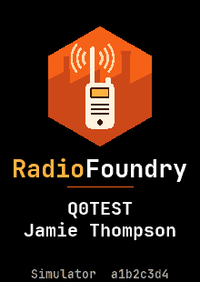
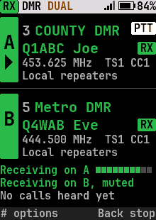
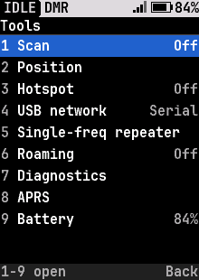
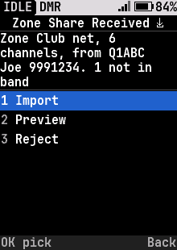
</p>
<p>
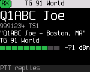
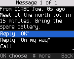
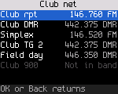
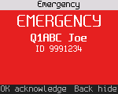
</p>
<p>
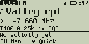
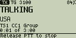
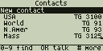
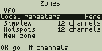
</p>

<sub>自上而下：240x320 彩屏、160x120 彩屏与 128x64 单色屏的界面，由界面模拟器（`make -C tests/host ui-gallery`）渲染。</sub>

<a id="radios-and-status"></a>

## 支持的电台与状态

<!-- generated: tools/boards.py docs radios; edit boards/*/board.toml [status] and docs/spec/radios.md -->
| 电台 | 构建 | 主机测试 | 实机 | 支持情况 |
|---|:---:|:---:|:---:|---|
| [Baofeng DM-32UV](docs/testing/dm32-bringup.md) | ● | ● | ● | FM 与 DMR 双向语音、CTCSS/DCS、APRS 双向、GPS 数据、热点以及双工分离的每一半都已在空中验证。待办：12.5 kHz 下的 FM 频偏和室外 GPS 定位。 |
| [Baofeng DM-1701](docs/spec/hardware-dm1701.md), Retevis RT84 | ● | ● | ● | FM、DMR 语音与数据、文本消息、告警、紧急呼叫、扫描、热点、单频中继、双工分离的每一半以及 USB 网络服务都已在空中验证。待办：独立 SFR 和两台电台组成的双工分离对。 |
| [Baofeng DM-1801 Pro](docs/testing/dm1801pro-bringup.md), DM-1801 | ● | ● | ● | 带 CTCSS/DCS 的 FM、使用电台自带声码器的 DMR 语音、DMR 数据与文本、热点、单频中继、PPP 网络服务以及双工分离的每一半都已在空中验证。待办：VHF 发射和 VOX。 |
| [Radioddity DB25-D PRO](docs/spec/hardware-db25d.md), Kydera CDR-300UV（车载台） | ● | ● | ● | FM 与 DMR 双向语音、热点、DMR VFO、PPP 网络服务、有线写频和设置存储都已在实机上验证。较早的 FD6818 批次运行同一镜像，但未经实机验证。待办：Retevis RT73。 |
| [TYT MD-380](docs/testing/md380-bringup.md), MD-390, Retevis RT3 | ● | ● | ● | 带 CTCSS 的 FM 双向，在直通、经中继或热点、任一时隙上的 DMR 语音与短信，以及配置数据和 ID 数据库写入，都已在 UHF 机型上验证。待办：DCS、亚音调制度，以及未经测试的 VHF 镜像。 |
| [TYT MD-UV380](docs/testing/mduv380-bringup.md), MD-UV390, Retevis RT3S, MD-UV390 Plus 10 W | ● | ● | ○ | 基于 UV380 家族代码，使用该机型的按键、屏幕、功率表和 GPS；尚未在实机上运行。待办：所有功能的空中验证。 |
| [TYT MD-9600](docs/spec/hardware-md9600.md), Retevis RT90（车载台） | ● | ● | ● | 一个镜像服务所有板本。在 V1–V3 机型上，双波段 FM 与 DMR、DMR 语音与数据、文本消息、漫游、扫描、双守候、APRS、热点、双工分离的每一半和 USB 网络服务都已在空中验证；两个波段的每个功率档都用功率计核对过。每次上电后需重新解锁发射。待办：V4 与 V4A/V5 板尚未实机运行，SFR 会丢失入站语音帧。 |
| Radioddity GD-77, TYT MD-760, GD-77S, Baofeng DM-1801 v1 / DM-860, RD-5R | ◐ | ◐ | ◐ | 进行中（[#111](https://github.com/radiofoundry/radiofoundry/pull/111)）。一个新平台：不同的 MCU（NXP MK22FN512），同样的 HR_C6000 与 AT1846S，128x64 单色屏。今天新买的 DM-1801 不是 v1，外形相似的 DR-1801 也与之无关。 |
| Radioddity GD-88 | ◐ | ◐ | ○ | 进行中（[#132](https://github.com/radiofoundry/radiofoundry/pull/132)）。HR_C7000 平台上的双接收机（芯片数量尚未确认）；应能大量复用 DM-32UV 的移植。 |
| Anytone AT-D868UV / AT-D878UV / AT-D878UVII Plus, BTECH DMR-6X2, Alinco DJ-MD5, Radioddity GD-AT10G | ○ | ○ | ○ | 计划中。一个新平台（GD32F30x）和一款新的 DMR 芯片（SCT3258，声码器内置），因此单开 Anytone 家族（[hardware-anytone.md](docs/spec/hardware-anytone.md)）。 |
| Radioddity DB40-D, Kydera CDR-700UV（车载台） | ○ | ○ | ○ | 计划中，需要硬件。两颗 HR_C7000 级处理器（A 与 B），与 GD-88 类似，因此跟随 GD-88 的移植。 |
| TYT MD-2017 / Retevis RT82 | ○ | ○ | ○ | 计划中。DM-1701 的 STM32 与 HR_C6000 搭配双接收机，应能复用 STM32F4 平台；硬件可同时接收两个信道。 |
| BTECH DMR-6X2 PRO | ○ | ○ | ○ | 计划中。基于 AT-D878UVII Plus，应跟随 Anytone 的移植。 |
| Anytone AT-D578UV（车载台） | ○ | ○ | ○ | 计划中。878 的芯片装进车载台，中途更换过 MCU：两个平台（[hardware-anytone.md](docs/spec/hardware-anytone.md)）。 |
| BridgeCom Maverick | ○ | ○ | ○ | 计划中。作为 AT-D878UV 的升级版销售，很可能跟随 Anytone 的移植。 |
| Retevis RT10（902–928 MHz） | ○ | ○ | ○ | 计划中。一款 902–928 MHz 的 DMR/FM 手持台，是这里唯一覆盖该波段的电台；芯片尚不清楚。 |
<!-- end generated -->

● 已完成&nbsp;&nbsp; ◐ 部分完成，或目前仅在所链接的 PR 中&nbsp;&nbsp; ○ 尚未完成

- **发行版**包含受支持电台的固件（不含声码器）、适用于 Windows、macOS 和 Linux 的 `rfoundry`，以及 PDF 格式的用户手册。无需自行构建：用[网页安装器](https://radiofoundry.org/flash/index.html)安装，或参阅[安装](docs/user/02-installing.md)。
- **已在空中验证的项目**，按功能和电台列出：[空中验证覆盖情况](docs/testing/on-air-coverage.md)
  和[功能矩阵](docs/feature-matrix.md#checked-on-each-radio)。"通过主机测试"指它在模拟芯片上工作，尚未上机验证。
- **在依赖发射频率之前，请用外部基准（频率计、综测仪或 MMDVMCal）核对**：精度取决于每台电台的出厂校准，曾有一台实测偏高 1.9 kHz
  （[#108](https://github.com/radiofoundry/radiofoundry/issues/108)）。
- 各电台所用的芯片及移植顺序：[docs/spec/radios.md](docs/spec/radios.md)。

<a id="features"></a>

## 功能

| 功能 | 说明 |
|---|---|
| **DMR 语音** | 组呼与个呼、呼号别名、基础加密（[dmr-voice](docs/spec/dmr-voice.md)） |
| **DMR 数据** | 文本消息、无线区域与信道共享、ARS、LRRP、呼叫提示、电台检查（[dmr-data](docs/spec/dmr-data.md)、[zone-share](docs/spec/zone-share.md)） |
| **紧急呼叫** | 告警、带热麦的紧急呼叫、警报（[dmr-emergency](docs/spec/dmr-emergency.md)） |
| **FM** | CTCSS/DCS、回波提示音、1750 Hz 导频（[radio-features](docs/spec/radio-features.md)） |
| **双守候、扫描、VFO** | 同时守候两个信道；区域、VFO 和双守候扫描会在有 DMR 通话时停止；FM 或 DMR 下手动输入任意频率（[radio-features](docs/spec/radio-features.md)） |
| **漫游** | 在空闲信标期间勘测站点，切换到区域中信号最强的中继（[dmr-roaming](docs/spec/dmr-roaming.md)） |
| **APRS** | FM 上的位置、状态与消息，经 DMR 发往 APRS 网关的位置，KISS TNC（[aprs](docs/spec/aprs.md)） |
| **热点** | 电台作为 USB 上的 MMDVM 调制解调器，包括 MMDVM 单频中继（[mmdvm-protocol](docs/spec/mmdvm-protocol.md)、[sfr](docs/spec/sfr.md)） |
| **USB 网络** | 电台作为 USB 网卡，通过 DMR 承载 IP；链路上提供状态页、rigctld、KISS over TCP、APRS-IS、mDNS、TFTP 和 SNMP（[usb-network](docs/spec/usb-network.md)、[tcp-services](docs/spec/tcp-services.md)） |
| **双工分离中继** | 实验性：两台电台在同一个 MMDVM 主机上组成全双工中继（[split-duplex](docs/spec/split-duplex.md)） |
| **写频** | 网站上的电台频率编辑器，或 qdmr（[cps-protocol](docs/spec/cps-protocol.md)） |
| **界面** | 从零设计，在 128x64 单色屏或 240x320 彩屏上保持一致，按键或旋钮皆可操作，并用主机测试检查按键次数预算（[principles](docs/ux/principles.md)、[screens](docs/ux/screens/)） |

每款电台支持哪些功能见[功能矩阵](docs/feature-matrix.md)。凡是占用闪存的功能都有构建开关（[build-config](docs/build-config.md)）。

## 互操作性

**跨硬件。** 同一套核心运行在每款电台上，从不判断自己跑在哪款电台上。板级文件挑选芯片，并描述波段、功率档、屏幕与按键。目前在同一套代码下有两款 MCU（STM32F405、C-SKY CK803S）、三款 DMR 调制解调器（HR_C5000、HR_C6000、HR_C7000）和四款射频芯片（AT1846S、BK4819、FD6818、SKY72310）。

**与人们已有的电台和软件互通。** 我们支持其他电台使用的格式：

| 领域 | 现已支持 | 计划中 |
|---|---|---|
| 空中接口 | ETSI DMR Tier II：直通、中继、MMDVM SFR（单频中继）、中继漫游 | 独立 SFR（一个信道上同时承担中继和用户角色）；ETSI Tier III 集群 |
| 文本消息 | ETSI IP 文本（默认，个呼文本已验证）；Motorola TMS；7 位、ISO 8859、UTF-8、UTF-16 编码的 ETSI 短数据；ETSI UDT 文本 | Hytera 文本格式 |
| 位置 | Motorola LRRP 位置应答与 ARS 注册；语音呼叫中的 ETSI GPS Info（显示呼叫者的位置、距离和方位，我方位置取自 APRS）；FM 上的 APRS 位置、状态与消息（Bell 202 AFSK），以及经 DMR 发往 APRS 网关 ID 的位置；USB 上的 KISS TNC | 电台 GPS 接收机的 NMEA、ETSI UDT 位置报告；在可采样接收音频的电台上的 APRS 接收与 iGate |
| 信令 | 呼叫提示、电台检查和紧急呼叫，各自支持 Motorola 与 ETSI 两种形式；全部四种 ETSI 格式的呼号别名 | FM 上的 DTMF 与五音信令 |
| 加密 | Motorola Basic Privacy、Anytone 16 位 Basic Privacy | 按 DMR Association 互操作规范实现 ARC4 与 AES-256 |
| 写频 | 网站上的电台频率编辑器：所有 RadioFoundry 电台经 USB 或写频线连接，支持 CSV 与 qdmr YAML 导入导出、来自 RadioID.net 的 DMR ID 数据库和联系人；qdmr 使用其开放固件配置数据协议 | 一个公开、自有的原生配置数据格式及其 qdmr 驱动 |
| 热点与网络 | MMDVM 调制解调器协议（MMDVMHost、Pi-Star、WPSD 及其背后的网络）；电台作为 USB 网卡实现 IP over DMR（已验证数据、SAP 3 压缩 UDP 头、供调度软件使用的控制站模式）；USB 链路上的 HTTP 状态页、Hamlib rigctld、KISS over TCP、APRS-IS、mDNS、TFTP 和 SNMPv2c；两台电台组成一个全双工中继（实验性，有构建开关；每一半都已通过空中验证，一对已在实验台验证） | 双工分离的主机侧（`tools/split_duplex_host.py` 是测试用主机） |
| 音频接入电脑 | | UDP 上的 USRP（AllStarLink、DVSwitch）、带串口 PTT 的 USB 声卡（[usb-audio](docs/spec/usb-audio.md)） |

"现已支持"指已实现并通过测试；[支持的电台](#radios-and-status)说明哪些项目已在空中验证。
每种格式都在 [docs/spec](docs/spec) 中写明，其他项目也可以照此实现。

## AMBE 声码器

DMR 语音需要 DVSI 的专有 AMBE+2 声码器。RadioFoundry 从不随本项目提供它，无论在本仓库还是任何二进制文件中。

每台电台都使用自己原厂固件里的声码器。[rfoundry](tools/rfoundry/README.md) 在你自己的机器上，从你下载的原厂固件文件中取出它，用 SHA-256 校验该文件，再与 RadioFoundry 一起写入声码器。如果电台里已经有正确的声码器，它只写入 RadioFoundry 自己的扇区。没有声码器时，固件只能运行 FM。细节和受支持的原厂文件见[声码器](docs/dev/codec.md)。

## 构建

需要 make、Python 3.11 或更新版本，以及 `arm-none-eabi-gcc`（STM32F405 电台）或 `csky-elf` GCC（HR_C7000 电台）。

```
tools/boards.py list        # 列出板级 id
make BOARD=dm1701           # 构建一个板级镜像；没有默认板级
make -C tests/host          # 主机测试
tools/ci.sh                 # 一个 PR 必须全部通过的项目
```

工具链、make 目标和每款电台的刷写路径：[构建](docs/dev/building.md)。

## 文档

| | |
|---|---|
| [用户手册](docs/user/README.md) | 安装、按键与界面、FM、DMR、消息、热点、设置、故障排查（每个发行版也提供 PDF） |
| [开发者文档](docs/dev/README.md) | 架构、构建、新增电台、测试、调试链路、写频协议、声码器、贡献指南、发行 |
| [规格说明](docs/spec/README.md)、[界面设计](docs/ux/)、[测试](docs/testing/README.md) | 行为、硬件与协议；界面设计；测试流程。全部索引：[docs/README.md](docs/README.md) |

## 测试方式

| 层级 | 内容 |
|---|---|
| 单元测试 | 用标准或真实电台给出的答案，检验纠错、编码器、设置格式等单个部件 |
| 软件在环 | 把真实的固件代码编译到主机上，针对模拟芯片运行完整功能（呼叫、消息、写频） |
| 界面模拟器 | 在各种屏幕尺寸上绘制真实界面，用脚本按键遍历菜单，并渲染本文的所有截图 |
| 硬件在环 | 同样的脚本，通过[调试链路](docs/spec/debuglink.md)用 USB 连接实机，以 SDR 实验台作为另一方（[tests/hil](tests/hil/README.md)） |

`tools/ci.sh` 会把每款电台在功能开关开与关的两种情况下都构建一遍，检查每个镜像都能装下，并运行许可与净室检查。每次推送时 CI 运行主机测试（也跑 ASan 与 UBSan）以及每个默认构建，完整矩阵则每夜运行（[CI](docs/dev/ci.md)、[测试](docs/dev/testing.md)）。

## 常见问题

**为什么允许商业使用？**

为什么不呢？正是商业用途让我们买得到 40 美元的 DMR 电台。如果 DMR 的一切都只限业余无线电使用，一台像样的电台现在还得花 500 美元。这里没有人"吃亏"，因为项目作者并不打算靠它赚钱。如果有人能把它用到自己的产品里并赚到钱，那很好！我们不是卖 DMR 固件的，只是希望人人都能用上一套像样的固件。

**为什么要重造轮子？**

RadioFoundry 用一套核心覆盖大部分电台，而且许可证允许任何人使用，因此在一款电台上的工作会帮到所有其他电台。

**为什么还要做一套电台固件？**

DMR 有一些便宜电台几乎从不实现的功能：数据、位置、紧急呼叫、漫游、IP。它们在商业使用和业余无线电中同样有用。

**我能帮上什么忙？**

任何方式都可以：

- **测试并反馈。** 在你的电台上运行 RadioFoundry，并[报告遇到的问题](https://github.com/radiofoundry/radiofoundry/issues/new?template=bug_report.yml)。如果电台重启了，
  请附上 **设置 > 高级 > 崩溃日志** 中的崩溃记录（[设置](docs/user/17-settings.md#crash-log)）。
- **提需求。** [申请功能](https://github.com/radiofoundry/radiofoundry/issues/new?template=feature_request.yml)或[希望支持的电台](https://github.com/radiofoundry/radiofoundry/issues/new?template=radio_request.yml)。
- **贡献代码。** 提交代码或文档的 pull request（[贡献指南](docs/dev/contributing.md)）。
- **捐赠或出借电台。** 这一项帮助最大，尤其是现在难以找到的老型号，因为每个移植都需要实验台上有实物。

**这个项目是 AI 生成的吗？**

不是。这个项目是几位贡献者数千小时人工努力的成果，花在电台拆解、逆向工程、软件架构和测试上。AI 被用作结对编程助手，以加快对更多电台的支持，并让项目这样宏大的范围得以持续推进。

## 净室与许可

RadioFoundry 采用 MIT 许可（[LICENSE](LICENSE)），并且是一个净室项目：代码依据文字规格、数据手册和公开标准编写，独立于更早的电台固件。没有 GPL 代码、没有非商业代码、没有厂商 SDK。规则与检查见 [docs/CLEANROOM.md](docs/CLEANROOM.md)。`third_party/` 中的第三方代码（FreeRTOS、TinyUSB、ST 的 HAL 与 CMSIS）保留各自宽松的许可证（[LICENSES/](LICENSES/)）。

## 致谢

RadioFoundry 建立在社区多年来开放这些电台的努力之上。那些代码都不在 RadioFoundry 中（见上文），但背后的逆向工程和文档让本项目成为可能。感谢：

- Travis Goodspeed KK4VCZ 与早期开源工具的贡献者，率先开展了这一系列机型的开放工作。
- Warren Merkel KD4Z，为其虚拟机工具链，以及对开放 DMR 软件开发社区的支持。
- Roger Clark VK3KYY、Kai Ludwig DG4KLU、Daniel Caujolle-Bert F1RMB 与开源固件的贡献者，让多款电台有了开放的固件。
- OpenRTX 团队，提供硬件文档。
- 彩屏机型的开源研究项目，提供其研究成果。
- Jonathan Naylor G4KLX 与 MMDVM、MMDVMHost 的贡献者，让热点与中继保持开放。
- Cort Buffington N0MJS 与 HBlink 的贡献者，推动开放的 DMR 网络。
- Hannes Matuschek DM3MAT 与 qdmr 的贡献者；qdmr 可与 RadioFoundry 电台配合使用。

完整的机型与项目名称见[英文版致谢](README.md#acknowledgements)。

## 贡献

欢迎提交 issue 和 pull request。请先阅读 [docs/CLEANROOM.md](docs/CLEANROOM.md)，把与机型相关的代码留在 `core/` 之外，为任何占用闪存的功能加上 `CONFIG_` 开关，并确保 `tools/ci.sh` 通过。详见：[贡献指南](docs/dev/contributing.md)。

## 目录结构

| 路径 | 内容 |
|---|---|
| `core/` | 与机型无关的代码：DMR 协议栈（`core/dmr`）、电台状态机（`core/radio`）、界面（`core/ui`）、热点、主机链路、配置数据、设置、写频协议、调试链路 |
| `hal/` | 核心使用的接口（调制解调器、射频、音频、声码器、闪存、显示、输入），以及 `board_t` 描述结构 |
| `drivers/` | 各电台共用的芯片驱动 |
| `platform/` | 各 SoC 的启动、时钟、中断与 RTOS 适配层（`stm32f4`、`hrc7000`） |
| `boards/` | 每款电台一个目录：板级描述、引脚、功能默认值、链接脚本、声码器承载 |
| `boot/` | 应用之前的第一阶段，供加载器直接启动它的电台使用（`boot/db25d`） |
| `config/` | 构建期功能开关 |
| `third_party/` | 宽松许可的上游代码，以子模块形式引入（FreeRTOS、ST HAL 与 CMSIS、TinyUSB） |
| `tools/` | 刷写（`rfoundry`）、发行打包、声码器合并、写频客户端、调试链路客户端（`rfoundry_debug.py`）、CI、SDR 实验台工具 |
| `tests/host/` | 单元与软件在环测试、界面模拟器（`tests/host/sim`） |
| `tests/hil/` | 硬件在环测试：用 pytest 连接电台与 SDR 实验台 |
| `docs/spec/` | 行为、硬件事实与协议；`gotchas.md` 按子系统列出过往的坑 |
| `docs/ux/` | 界面原则、流程、截图库 |
| `docs/user/`、`docs/dev/`、`docs/testing/` | 用户手册（发行标签上构建为 PDF）、开发者文档、测试流程 |
