# RadioFoundry

**Firmware libre sous licence MIT pour émetteurs-récepteurs DMR abordables.** Un cœur partagé gère la pile DMR, l'interface utilisateur (UI), le codeplug et les outils hôtes ; chaque radio y ajoute une fine couche matérielle. Il apporte les fonctionnalités FM et DMR délaissées par les firmwares d'origine à bas coût, avec une interface utilisateur conçue selon des principes fondamentaux. Tout le monde peut l'utiliser pour n'importe quel usage, y compris des produits commerciaux.

### 🌐 [radiofoundry.org](https://radiofoundry.org)

**Le site web est la méthode recommandée pour installer RadioFoundry et éditer le codeplug de votre radio.** Dans un navigateur Chromium (Chrome, Edge), branchez la radio et utilisez l'[installateur web](https://radiofoundry.org/flash/index.html) pour sauvegarder, installer, mettre à jour et restaurer, ainsi que l'[Éditeur de Codeplug](https://radiofoundry.org/codeplug/index.html) pour les canaux, zones, contacts et la base de données d'identifiants DMR. Rien à installer, et vos fichiers ne quittent jamais votre ordinateur. Les outils en ligne de commande et les [étapes manuelles](docs/user/02-installing.md) sont destinés aux scripts et aux navigateurs ne pouvant pas communiquer avec une radio.

**[Installer](docs/user/02-installing.md)** · **[Manuel utilisateur](docs/user/README.md)** · **[Radios](#radios-et-statut)** · **[Fonctionnalités](#fonctionnalites)** · **[Documentation développeur](docs/dev/README.md)**

<p>
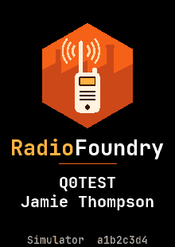
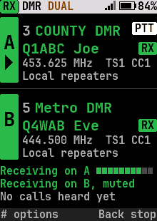
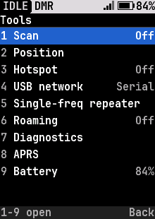
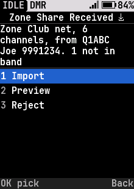
</p>
<p>
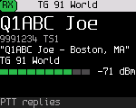
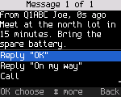
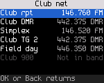
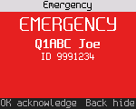
</p>
<p>
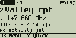
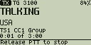
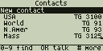
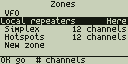
</p>

<sub>De haut en bas : Écrans du DM-32UV (couleur 240x320), du DM-1701 (couleur 160x120) et du DM-1801 Pro (mono 128x64), rendus par le simulateur d'interface (`make -C tests/host ui-gallery`).</sub>

## Radios et statut

<!-- generated: tools/boards.py docs radios; edit boards/*/board.toml [status] and docs/spec/radios.md -->
| Radio | Builds | Tests hôtes | Sur la radio | Support |
|---|:---:|:---:|:---:|---|
| [Baofeng DM-32UV](docs/testing/dm32-bringup.md) | ● | ● | ● | Voix FM et DMR bidirectionnelle, CTCSS/DCS, APRS bidirectionnel, données GPS, le hotspot et chaque demi-duplex fonctionnent par voie hertzienne. En cours : déviation FM à 12,5 kHz et acquisition GPS en extérieur. |
| [Baofeng DM-1701](docs/spec/hardware-dm1701.md), Retevis RT84 | ● | ● | ● | FM, voix et données DMR, messages texte, alertes, urgence, balayage, hotspot, répéteur mono-fréquence (SFR), chaque demi-duplex et les services réseau USB fonctionnent par voie hertzienne. En cours : SFR autonome et paire duplex séparée sur deux radios. |
| [Baofeng DM-1801 Pro](docs/testing/dm1801pro-bringup.md), DM-1801 | ● | ● | ● | FM avec CTCSS/DCS, voix DMR avec le codec propre à la radio, données et texte DMR, hotspot, répéteur mono-fréquence, services réseau PPP et chaque demi-duplex fonctionnent par voie hertzienne. En cours : émission VHF et VOX. |
| [Radioddity DB25-D PRO](docs/spec/hardware-db25d.md), Kydera CDR-300UV (mobile) | ● | ● | ● | Voix FM et DMR bidirectionnelle, hotspot, VFO DMR, services réseau PPP, programmation par câble et stockage des paramètres fonctionnent sur la radio. Les révisions plus anciennes du FD6818 utilisent la même image, non testée sur radio. En cours : le Retevis RT73. |
| [TYT MD-380](docs/testing/md380-bringup.md), MD-390, Retevis RT3 | ● | ● | ● | FM avec CTCSS bidirectionnel, voix DMR et SMS en simplex et via relais ou hotspot sur l'un ou l'autre intervalle de temps (slot), programmation du codeplug et de la base d'identifiants fonctionnels sur radio UHF. En cours : DCS, déviation de tonalité et image VHF non testée. |
| [TYT MD-UV380](docs/testing/mduv380-bringup.md), MD-UV390, Retevis RT3S, MD-UV390 Plus 10 W | ● | ● | ○ | Basé sur le code de la famille UV380 avec les touches, l'écran, les tables de puissance et le GPS du MD-UV380 ; rien n'a encore tourné sur radio. En cours : toutes les fonctionnalités par voie hertzienne. |
| TYT MD-9600, Retevis RT90 (mobile) | ◐ | ◐ | ○ | En cours ([#112](https://github.com/radiofoundry/radiofoundry/pull/112)). Radio mobile sur la même paire STM32F405 et HR_C6000, avec synthétiseurs SKY72310 (cartes plus anciennes) et LCD monochrome 128x64. |
| Radioddity GD-77, TYT MD-760, GD-77S, Baofeng DM-1801 v1 / DM-860, RD-5R | ◐ | ◐ | ◐ | En cours ([#111](https://github.com/radiofoundry/radiofoundry/pull/111)). Nouvelle plateforme : microcontrôleur différent (NXP MK22FN512), mêmes HR_C6000 et AT1846S, LCD monochrome 128x64. Un DM-1801 acheté neuf aujourd'hui n'est pas une v1, et le DR-1801 d'apparence similaire n'a aucun lien. |
| Radioddity GD-88 | ◐ | ◐ | ○ | En cours ([#132](https://github.com/radiofoundry/radiofoundry/pull/132)). Double récepteur sur plateforme HR_C7000 (nombre de puces non confirmé) ; devrait réutiliser une grande partie du portage DM-32UV. |
| Anytone AT-D868UV / AT-D878UV / AT-D878UVII Plus, BTECH DMR-6X2, Alinco DJ-MD5, Radioddity GD-AT10G | ○ | ○ | ○ | Planifié. Nouvelle plateforme (GD32F30x) et nouvelle puce DMR (SCT3258, qui gère le vocodeur elle-même), initiant la famille Anytone ([hardware-anytone.md](docs/spec/hardware-anytone.md)). |
| Radioddity DB40-D, Kydera CDR-700UV (mobile) | ○ | ○ | ○ | Planifié. Matériel requis. Deux processeurs de classe HR_C7000 (A et B), comme le GD-88, suivant ainsi son portage. |
| TYT MD-2017 / Retevis RT82 | ○ | ○ | ○ | Planifié. La paire STM32 et HR_C6000 du DM-1701 avec deux récepteurs, devrait réutiliser la plateforme STM32F4. Le matériel peut recevoir deux canaux simultanément. |
| BTECH DMR-6X2 PRO | ○ | ○ | ○ | Planifié. Basé sur l'AT-D878UVII Plus, devrait suivre le portage Anytone. |
| Anytone AT-D578UV (mobile) | ○ | ○ | ○ | Planifié. Les puces du 878 dans un mobile, avec un changement de microcontrôleur en cours de production : deux plateformes ([hardware-anytone.md](docs/spec/hardware-anytone.md)). |
| BridgeCom Maverick | ○ | ○ | ○ | Planifié. Vendu comme un AT-D878UV amélioré, suit vraisemblablement le portage Anytone. |
| Retevis RT10 (902-928 MHz) | ○ | ○ | ○ | Planifié. Portatif DMR et FM pour la bande 902-928 MHz, non couverte par les autres radios ; puces inconnues pour le moment. |
<!-- end generated -->

● Terminé&nbsp;&nbsp; ◐ En partie, ou uniquement dans la Pull Request associée pour l'instant&nbsp;&nbsp; ○ Pas encore

- **Les versions (Releases)** contiennent les firmwares pour les radios supportées (sans le codec), `rfoundry` pour Windows, macOS et Linux, et le manuel utilisateur au format PDF. Rien à compiler : installez avec l'[installateur web](https://radiofoundry.org/flash/index.html), ou consultez [Installation](docs/user/02-installing.md).
- **Ce qui a été vérifié par voie hertzienne**, par fonctionnalité et par radio : la [couverture radio](docs/testing/on-air-coverage.md) et la [matrice de fonctionnalités](docs/feature-matrix.md#checked-on-each-radio). « Testé sur hôte » signifie que cela fonctionne avec des puces simulées, mais pas encore testé sur les ondes.
- **Vérifiez la fréquence d'émission (TX)** par rapport à une référence externe (fréquencemètre, banc de mesure ou MMDVMCal) avant de l'utiliser en conditions réelles : la précision dépend du calibrage d'usine de chaque appareil. Un MD-380 a été mesuré avec un décalage de +1,9 kHz ([#108](https://github.com/radiofoundry/radiofoundry/issues/108)).
- Les puces de chaque radio et l'ordre de portage prévu : [docs/spec/radios.md](docs/spec/radios.md).

## Fonctionnalités

| Fonctionnalité | Description |
|---|---|
| **Voix DMR** | Appels de groupe et privés, alias de l'intervenant (talker alias), confidentialité de base ([dmr-voice](docs/spec/dmr-voice.md)) |
| **Données DMR** | Messages texte, partage sans fil de zones et canaux, ARS, LRRP, alerte d'appel, vérification radio ([dmr-data](docs/spec/dmr-data.md), [zone-share](docs/spec/zone-share.md)) |
| **Urgence** | Alarme, appel d'urgence avec micro ouvert (hot mic), alertes ([dmr-emergency](docs/spec/dmr-emergency.md)) |
| **FM** | CTCSS/DCS, Roger beep, tonalité 1750 Hz ([radio-features](docs/spec/radio-features.md)) |
| **Double veille, balayage, VFO** | Deux canaux à la fois ; balayage de zone, VFO et double veille interrompu par les appels DMR en cours ; saisie manuelle de n'importe quelle fréquence en FM ou DMR ([radio-features](docs/spec/radio-features.md)) |
| **Roaming (itinérance)** | Bascule vers le relais le plus puissant d'une zone en analysant les sites lors des balises inactives ([dmr-roaming](docs/spec/dmr-roaming.md)) |
| **APRS** | Position, statut et messages en FM, positions transmises sur DMR vers une passerelle APRS, TNC KISS ([aprs](docs/spec/aprs.md)) |
| **Hotspot** | La radio fonctionne comme un modem MMDVM sur USB, incluant le répéteur mono-fréquence MMDVM ([mmdvm-protocol](docs/spec/mmdvm-protocol.md), [sfr](docs/spec/sfr.md)) |
| **Réseau USB** | La radio devient une carte réseau USB qui achemine l'IP sur DMR, avec page de statut, rigctld, KISS sur TCP, APRS-IS, mDNS, TFTP et SNMP sur la liaison ([usb-network](docs/spec/usb-network.md), [tcp-services](docs/spec/tcp-services.md)) |
| **Relais duplex séparé** | Expérimental : deux radios sur un seul hôte MMDVM formant un relais full-duplex ([split-duplex](docs/spec/split-duplex.md)) |
| **Programmation** | Éditeur de Codeplug sur le site web ou qdmr ([cps-protocol](docs/spec/cps-protocol.md)) |
| **Interface utilisateur (UI)** | Conçue selon des principes fondamentaux, identique sur écran LCD monochrome 128x64 ou couleur 240x320, clavier ou bouton rotatif, avec optimisation du nombre d'appuis de touches validée par les tests hôtes ([principles](docs/ux/principles.md), [screens](docs/ux/screens/)) |

La prise en charge détaillée par radio est disponible dans la [matrice de fonctionnalités](docs/feature-matrix.md). Chaque option consommant de la mémoire flash possède un commutateur de compilation ([build-config](docs/build-config.md)).

## Interopérabilité

**Entre les matériels.** Un seul cœur s'exécute sur chaque radio sans jamais vérifier sur quel matériel il se trouve. Un fichier de carte définit les puces et décrit les bandes, les niveaux de puissance, l'écran et les touches. Aujourd'hui, cela couvre deux microcontrôleurs (STM32F405, C-SKY CK803S), trois modems DMR (HR_C5000, HR_C6000, HR_C7000) et quatre puces RF (AT1846S, BK4819, FD6818, SKY72310) sous le même code source.

**Avec les radios et logiciels existants.** Nous prenons en charge les formats utilisés par les autres radios :

| Domaine | Pris en charge actuellement | Planifié |
|---|---|---|
| Interface radio | ETSI DMR Tier II : simplex, relais, SFR MMDVM (répéteur mono-fréquence), itinérance (roaming) | SFR autonome (rôles relais et utilisateur sur un canal) ; trunking ETSI Tier III |
| Messages texte | Texte IP ETSI (par défaut ; messages individuels confirmés) ; Motorola TMS ; données courtes ETSI en 7-bit, ISO 8859, UTF-8 et UTF-16 ; texte UDT ETSI | Format texte Hytera |
| Localisation | Réponses de positionnement Motorola LRRP et enregistrement ARS ; GPS Info ETSI lors des appels vocaux (position de l'appelant affichée avec distance et azimut, la nôtre transmise depuis la position APRS) ; position APRS, statut et messages en FM (AFSK Bell 202) et positions sur DMR vers une passerelle APRS ; TNC KISS sur USB | NMEA depuis le récepteur GPS de la radio, rapports de position UDT ETSI, réception APRS et iGate sur les radios capables d'échantillonner l'audio reçu |
| Signalisation | Alerte d'appel, vérification radio et urgence, chacune aux formats Motorola et ETSI ; alias de l'intervenant (talker alias) dans les quatre formats ETSI | DTMF et 5-tons en FM |
| Confidentialité et chiffrement | Confidentialité de base Motorola, confidentiality de base 16-bit Anytone | ARC4 et AES-256 selon les profils d'interopérabilité de la DMR Association |
| Programmation | Éditeur de Codeplug sur le site web : toutes les radios RadioFoundry via USB ou câble de programmation, import/export CSV et YAML qdmr, base de données ID DMR et contacts depuis RadioID.net. qdmr via son protocole de codeplug open-firmware | Format de codeplug natif ouvert et publié avec son propre pilote qdmr |
| Hotspot et réseau | Protocole modem MMDVM (MMDVMHost, Pi-Star, WPSD et les réseaux associés) ; IP sur DMR avec la radio comme carte réseau USB (données confirmées, en-têtes UDP compressés SAP 3, mode station de contrôle pour logiciels de dispatch) ; statut HTTP, Hamlib rigctld, KISS sur TCP, APRS-IS, mDNS, TFTP et SNMPv2c sur la liaison USB ; deux radios en un seul relais full-duplex (expérimental, option de compilation ; chaque moitié validée sur les ondes, une paire testée sur banc) | Côté hôte pour duplex séparé (`tools/split_duplex_host.py` est un hôte de test) |
| Audio vers ordinateur | | USRP sur UDP (AllStarLink, DVSwitch), carte son USB avec PTT sur ligne série ([usb-audio](docs/spec/usb-audio.md)) |

« Pris en charge actuellement » signifie développé et passant les tests automatiques ; la section [Radios et statut](#radios-et-statut) indique ce qui a été vérifié sur les ondes. Chaque format est spécifié dans [docs/spec](docs/spec) afin que d'autres projets puissent l'implémenter.

## Le codec AMBE

La voix DMR nécessite le vocodeur propriétaire AMBE+2 de DVSI. RadioFoundry ne le fournit jamais, que ce soit dans ce dépôt ou dans un binaire.

Chaque radio exécute le codec extrait de son propre firmware d'origine. L'outil [rfoundry](tools/rfoundry/README.md) l'extrait du fichier de firmware d'origine que vous avez téléchargé sur votre machine, vérifie son empreinte SHA-256 et l'écrit en même temps que RadioFoundry. Si la radio contient déjà le bon codec, seuls les secteurs propres à RadioFoundry sont réécrits. Sans codec, le firmware fonctionne uniquement en FM. Détails et fichiers constructeurs supportés : [le codec](docs/dev/codec.md).

## Compilation

Vous avez besoin de `make`, Python 3.11 ou supérieur, et `arm-none-eabi-gcc` (radios STM32F405) ou un GCC `csky-elf` (radios HR_C7000).

```bash
tools/boards.py list        # liste les identifiants de cartes
make BOARD=dm1701           # image pour une carte ; il n'y a pas de carte par défaut
make -C tests/host          # tests hôtes
tools/ci.sh                 # tout ce qu'une Pull Request doit valider
```

Chaînes de compilation, cibles make et méthodes d'installation pour chaque radio : [compilation](docs/dev/building.md).

## Documentation

| | |
|---|---|
| [Manuel utilisateur](docs/user/README.md) | Installation, touches et écrans, FM, DMR, messages, hotspot, paramètres, dépannage (également en PDF sur chaque version) |
| [Documentation développeur](docs/dev/README.md) | Architecture, compilation, ajout d'une radio, tests, lien de débogage, CPS, codec, contribution, versions |
| [Spécifications](docs/spec/README.md), [UX](docs/ux/), [Tests](docs/testing/README.md) | Comportement, caractéristiques matérielles et protocoles ; conception de l'UI ; procédures de test. Global : [docs/README.md](docs/README.md) |

## Méthodes de test

| Niveau | Description |
|---|---|
| Unitaire | Composants isolés (correction d'erreurs, encodeurs, format de configuration) comparés aux résultats attendus des normes ou des radios réelles |
| Software-in-the-loop (SIL) | Le code réel du firmware, compilé pour l'hôte, exécute des fonctionnalités complètes (appels, messages, écriture de codeplug) face à des puces simulées |
| Simulateur d'UI | Génère les écrans réels à toutes les résolutions, parcourt les menus via des séquences de touches scriptées et crée toutes les captures d'écran de ce document |
| Hardware-in-the-loop (HIL) | Même type de scripts exécutés sur une vraie radio connectée en USB via le [lien de débogage](docs/spec/debuglink.md), avec un banc SDR comme station distante ([tests/hil](tests/hil/README.md)) |

`tools/ci.sh` compile le projet pour chaque radio avec chaque commutateur de fonctionnalité activé et désactivé, vérifie que chaque image rentre en mémoire, et exécute les contrôles de licence et de développement « clean-room ». L'intégration continue (CI) lance les tests hôtes (notamment sous ASan et UBSan) ainsi que les builds par défaut à chaque push, et la matrice complète chaque nuit ([CI](docs/dev/ci.md), [testing](docs/dev/testing.md)).

## FAQ

**Pourquoi autoriser l'usage commercial ?**

Pourquoi pas ? L'usage commercial est la raison pour laquelle nous pouvons acheter des radios DMR à 40 $. Si tout le DMR était réservé aux radioamateurs, nous paierions encore 500 $ pour un équipement correct. Personne n'est lésé ici, car les auteurs du projet ne cherchent pas à gagner d'argent avec. Si quelqu'un trouve un moyen de l'intégrer à son produit et d'en tirer un bénéfice, c'est parfait ! Notre objectif n'est pas de vendre du firmware DMR, mais de s'assurer que tout le monde ait accès à un firmware de qualité.

**Pourquoi réinventer la roue ?**

RadioFoundry prend en charge la plupart de ces radios avec un seul cœur sous une licence ouverte à tous, ainsi le travail effectué sur une radio bénéficie à toutes les autres.

**Pourquoi un autre firmware radio ?**

Le DMR propose des fonctionnalités que les radios bon marché n'implémentent presque jamais : données, géolocalisation, urgence, roaming, IP. Elles sont utiles aussi bien dans le cadre commercial que pour les radioamateurs.

**Comment puis-je aider ?**

Par tous les moyens possibles :

- **Tester et signaler.** Utilisez RadioFoundry sur votre radio et [reportez les dysfonctionnements](https://github.com/radiofoundry/radiofoundry/issues/new?template=bug_report.yml). Si la radio a redémarré, incluez le journal de plantage disponible dans **Paramètres > Avancé > Journal de plantage** ([settings](docs/user/17-settings.md#crash-log)).
- **Demander.** [Proposez une fonctionnalité](https://github.com/radiofoundry/radiofoundry/issues/new?template=feature_request.yml) ou [une radio](https://github.com/radiofoundry/radiofoundry/issues/new?template=radio_request.yml) que vous aimeriez voir supportée.
- **Contribuer.** Soumettez des Pull Requests pour le code ou la documentation ([contributing](docs/dev/contributing.md)).
- **Donner ou prêter une radio.** C'est l'aide la plus précieuse, particulièrement pour les anciens modèles difficiles à trouver aujourd'hui, car chaque portage nécessite d'avoir le matériel sur le banc d'essai.

**Ce projet a-t-il été généré par IA ?**

Non. Ce projet est le fruit de milliers d'heures d'effort humain combiné de plusieurs contributeurs, consacrées au démontage de radios, à l'ingénierie inverse, à l'architecture logicielle et aux tests. L'IA a été utilisée comme partenaire de programmation (pair programmer) pour accélérer le support de radios supplémentaires et rendre les objectifs ambitieux du projet réalisables et pérennes.

## Conception clean-room et licences

RadioFoundry est publié sous licence MIT ([LICENSE](LICENSE)) et développé selon une méthode « clean-room » : le code est écrit à partir de spécifications textuelles, de fiches techniques et de normes publiques, indépendamment de tout firmware antérieur. Aucun code GPL, aucun code non commercial, aucun SDK constructeur. Les règles et contrôles : [docs/CLEANROOM.md](docs/CLEANROOM.md). Le code tiers présent dans `third_party/` (FreeRTOS, TinyUSB, HAL et CMSIS de ST) conserve sa propre licence permissive ([LICENSES/](LICENSES/)).

## Remerciements

RadioFoundry s'appuie sur des années de travail communautaire qui ont permis d'ouvrir ces radios. Aucun de ces codes n'est présent dans RadioFoundry (voir ci-dessus), mais l'ingénierie inverse et la documentation qui en découlent ont rendu ce projet possible. Merci à :

- Travis Goodspeed KK4VCZ et les contributeurs de md380tools, pour le premier travail ouvert sur la famille MD-380.
- Warren Merkel KD4Z, pour md380tools-vm et son soutien à la communauté de développement de logiciels DMR ouverts.
- Roger Clark VK3KYY, Kai Ludwig DG4KLU, Daniel Caujolle-Bert F1RMB et les contributeurs d'OpenGD77, pour le firmware open-source sur les GD-77, MD-UV380, DM-1701, MD-9600 et d'autres.
- L'équipe OpenRTX, pour leur documentation matérielle.
- Le projet OpenDM32, pour ses recherches sur le DM-32UV.
- Jonathan Naylor G4KLX et les contributeurs de MMDVM et MMDVMHost, pour les hotspots et relais ouverts.
- Cort Buffington N0MJS et les contributeurs d'HBlink, pour le réseau DMR ouvert.
- Hannes Matuschek DM3MAT et les contributeurs de qdmr, logiciel avec lequel les radios RadioFoundry sont compatibles.

## Contribution

Les issues et les pull requests sont les bienvenues. Lisez d'abord [docs/CLEANROOM.md](docs/CLEANROOM.md), gardez le code spécifique à une radio hors du dossier `core/`, isolez tout ce qui consomme de la mémoire flash derrière un commutateur `CONFIG_`, et assurez-vous que `tools/ci.sh` s'exécute sans erreur. Détails : [contributing](docs/dev/contributing.md).

## Structure du projet

| Chemin | Contenu |
|---|---|
| `core/` | Code indépendant du matériel : pile DMR (`core/dmr`), machine à états radio (`core/radio`), UI (`core/ui`), hotspot, liaison hôte, codeplug, paramètres, CPS, lien de débogage |
| `hal/` | Interfaces utilisées par le cœur (modem, RF, audio, codec, flash, affichage, entrées) et descripteur `board_t` |
| `drivers/` | Pilotes de puces partagés entre plusieurs radios |
| `platform/` | Démarrage propre à chaque SoC, horloges, interruptions et liaison RTOS (`stm32f4`, `hrc7000`) |
| `boards/` | Un répertoire par radio : descripteur de carte, broches, fonctionnalités par défaut, script d'édition de liens, intégration du codec |
| `boot/` | Premiers étages avant l'application, pour les radios dont le chargeur démarre directement (`boot/db25d`) |
| `config/` | Commutateurs de fonctionnalités à la compilation |
| `third_party/` | Code amont sous licence permissive, sous forme de sous-modules (FreeRTOS, ST HAL et CMSIS, TinyUSB) |
| `tools/` | Outils de flashage (`rfoundry`), paquetage des versions, fusion de codec, client CPS, client de débogage (`rfoundry_debug.py`), CI, outils de banc SDR |
| `tests/host/` | Tests unitaires et SIL, simulateur d'interface utilisateur (`tests/host/sim`) |
| `tests/hil/` | Tests HIL : pytest exécuté sur une radio et le banc SDR |
| `docs/spec/` | Spécifications de comportement, données matérielles et protocoles ; `gotchas.md` liste les anciens bugs par sous-système |
| `docs/ux/` | Principes d'ergonomie/UI, flux d'utilisation, galerie de captures d'écran |
| `docs/user/`, `docs/dev/`, `docs/testing/` | Manuel utilisateur (généré en PDF lors du marquage d'une version), documentation développeur, procédures de test |
