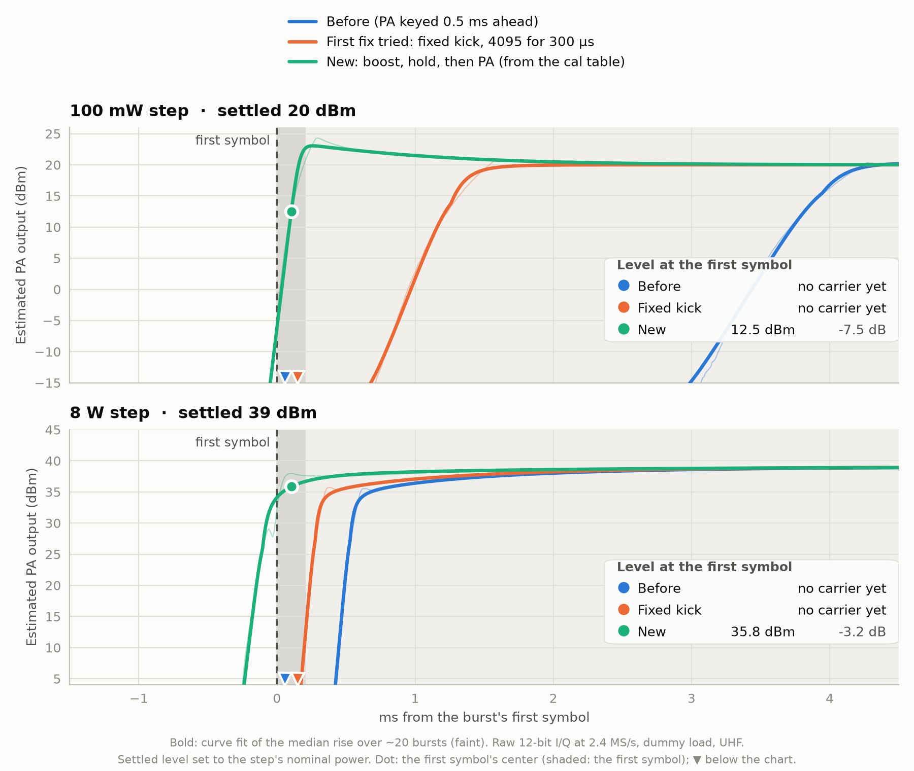
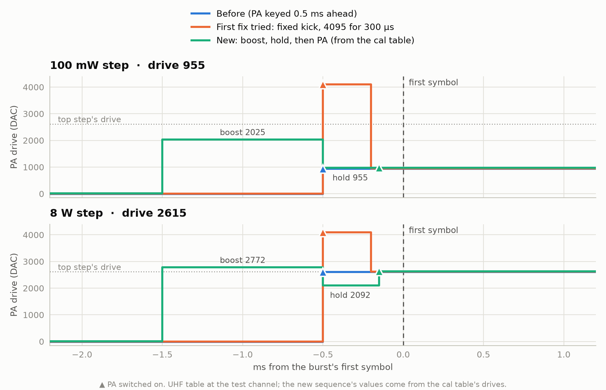

<!-- SPDX-License-Identifier: MIT -->
<!-- Copyright (c) 2026 The RadioFoundry Authors -->

# DMR PA key-up

A radio that keys its PA for every DMR burst has to reach full power by the burst's first symbol. A PA power loop
comes up slowly from a small drive: at a low power step it can take 3-4 ms, while the top step takes about 1 ms. A
fixed lead long enough for the low steps keys the top step early and cuts into the receive time before our slot, which
an SFR ([sfr.md](sfr.md)) needs. So the key-up drives the PA control harder for a moment first, for a time that
depends on the step, and takes every value from the radio's own power calibration table.

Code: `core/radio/pa_keyup.h`. A radio's hardware page says whether it keys this way and with which constants.

## 1. How the loop behaves

Three things, each seen in key-up sweeps on a radio, shape the rule:

| What | Effect |
|---|---|
| A dead zone | a drive under a certain value does nothing to the loop |
| A knee | no output until the drive above the dead zone has added up to a fixed amount (drive counts × ms). A low step's own drive takes milliseconds to get there |
| A memory | the loop follows the drive through a low-pass of about 1 ms. Once the output is there it follows that filtered drive, so what is left of a boost when the output appears is overshoot |

So the boost carries the knee's amount in a short time, and ends early enough for the low-pass to forget it.

## 2. The sequence

`d` is the step's drive from the power cal table at the transmit frequency and `top` the highest step's drive there.
All times are before the burst's first symbol.

| Point | PA drive | PA |
|---|---|---|
| `boost_us` − late | boost = boost% × top | |
| `pa_us`, or with the boost when that starts later | | on |
| `boost_us` − late − t | hold = hold% × d | |
| `drive_us` | d | |

t = (knee + slope × (d − dead)) / (boost − dead), at most `boost_us` − `drive_us`. late = late% × (t_top − t), where
t_top is t for the top step.

A lower step's boost is shorter, so it starts later, and the PA with it. Each step is keyed just in time: its output
rises where the top step's does, and the receiver keeps the time a fixed start would take from it. `boost_us` is the
top step's start, the earliest of all. At `late_pct` 100 every boost ends at the same point. A PA whose low steps
come up slower after the boost takes less. 0 starts every step at `boost_us`.

| Constant | What it sets |
|---|---|
| `dead` | the drive under which the loop does nothing, in drive counts |
| `knee` | what the boost has to carry before the PA gives output, in drive counts above `dead` × ms |
| `slope_us` | more boost time for a higher step, in µs × counts per count of (d − dead) |
| `hold_pct` | the hold between the boost and d, % of d, 0-100 %. It lets the low-pass forget the boost |
| `boost_pct` | the boost, % of the top step's drive, 50-120 %. A limit more than a tuning value |
| `late_pct` | how much later a lower step starts, % of what its boost is shorter than the top step's, 0-100 % |
| `boost_us`, `pa_us`, `drive_us` | the points; `boost_us` 0 = no boost or hold: the PA keyed at `pa_us` at d |

Every step gets the same boost level for a time of its own: a low step a short, late boost, the top step a long one
from `boost_us`. No step is driven over `boost_pct` of the top step's drive, and
only for about a millisecond. Nothing is stored per frequency or per step: the cal table already has the drives.

Integer math, 32-bit: `t_us = (knee * 1000 + slope_us * (d - dead)) / (top * boost_pct / 100 - dead)`, one divide per
key-up. A boost inside the dead zone or under d gives no boost: the PA is keyed at `pa_us` at d.

Two rules for the hold:

- Keep it above the dead zone at the lowest step. A hold far under it (drive 0) for more than a few hundred µs loses
  the boost's charge, and the step comes up milliseconds late. `pa_keyup_drives` holds at `dead + 1` when
  `hold_pct` of d is at or under it, and at d for a step whose drive is in the dead zone.
- The lowest drive sits on an edge. After the boost it adds to the knee only at its own small rate, so a boost a few
  percent short comes up late and one a few percent long overshoots. Higher steps have several times the margin.

## 3. What a board does

A board with per-burst keying opts in; one that doesn't call it keys its PA as before.

| Step | Call |
|---|---|
| Start-up | `pa_keyup_init(defaults, max_ahead_us, max_drive)`: its constants, the earliest point its burst sequence can run (after the burst task's wake and any switching that has to go first) and its drive limit |
| Key-up (radio task), a board whose bands have their own PA | `pa_keyup_select(constants)` with the transmit band's, before the plan |
| Key-up (radio task) | `pa_keyup_plan(d, top, floor, &cfg)` with its cal table's drives at the transmit frequency; keep the result and the constants it returns in `cfg` for the bursts, so the points and the plan come from one set |
| Each burst | the four points in time order, the RF switch to transmit placed among them by its own time |

The RF switch has its own lead on the PA's point. A switch that holds the burst task for longer (a synthesizer retune
on a split channel) goes before the boost, so it can't delay the boost's points. On a simplex channel, the later the
switch, the more of the inbound burst before ours the radio still hears.

## 4. Debug link

The constants are RAM: RADIO op 37 ([debuglink.md](debuglink.md)) changes them for tuning, from the next key-up, and a
restart restores the board's. Constants set this way apply on every band until `default` gives the board's back. The `core` view shows `pa_keyup` (the constants) and `pa_keyup.last` (the last key-up's
boost, hold and drive, the hold's point and the later start). RADIO op 36 sets a drive that is not in the table.

```
rfoundry_debug.py radio pa-keyup 680 1450 600 120 80 1500 1500 500 100
rfoundry_debug.py radio pa-keyup default
```

## 5. Tuning a radio

Tune on a dummy load, with raw I/Q from the SDR bench at 1 MS/s or more, about 20 bursts per setting, and a receive
level that stays linear at the top step (check that the steps come out at their expected spacing first). For each
burst, find the first symbol from the sync, and take the median power envelope against it.

| Measure | Target |
|---|---|
| The -3 dB point | at or before the first symbol, every step, and no step more than about 0.3 ms before |
| The first symbol's level against the settled level | within 3 dB |
| Overshoot above the settled level | 3 dB at most; the lowest step overshoots most |

Tune each band that has its own PA: the knee of one band's PA can be several times another's on the same radio.

1. Characterize the loop with the boost off (`boost_us` 0): the time from the PA's point to the output at three or
   four drives. Two drives give `dead` and `knee`: the knee is (d − dead) × (that time − the low-pass's time), the same
   at every drive. The decay of an overshoot gives the low-pass's time; start `slope_us` there.
2. Set `boost_pct` 120, `hold_pct` 80 (higher if that is under the dead zone at the lowest step), the boost at the earliest point the board allows, the PA with it, and `drive_us` about a third of that.
3. At the lowest drive, step `knee` until the -3 dB point is 0.2-0.3 ms before the first symbol. Too little comes up
   late with no overshoot, too much early and over. Repeat the chosen value: it should hold within 0.1 ms.
4. At the top step: late or low at the first symbol, raise `slope_us` or `hold_pct`; overshooting, lower `slope_us`.
5. Check every step at both band edges and the band center, on every band, then split channels and the first burst of
   a call. A band whose low drive wants a knee more than a few percent away needs its own.
6. With the top step right, look at where the lower steps rise. Earlier than the top step: raise `late_pct` until
   they line up with it. Later, or low at the first symbol: lower it. Then move `boost_us` and `pa_us` together as
   late as the top step allows.
7. `knee` goes with `pa_us`: the control charges less with the PA selected, so moving the PA's point later wants a
   smaller knee. Retune after moving it.

The charts show a radio at a low drive and its top step: the estimated PA output (a curve fit of the measured median),
and the drive through each sequence. Three sequences: the PA keyed at d with no boost, an earlier form of this rule (a
boost of fixed length blended from d and the top step, then a hold, the PA keyed last), and the rule above.

<picture>
  <source media="(prefers-color-scheme: dark)" srcset="../dev/img/dmr-pa-keyup-ramp-dark.png">
  
</picture>

<picture>
  <source media="(prefers-color-scheme: dark)" srcset="../dev/img/dmr-pa-keyup-drive-dark.png">
  
</picture>

The earlier form's boost was the same length at every step, so it was too short for the low drive and left the PA
coming up at the first symbol. Sizing the boost by the step brings every step up before it.
