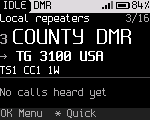

<!-- SPDX-License-Identifier: MIT -->
<!-- Copyright (c) 2026 The RadioFoundry Authors -->

# Introduction

RadioFoundry is free, MIT-licensed multi-mode firmware for inexpensive digital radios: DMR, P25, NXDN, and FM. It
replaces the radio's original firmware. One radio-independent core provides the digital voice stacks, the user
interface, the codeplug, and the host tools. Each radio adds a thin board layer underneath.

This manual describes what RadioFoundry does on every radio. What differs between radios (the keys, power levels,
battery, power switch, display, and missing hardware) is in the [Radio reference](23-radios.md). For which radio has
which feature, see the [feature matrix](../feature-matrix.md). The screenshots are 160 x 120. Other radios show the
same screens, laid out for their display.

## What RadioFoundry does

- DMR voice: group and private calls, talker alias, basic privacy, and positions in calls (ETSI GPS Info).
- DMR data: text messages, call alert, radio check, ARS registration, and LRRP location answers.
- DMR emergency: an alarm, an emergency call with a hot microphone, and alerts when someone else declares an
  emergency.
- DMR repeater roaming in each zone.
- FM: CTCSS and DCS tones, squelch, monitor, 12.5 and 25 kHz bandwidth, VOX, and touch tones.
- A VFO to tune a frequency by hand, in FM or DMR. Air band AM and FM broadcast receive on radios with the hardware.
- Scan of a zone or of the VFO band, and dual watch on two channels.
- APRS: position, status, and messages on FM, positions over DMR, and a KISS TNC.
- Hotspot mode: the radio is an MMDVM modem for MMDVMHost and Pi-Star-style hosts, with a single-frequency repeater
  mode (MMDVM SFR).
- USB network mode: the radio is a USB network adapter and routes IP over DMR. On that link it serves a status page,
  rig control, KISS over TCP, TFTP codeplug access, SNMP, and mDNS. It can also act as a control station for dispatch
  software.
- Programming with the Codeplug Editor in the browser or with qdmr, and a DMR ID database built from RadioID.net.

## How to use this manual

| To | Read |
|---|---|
| Put RadioFoundry on a radio | [Installing](02-installing.md), then [First boot](03-first-boot.md) |
| Carry a codeplug over from the original firmware | [Moving from the original firmware](18-moving-from-stock.md) |
| Load channels, zones, and contacts | [Programming the radio](04-programming.md) |
| Learn the keys and screens | [Keys and navigation](05-keys-and-navigation.md), [The Home screen](06-home-screen.md) |
| Use a feature | The chapters from [Channels, zones, and the VFO](07-channels-zones-vfo.md) to [Battery and power](16-battery-and-power.md) |
| Look up a setting | [Settings](17-settings.md) |
| Fix a problem | [Troubleshooting](20-troubleshooting.md), [FAQ](21-faq.md) |
| Look up your radio's keys and values | [Radio reference](23-radios.md) |

## The AMBE codec

DMR voice needs DVSI's proprietary AMBE+2 vocoder. RadioFoundry never ships it. Each radio runs the codec from its own
original firmware. The installer keeps the codec that's already in your radio, or takes it from the original firmware
file on your computer and writes it to the radio. For details, see [Installing](02-installing.md).

Without the codec, the radio works on FM, shows DMR calls, and handles DMR data. It doesn't play or send DMR voice.

## Conventions in this manual

Keys are named by the job they do. Each radio puts these jobs on its own keys. For the table for every radio, see
[Key roles](23-radios.md#key-roles).

The key names are **OK**, **Back**, **Up**, **Down**, **\***, **#**, **0** to **9**, **Monitor**, **Talk target**,
**Power level**, **Previous zone**, **Next zone**, and **PTT**. On a radio without one of these keys, the menus reach
the job.

| Term | Meaning |
|---|---|
| Press | A short press |
| Hold | Press and keep the key down for at least 0.6 s. This is the long-press time, which you can change in [Settings](17-settings.md#keys-key-8) |
| **Settings > Display > Brightness** | A menu path: open Settings, then Display, then Brightness |
| "Saved to channel" | On-screen text, quoted as the radio shows it |
