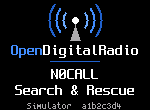

<!-- SPDX-License-Identifier: MIT -->

# First Boot

## Turning the radio on

Switch the radio on with its power switch. On the handhelds this is the volume knob, turned clockwise past its
click. The [Radio reference](23-radios.md) says where the switch is on each radio. The boot screen shows for about a
second, then the radio opens the Home screen. Keys pressed during the boot screen are ignored.

The boot screen shows the RadioFoundry logo and the two boot text lines from the codeplug. Along the bottom it shows the radio
model and the firmware version. The boot text lines are 16 characters each, set in the codeplug, for example your callsign and name.

To turn the radio off, use the power switch again. On the handhelds, turn the volume knob counterclockwise until it
clicks. See [Turning off](16-battery-and-power.md#turning-off).

## Channels on a new installation

RadioFoundry reads the codeplug from the radio's SPI flash, in the layout the Codeplug Editor and qdmr write. The codeplug holds the channels, zones,
contacts and your DMR ID. When RadioFoundry finds no channels there, it uses six built-in FM simplex channels:

| Channel | Frequency | Bandwidth |
|---|---|---|
| Simplex 145.500 | 145.500 MHz | 25 kHz |
| Simplex 146.520 | 146.520 MHz | 25 kHz |
| Simplex 146.550 | 146.550 MHz | 25 kHz |
| Simplex 433.500 | 433.500 MHz | 12.5 kHz |
| Simplex 446.000 | 446.000 MHz | 12.5 kHz |
| Simplex 446.500 | 446.500 MHz | 12.5 kHz |

Check that these frequencies are legal for you before you transmit on them. **Settings > Advanced > Codeplug** shows
which channels the radio uses: "built-in channels" or "from the CPS".

A radio that ran the stock firmware has stock data in the SPI flash. RadioFoundry may read it as channels with unreadable
names. In that case, write a codeplug right away.

## Programming the radio

Program channels, zones, contacts, talkgroup lists and your DMR ID with the Codeplug Editor on the project's web site
([Programming the radio](04-programming.md)). qdmr is an alternative. Most settings can also be changed on the radio
([Settings](17-settings.md)). Channels, contacts and the DMR ID come from the codeplug.

DMR needs your DMR ID. Without one, the radio refuses to transmit on DMR channels and shows "No DMR ID in codeplug".
**Settings > My radio > DMR ID and name** shows the ID the radio has, and sets one on the radio: it is written into
the codeplug.

## Checks after installing

1. **Settings > Advanced > About** shows "RadioFoundry" with the version you flashed and the radio model. Below
   them it lists the authors and the licenses of everything in the firmware.
2. On an FM channel, hold **Monitor** to open the squelch. You hear noise. This shows that the
   receiver and the audio path work.
3. On a DMR channel, the Home screen shows "No codec: voice off" in its bottom line if the codec isn't merged. See
   [Installing, no codec](02-installing.md#no-codec-no-codec-voice-off).
4. Change a setting, for example **Settings > Display > Brightness**. Turn the radio off and on again. Check that
   the setting stayed. If it didn't, see "Settings are not kept" in [Troubleshooting](20-troubleshooting.md).
