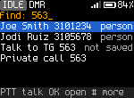
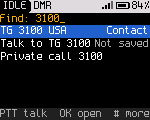
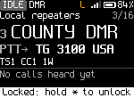

<!-- SPDX-License-Identifier: MIT -->

# Keys and navigation

Each key does the same kind of thing on every screen. Learn the five rules below and the rest of the radio follows
from them.

## The five rules

1. **OK** opens or chooses the thing with the focus. Holding **OK** does the lasting version: save, make permanent.
2. **Back** goes back one level. On Home it undoes one temporary change per press. Holding **Back** returns to Home
   from anywhere.
3. **\*** opens quick settings for what you are doing. Holding **\*** locks or unlocks the keys.
4. **#** opens the actions for the thing with the focus: a person, a talkgroup, a message, the last caller. Holding
   **#** opens Recent.
5. **PTT** talks to the person or talkgroup with the focus in any list, once. With nothing focused, it talks to the
   channel's talk target.

The bottom line of most screens (the hint row) shows what the nearest keys do there.

## Key reference (DM-1701)

| Key | Press | Hold |
|---|---|---|
| **OK** | Home: open the hub. Lists: open or choose | Save or make permanent |
| **Back** | Back one level. Home: undo one temporary change | Home |
| **Up**, **Down** | Move the focus. Home: next or previous channel (VFO: frequency step), or zone or talk target with **Settings > Keys > Up/Down on Home**. Editors: change the value | Repeats |
| **\*** | Quick settings | Lock or unlock the keys |
| **#** | Actions for the focused item. Home: actions for the last caller | Recent |
| **0** to **9** | Home: start Find. Lists: pick a numbered row, or type to filter. VFO: type a frequency | Home: speed dial (not built yet) |
| **P1** | Home: previous zone | |
| **P2** | Home: next zone | |
| **SK1** | Monitor while held: FM opens the squelch, DMR plays every talkgroup | |
| **SK2** | Talk target picker (DMR channels) | Scan on or off |
| **Top side key** | Home: next power level | Hold 1.5 s: emergency ([Emergency](10-emergency.md)). Builds without emergency: speak status (not built yet) |
| **PTT** | Transmit | |
| Channel knob | Each click is one step. Clockwise: the next channel on Home (as **Up**), the next row down in a list or menu, a higher value in an editor. Counterclockwise: the opposite | |

Each key press gives a short key beep unless **Settings > Sound > Key tones** is off.

While the keys are locked (hold **\***), **PTT** still works unless **Settings > Privacy > PTT when locked** is off. Then
**PTT** gives an error beep and "PTT is off while locked: hold * to unlock".

## Moving around

The Home screen is the base. Every other screen is at most three levels away from it.

```
Home
 |-- *        Quick settings
 |-- OK       Hub: 1 Contacts, 2 Messages, 3 Recent, 4 Channels, 5 Tools, 6 Settings
 |-- #        Actions for the last caller
 |-- hold #   Recent
 |-- 0-9      Find
 '-- SK2      Talk target picker
```

In numbered lists (the hub, Tools, Settings, actions, quick settings) a number key picks the row with that number
directly: **OK**, **5** opens Tools.

In long lists (Contacts, Channels, a zone's channels) the number keys filter the list by name, the way a phone
keypad spells words: **2** is ABC, **3** is DEF, and so on to **9** (WXYZ). Each key narrows the list to names with a
word that starts with those letters. **Back** deletes the last key typed, then leaves the list.


## Find

On Home (not in the VFO), a number key opens Find. Find searches everything at once. Type digits, and Find lists, in
this order:

1. the channel at that position in the current zone ("12" lists channel 12);
2. channels in the zone, contacts and talkgroups, zones, places (Contacts, Messages and so on) and settings whose
   names match the keys as letters;
3. contacts whose DMR ID starts with the number (from three digits on);
4. the number itself, as a talkgroup ("Talk to TG 3100", "not saved") and as a private call ("Private call 3100").

Then:

| Key | Does |
|---|---|
| **OK** | Go to the channel or zone, open the place or setting, or talk to the talkgroup or person for now |
| **PTT** | Talk to the focused talkgroup or person once |
| **#** | Actions for the focused talkgroup or person |
| **Back** | Delete the last digit; with one digit left, leave Find |

Settings also answer to other names: "promiscuous" finds Hear all, "TOT" finds TX timeout.




## Temporary and permanent changes

Changes you make while operating (power, squelch, tone, timeslot, color code, mode, talk target) are temporary. They
last until you change the channel or press **Back** on Home, and the changed fields are marked on Home. To keep a
change in the channel, hold **OK**: on Home, or in quick settings. The radio shows "Saved to channel".

**Back** on Home clears one thing per press, in this order: a frequency being typed, a banner, the scan, the reply
window, hear all, then all temporary changes together ("Changes undone").

## Key lock

Hold **\*** to lock the keys. The screen shows "Keys locked: hold * to unlock" and an "L" in the status line. While
locked, **PTT** and **SK1** (monitor) still work; any other key shows the unlock hint. Hold **\*** again to
unlock.

**Settings > Privacy > Auto lock** locks the keys by itself after a time without a key press.



## Toasts and banners

Short messages ("toasts") appear in the hint row for about two seconds: the result of an action, or why something
isn't available. Banners announce events (a message, a call alert, a radio check result) for eight seconds. While a
banner about a message or a call alert is up, **#** opens what it is about. **Back** on Home hides it.
