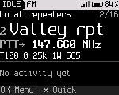
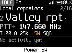
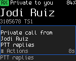
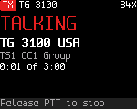
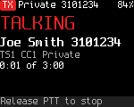
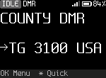

<!-- SPDX-License-Identifier: MIT -->

# The Home screen

Home answers four questions at a glance: where you are, what **PTT** will do, what is happening, and whether the radio
is OK.

## Regions, top to bottom

| Region | Shows |
|---|---|
| Status line | Left: the state (IDLE, RX, TX, or NO TX when a transmission is refused), the mode (DMR or FM), and SCAN or MON when scan or monitor is on. Right: "L" when the keys are locked, "M" and a number for unread messages, the signal bars, the battery icon and the battery percentage |
| Place | The zone name and the channel's position in the zone ("3/16"). In the VFO: "VFO" |
| Channel | The channel number and name, as large as they fit. In the VFO: the frequency |
| Talk target | "PTT→" and where **PTT** goes. DMR: a talkgroup or person. FM: the transmit frequency. During the reply window: "Reply→" and a countdown |
| Chips | DMR: timeslot, color code, power. FM: tone, bandwidth, power, squelch level |
| Activity | Idle: the last station heard and how long ago, or "No calls heard yet". Receiving or transmitting: see below |
| Hint row | What the nearest keys do now |

A field changed for now (a temporary change) is drawn in a highlight color on Home, and the hint row says
"Back undo  Hold OK save".

The battery percentage turns to the warning color at the low battery warning level (15 % by default) and below.

## Hint row messages

The hint row changes with the situation. What the **Back** key does is always at the right end of the row, above the
key. The most common hints:

| Hint | Meaning |
|---|---|
| OK Menu  \* Quick  # Joe | The normal hint. The name after # is the last caller. **#** opens actions for them |
| Back undo  Hold OK save | The channel has temporary changes |
| # caller  Back end reply | The reply window is running. **PTT** answers the last call |
| Back: channel's talkgroup | A talk target chosen for now is in use ("Back default target" where the row is narrow) |
| Hear all on  Back off | Hear all is latched on |
| # skip  Back stop scan | Scan is running |
| No codec: voice off | DMR channel without the codec merged |
| 0-9 freq  \* Quick  Up/Dn | In the VFO |
| Keys locked: hold \* to unlock | The keys are locked ("Locked: hold \* to unlock" where the row is narrow) |

## Receiving

During a DMR call, Home shows the caller:

- the name, from your contacts or else from the DMR ID database in the codeplug;
- the DMR ID and the timeslot;
- the talker alias as it arrives, unless **Settings > Talk & listen > Show talker alias** is off;
- the talkgroup, or "Private to you";
- the signal strength.

A call that the radio hears but doesn't play shows why. The reasons are "Other TG: not played" (a talkgroup you don't
listen to), "Encrypted: not played" and "No codec: voice off". Hold **Monitor** to hear a call on another talkgroup.

On FM, the activity region shows "Receiving" while the squelch is open, or "Squelch open" (monitor).

## Transmitting

While you hold **PTT**, the screen shows TALKING, the target, the timeslot and color code (DMR), the time on air and
the transmit timeout. DMR shows the time as "0:07 of 3:00", FM as "2:53 left of 3:00".

On DMR the top line says what kind of call it is: "TG 3100" for a group call, "Private 3101234" for a private call.
A private call shows the contact's name, and its ID when there is room. A name too long for the line keeps the name
and drops the ID.

On DMR the screen may first show WAITING (the radio waits for a free slot) or WAKING RPT (it wakes up the repeater).

When the radio refuses to transmit, the status line shows NO TX. The screen says why, and the hint row says what to
do:

| Message | Cause | What to do |
|---|---|---|
| This channel is RX only | The channel is set receive only | Pick another channel |
| Outside ... | The frequency is outside the radio's transmit bands | Pick another channel, or tune into a band in the VFO |
| TX time-out reached | You talked longer than the transmit timeout | Release **PTT** and press it again |
| No TX frequency set | The channel has no transmit frequency | Fix the channel in qdmr |
| No codec: voice off | DMR voice without the codec | "Add codec with odrflash" ([Installing](02-installing.md)) |
| Channel busy | Someone else is talking on the slot | Wait for the call to end |
| No repeater answered | The repeater didn't wake up | "Check CC and range" |
| Hotspot mode: PTT off | The radio is a hotspot | Press **OK** to leave hotspot mode |
| No DMR ID in codeplug | The codeplug has no DMR ID | Set your ID in qdmr |
| DMR modem not running | The DMR chip didn't start | Restart the radio. See [Troubleshooting](20-troubleshooting.md) |

The low and critical battery levels also limit transmitting. See [Battery and power](16-battery-and-power.md).

## Large text

**Settings > Display > Large text** shows only the status line, the channel name and the talk target, each as large as
it fits. The radio keeps this setting across power off. It keeps **Settings > Display > Hint row** too.

