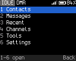
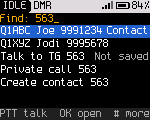
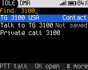
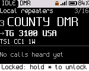

<!-- SPDX-License-Identifier: MIT -->
<!-- Copyright (c) 2026 The RadioFoundry Authors -->

# Keys and navigation

Each key does the same kind of thing on every screen.

## The five rules

1. **OK** opens or chooses the item with the focus. Hold **OK** for the lasting version, such as save or make
   permanent.
2. **Back** goes back one level. On Home, each press undoes one temporary change. Hold **Back** to return to Home from
   anywhere.
3. **\*** opens quick settings for what you're doing. Hold **\*** to lock or unlock the keys.
4. **#** opens the actions for the item with the focus, such as a person, a talkgroup, a message, or the last caller.
   Hold **#** to open the talk target picker on a DMR channel.
5. **PTT** talks once to the person or talkgroup with the focus, in any list. With nothing focused, it talks to the
   channel's talk target.

The bottom line of most screens is the hint row. It shows what the nearest keys do on that screen. What **Back** does
is at its right end, above the **Back** key.

A menu opens with the first available item selected. You can still move to a dimmed item and press **OK** to see why
it's unavailable. **Back** restores your previous menu selection.

## Key reference

The keys are named by their job ([Conventions](01-introduction.md#conventions-in-this-manual)).
[Key roles](23-radios.md#key-roles) lists which physical key does each job on your radio, and what replaces a key that
the radio doesn't have.

| Key | Press | Hold |
|---|---|---|
| **OK** | Home: open the hub. Lists: open or choose | Save or make permanent |
| **Back** | Back one level. Home: undo one temporary change | Go to Home |
| **Up**, **Down** | Move the focus. Home: next or previous channel (in the VFO, a frequency step), or the zone or talk target with **Settings > Keys > Up/Down on Home** (the channel knob stays on the channel). Editors: change the value | Repeat |
| **\*** | Quick settings. While you transmit on FM with **PTT**: the key's [touch tone](08-fm.md#touch-tones-dtmf) | Lock or unlock the keys |
| **#** | While you transmit on FM with **PTT**: the key's [touch tone](08-fm.md#touch-tones-dtmf). Otherwise: actions for the focused item. Home: actions for the last caller. VFO: tune a frequency that you're typing, like **OK** | DMR channels: the talk target picker (pick a talkgroup, or type an ID). Recent is **OK**, **3** |
| **0** to **9** | Home: start Find. Lists: pick a numbered row, or type to filter. VFO: type a frequency. While you transmit with **PTT**: on FM, send the key's [touch tone](08-fm.md#touch-tones-dtmf); on DMR, nothing | While you transmit with **PTT**: the same as a press |
| **Previous zone**, **Next zone** | Home: previous or next zone | |
| **Monitor** | FM: open the squelch while you hold the key. DMR: turn digital monitor (every talkgroup) on or off | |
| **Talk target** | Talk target picker (DMR channels) | The same as a press |
| **A/B** | Dual watch: switch to the other channel | Turn dual watch on or off |
| **Power level** | Home: next power level | Hold for 1.5 seconds: emergency ([Emergency](11-emergency.md)) |
| **PTT** | Transmit | |
| Channel knob | Each click is one step. Clockwise: the next channel on Home (like **Up**), the next row down in a list or menu, or a higher value in an editor. Counterclockwise: the opposite | |

You can give the side keys (**Monitor**, **Talk target**, and **Power level** on most radios) other jobs. Set them in
**Settings > Keys** ([Settings](17-settings.md#keys-key-8)) or in the codeplug.

Each key press gives a short key beep, unless **Settings > Sound > Key tones** is off.

While the keys are locked (hold **\***), **PTT** still works. When **Settings > Key lock > PTT when locked** is off,
**PTT** gives an error beep and the radio shows "PTT is off while locked: hold * to unlock".

## Moving around

The Home screen is the base. Every other screen is at most three levels away from it.

```
Home
 |-- *            Quick settings
 |-- OK           Hub: 1 Contacts, 2 Messages, 3 Recent, 4 Zones, 5 Channels, 6 Tools, 7 Settings
 |                    (a radio without # gets 0 Last caller at the top)
 |-- #            Actions for the last caller
 |-- hold #       Talk target picker (DMR)
 |-- 0-9          Find
 '-- Talk target  Talk target picker
```

In numbered lists (the hub, Tools, Settings, actions, quick settings), a number key picks the row with that number. For
example, **OK**, **6** opens Tools.

In long lists (Contacts, Channels, a zone's channels), the number keys filter the list by name, the way a phone keypad
spells words. **2** is ABC, **3** is DEF, and so on to **9** (WXYZ). Each key narrows the list to names with a word
that starts with those letters. **Back** deletes the last key you typed, then leaves the list.



## Find

On Home (not in the VFO), a number key opens Find. Find searches everything at once. Type digits. Find lists, in this
order:

1. The channel at that position in the current zone. "12" lists channel 12.
2. The digits as a frequency in one of the radio's bands, read as in the VFO: "438250" lists "Tune VFO to 438.250".
   **OK** opens the VFO on that frequency. The VFO's mode, power, and tones stay as they were.
3. Channels in the zone, contacts and talkgroups, zones, places (Contacts, Messages, and so on), and settings whose
   names match the keys as letters.
4. Contacts whose DMR ID starts with the number, from three digits on.
5. The number itself, as a talkgroup ("Talk to TG 3100", "not saved") and as a private call ("Private call 3100").
6. "Create contact 3100" when no contact has that ID. **OK** opens **New Contact** ([Contacts](09-dmr.md#contacts)).

Then use these keys:

| Key | Action |
|---|---|
| **OK** | Go to the channel or zone, tune the VFO, open the place or setting, talk to the talkgroup or person for now, or create the contact |
| **PTT** | Talk once to the focused talkgroup or person |
| **#** | Open the actions for the focused talkgroup or person |
| **Back** | Delete the last digit. With one digit left, leave Find |

Settings also answer to other names. For example, "promiscuous" finds **Digital monitor**, and "TOT" finds **TX
timeout**.




## Temporary and permanent changes

Changes that you make while you operate (power, squelch, tone, timeslot, color code, mode, talk target) are temporary.
They last until you change the channel or press **Back** on Home. Home marks the changed fields. To keep a change in
the channel, hold **OK** on Home or in quick settings. The radio shows "Saved to channel".

In the VFO, the radio keeps changes by itself, so a hold shows "VFO settings save automatically". Squelch is one
setting for the whole radio, so squelch that you set in the VFO also becomes the default squelch on every channel, the
same as when you hold **OK** to save it on a channel. If another write is in progress, the radio shows "Save busy: try
again". Wait a moment and hold **OK** again.

Each press of **Back** on Home clears one thing, in this order:

1. A frequency that you're typing.
2. A banner.
3. The scan.
4. The reply window.
5. Digital monitor.
6. All temporary changes together ("Changes undone").

## Key lock

On Home, hold **\*** to lock the keys. The screen shows "Keys locked: hold * to unlock" and an "L" in the status line.
While the keys are locked, **PTT** and **Monitor** still work. Any other key, and the channel knob, shows the unlock
hint. Hold **\*** again to unlock. The volume knob still works, unless **Settings > Key lock > Knob when locked** is
off. In menus, holding **\*** doesn't lock the keys, so a slow press can't lock them in the middle of a task.

**Settings > Key lock > Auto lock** locks the keys by itself after a time without a key press. A radio with only side
keys (no keypad, no **Back** key) never locks by itself, because nothing could unlock it.



## Toasts and banners

Short messages, called toasts, appear in the hint row for about two seconds. A toast shows the result of an action, or
why something isn't available. A long toast takes a second line above the hint row and isn't cut short.

Banners announce events (a message, a call alert, a radio check result) for eight seconds. While a banner about a
message or a call alert is up, **#** opens what it's about. **Back** on Home hides it.
