<!-- SPDX-License-Identifier: MIT -->

# Channels, Zones and the VFO

A **channel** is a saved frequency with its mode (FM, DMR, or P25 and NXDN where the radio runs them) and settings. A **zone** is a named list of channels.
The **VFO** tunes any frequency by hand. Channels and zones come from the codeplug ([Programming the radio](04-programming.md)).

## Changing the channel

- Turn the channel knob, or press **Up** or **Down** on Home, to step through the zone's channels.
- Type the channel's position on Home and press **OK**. For example, **1**, **2**, **OK** goes to channel 12 of the
  zone.
- Type letters of the channel's name on Home (see [Find](05-keys-and-navigation.md#find)) and press **OK** on it.
- Press **OK**, **4** (Zones), focus the zone and press **#**. The zone's channels open. Focus one and press **OK**.

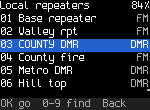

Changing the channel ends temporary changes, the reply window, digital monitor and a scan.

## Changing the zone

- Press **Next zone** or **Previous zone** ([Key roles](23-radios.md#key-roles) shows which keys these are on your
  radio). The radio shows "Zone:" and the name.
- Or press **OK**, **4** (Zones). The list opens with the current zone focused ("here"). Focus another zone and press
  **OK**. The radio switches to it and returns to Home.
- Or type the zone's name on Home. Find lists zones too.

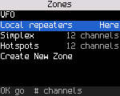

The Zones list shows the VFO first, then every zone with its number of channels. Type letters to filter it.

## Making a zone

**OK**, **4** (Zones), then the last row, **Create New Zone**. Type the name and press **OK**. The radio saves the empty zone
and focuses it in the list. Press **#** to open it and add channels with **Add channel**. A channel's own page can
also put it in zones (**Zones** row, [Editing a channel](#editing-a-channel)).

## Editing a zone

A zone's list (**OK**, **4**, focus the zone, **#**) also edits the zone. Each change is saved at once: there is
nothing to save or discard. On a radio without **#**, hold **OK** wherever this section says **#**.

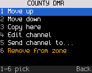

- **Add channel** (the first row) lists every channel the zone doesn't hold. Type letters or digits to filter it and
  press **OK** on one. It goes after the channel you are on, or at the end of a zone you are not using.
- **#** on a channel opens its actions:

  | Key | Action | Does |
  |---|---|---|
  | 1 | Move up | swaps it with the channel above. The menu stays open, so press **1** again to move it on |
  | 2 | Move down | swaps it with the channel below |
  | 3 | Copy here | opens a copy at the lowest free channel number, named with " 2" added. Change what differs and hold **OK**: the copy is saved and put after the channel in this zone |
  | 4 | Edit channel | opens the channel's settings ([Editing a channel](#editing-a-channel)) |
  | 5 | Share channel to... | sends the channel to another radio or a talkgroup ([Sharing a zone](#sharing-a-zone)) |
  | 6 | Remove from zone | takes it out of this zone. The channel stays in Channels and in any other zone |

- **Zone options** (the last row):

  | Key | Action | Does |
  |---|---|---|
  | 1 | Rename | type the new name and press **OK** |
  | 2 | Copy as new zone | makes a new zone with the same channels, named with " 2" added |
  | 3 | Share zone to... | sends the zone to another radio or a talkgroup ([Sharing a zone](#sharing-a-zone)) |
  | 4 | Delete zone | asks first, with "No, keep it" focused. The zone's channels stay in Channels |

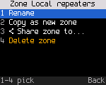

Moving, adding and removing keep the radio on its channel. Removing the channel you are on moves the radio to the
next channel in the zone. A zone holds a channel once, and the radio refuses a channel past the zone's size ("Zone
full"). A radio whose codeplug has no zones shows one zone, "All channels"; the first change saves it as a real zone.

Deleting the zone you are using moves the radio to the zone that comes after it in the list (or the one before, when
it was last). Dual watch keeps watching a channel from a deleted zone when another zone holds it, and otherwise
stops. A zone marked for roaming loses the mark when it is deleted; the other marks stay on their zones.

## Sharing a zone

You can send a zone, or one channel, to another radio or a talkgroup over DMR. Status: sending one channel works on a
radio; sending a whole zone and receiving are tested only in the host tests so far.

**Send:**

1. Tune a DMR channel. The zone goes out on it.
2. Press **OK**, **4** (Zones). Focus the zone and press **#**. Its channels open.
3. For one channel: press **#** on it and pick **5 Share channel to...**, or pick **Share channel to...** in the
   channel's settings. For the whole zone: pick **Zone options** (the last row), then **3 Share zone to...**.
4. Pick a contact or talkgroup and press **OK**. For a station that isn't a contact, type its ID: "Private ID ..."
   and "TG ..." appear under the contacts. The radio says where it sends: "Sending to ... via 442.375" (on a
   repeater, its output frequency). A banner says "Sent to ..." when it is out.

A zone too big for one send goes in part, and the radio says how much ("Sending 40 of 60 channels"). Scan lists,
group lists and privacy keys are never sent.

**Receive:** **Settings > Connections > Accept zone shares** is **On** at first. Nothing is imported until you
say so. Set it to **Off** to ignore what others send.

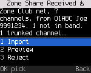

1. A banner says "Zone from ...". It stays until you press **#** to open it or **Back** to hide it. The offer also waits under **Tools > Zones/Chs Received** for 10 minutes. The screen is titled **Zone Share Received**, or **Channel Share Received** for one channel.
2. The offer shows the zone's name, its channels, the sender and how many channels are outside your radio's bands.
3. Pick **Preview** to see the channels, **Import** to add them, or **Reject**.

What an import does:

- The zone is added after your zones. If you have a zone with that name, it gets " 2".
- Only channels your radio can receive come in. A conventional channel comes in **receive only**: turn transmit on
  per channel when you know you may use the channel.
- A trunked channel keeps the sender's transmit setting when its system comes with the zone or your radio already
  has that system. The system's listen-only setting then decides, so a shared trunked channel can transmit as soon as
  the zone is imported. A trunked channel whose system doesn't come in arrives receive only.
- Talkgroups and contacts you already have are used with your names. Missing ones are added.
- The same zone sent again by the same radio updates your copy instead of adding another. It replaces only the
  channels from the earlier import that you left as they were. Channels you added to the zone or changed stay,
  after the new ones.
- A single channel is added to a zone you pick.

At most 6 offers an hour are shown, one at a time. The format is in [zone-share.md](../spec/zone-share.md).

## Every channel

**OK**, **5** (Channels) lists every channel in the codeplug by number and name, whichever zones hold it. Each
row ends with the RX frequency and the talkgroup (DMR) or FM. A long name stays whole and the row shortens the rest:
"TG" goes first, then the frequency. The channel you are on is marked. Type letters to filter the list.

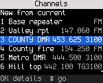

- **OK** on a channel opens its settings, where you can change them (below).
- **#** in the list goes to the channel: in the current zone if it holds it, otherwise in the first zone that does.
  A channel in no zone says "Not in any zone".
- The first row, **New from current**, starts a new channel from what the radio uses now (below).

## Editing a channel

The channel's page lists every setting: name, mode, RX and TX frequency, power, RX only, then bandwidth, tones,
VOX and tone burst on FM, or color code, timeslot, TX contact, RX group list, own ID, direct mode, talk permit beeps and talker
alias on DMR, then TX time-out, scan, battery saver and the zones that hold it. The list scrolls.

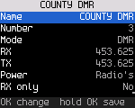

Focus a row and press **OK**:

| Row | What OK does |
|---|---|
| Mode | steps to the next mode: FM, DMR, then P25 and NXDN on a radio that runs them. Stepping on comes back to the mode the channel had, with its settings as they were |
| Two choices (timeslot, bandwidth, RX only, scan, VOX, tone burst, direct mode, beeps, talker alias, battery saver) | switches to the other one |
| Power, RX CTCSS/DCS, TX CTCSS/DCS, color code, TX time-out | opens a picker: turn the knob (or Up / Down) to the value, **OK** keeps it, **Back** cancels. Color code and time-out also take digits |
| RX CTCSS/DCS, TX CTCSS/DCS, typed | type a CTCSS tone with its tenths digit: **8 8 5** is 88.5, **1 3 1 8** is 131.8. Under 60 the digits are whole Hz: **6 7** is 67.0, **1 0 0** is 100.0. Start with **0** for a DCS code: **0 2 3** is D023N. **Back** takes the last digit back. For an inverted DCS code, turn the knob one step: each code's I follows its N (D023N, D023I, D025N) |
| Zones | opens every zone, marked "In" where the channel is. **OK** puts the channel in a zone or takes it out, saved at once. A new channel shows the row once saved |
| RX, TX, own ID | type the digits, **OK** keeps them, **Back** takes the last digit back. Digits outside the radio's bands are refused as you type. A new RX moves TX with it, so a repeater keeps its offset. If the new RX is in another band (UHF to VHF), or TX would land outside the band, TX is set to the new RX |
| Name | opens text entry (below) |
| TX contact, RX group list | opens the list of contacts or group lists; type letters to find one |

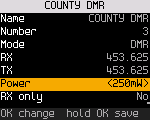

A changed row is marked until you save. **Hold OK** anywhere on the page to save, or pick the **Save** row. The radio
writes the channel in the background and says "Saved channel 3". **Back** with unsaved changes asks whether to
discard them; the answer starts on "No, keep editing". Saving any channel drops the quick-settings changes on the
channel you are on: the radio reloads it from the codeplug.

The radio won't save a channel without a name, with RX outside its bands, with TX where it can't transmit (set RX only
instead), a DMR channel in the broadcast band or in the air band (on a radio that receives AM there), or a DMR channel
without a TX contact, unless it is RX only. It says which. A DMR channel where the radio receives but can't transmit
saves when it is RX only.

**Save as new channel** stores the edited copy at the lowest free number and leaves the original as it was.
**Tune to this ch** tunes the channel and **Share channel to...** sends it to another radio ([Sharing a zone](#sharing-a-zone));
save or discard your changes first.

### Text entry

It works like a phone keypad. Keys **2** to **9** type their letters, then the digit, then the letters in the other
case: press **2** once for A, twice for B, four times for 2, five times for a. Press the same key again within a
second for the next character; another key, or a pause, moves on. **1** types punctuation (`. - / , ' & ( ) @ _ ! ?`
and 1), **0** a space, 0, `+`, `#` and `*`. The title shows the mode.

**#** switches the mode: ABC (capitals, the start), then 123 (each key types its digit), then abc (lower case), then
back to ABC. Holding a digit key types the digit in any mode. **Back** deletes the last character (**\*** does too).
**OK** keeps the name. To leave without changing it, press **Back** until the field is empty and once more. Names hold
up to 16 characters.

On a radio without a keypad, Up / Down change the last character, **OK** adds another, and holding **OK** keeps the
name.

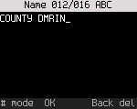

### New channel from current settings

**OK**, **5**, then the first row, **New from current**. It opens an unsaved copy of the channel you are on, with any
quick-settings changes, or of the VFO, at the lowest free channel number. The name gets " 2" added (from the VFO, the
frequency). Change what differs, then hold **OK** to save it. A new channel is in no zone yet: add it to one with **Add channel** in the
zone's list ([Editing a zone](#editing-a-zone)), or use **Copy here** there to make the copy and add it in one step.

## Saving changes to a channel

Change power, squelch, tone, bandwidth, timeslot, color code or mode with quick settings. Then hold **OK** on Home or
in quick settings. The radio writes the channel in the background and shows "Saved to channel". The squelch is saved
as the radio's default squelch, not in the channel.

A save that fails shows "Couldn't save: ..." and the change stays for now only.

## The VFO

The VFO is an FM VFO or, on a radio with DMR, a DMR VFO. It keeps its mode like its frequency. Everything you change in
the VFO (mode, color code, timeslot, talk target) is kept, also when you go to a channel and come back, and after a
restart.

1. **OK**, **4** (Zones). The VFO is the first row.
2. Press **OK**. Home shows the frequency large, and the radio says "VFO: type a frequency".

On a radio with a **VFO/MR** key, press it instead: it goes between the channel and the VFO. **Settings > Keys** can
give any side key the same job, "VFO/Channel", on a press or a hold.

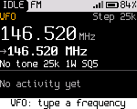

### Copy a channel to the VFO

To start from a channel, press **\***, **4** ("To VFO") on it. The channel's settings become the VFO's and Home shows
the VFO ("Copied to VFO"). On a radio with a **VFO/MR** key, hold it instead. **Settings > Keys** can give any side
key "Copy to VFO", on a press or a hold.

| Copied | Notes |
|---|---|
| RX and TX frequency | A repeater's offset stays until you step the frequency |
| Mode, bandwidth, power | Power stays "default" if the channel's is |
| Tones (FM) | CTCSS or DCS, RX and TX |
| Color code, timeslot, talk target (DMR) | The talk target is the contact's ID, as a group or private call. A channel with no contact gives what it would send now |

- The VFO gets what is in effect now, so a temporary change you made on the channel (a bandwidth, a power level, a
  talk target) is copied too.
- The channel stays as it was. The VFO keeps the values like its other settings, also after a restart.
- Not copied: the RX group list, the privacy key, roaming, the data and emergency settings, and the squelch level.
  The VFO uses the radio's own values for these.
- A channel the VFO can't hold is refused with a short message and nothing changes: a DMR channel on a radio build
  whose VFO is FM only (or the other way round), or a frequency outside the radio's bands.
- In the VFO the same key says "Already in VFO".

### Typing a frequency

On Home in the VFO, type the frequency digits from the hundreds of MHz down, without a decimal point. The radio shows
what you typed as you go.

| Keys | Frequency |
|---|---|
| **4** **4** **6** **0** **0** **0** | 446.000 MHz |
| **1** **4** **6** **5** **2** | 146.520 MHz |
| **4** **3** **8** **2** **6** **2** **5** | 438.2625 MHz |
| **0** **8** **8** **1** | 88.100 MHz (below 100 MHz, start with **0**) |

- Type at least the three MHz digits, then press **OK** (or **#** where the radio has that key) to tune.
- **Back** deletes the last digit.
- A digit that can't lead to a frequency in the radio's bands is refused, and the radio shows the bands. The bands
  depend on the radio ([Radio reference](23-radios.md)).
- Up to eight digits (10 Hz). After 10 s without a key, the entry is dropped.

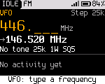

### Stepping

**Up**, **Down** and the channel knob change the VFO frequency by its step. The step is **Settings > Talk > VFO step**. Its
default, **Auto**, follows the width: 25 kHz at 25K (and in AM) and 12.5 kHz at 12.5K. In the broadcast band the step
is always the FM broadcast step, whatever the VFO step. The step is in the status strip.

### Split (repeater offset)

In the VFO, **\***, **5** (**\***, **6** in the DMR VFO) is **TX freq** (the split): TX against RX, "Off" or the offset ("+600k",
"-5M").

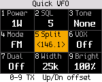

- **Up** and **Down** step through the band's usual offsets, at once. **Up** goes +, **Down** goes -, the most common
  first, and stop at the last one:

  | Band | Offsets |
  |---|---|
  | 2 m (below 200 MHz) | 600 kHz, then 1 MHz |
  | 1.25 m (200-300 MHz) | 1.6 MHz |
  | 70 cm (above 300 MHz) | 5 MHz, then 7.6 MHz, then 1.6 MHz |

  On 70 cm, **Up** from Off is +5M, again +7.6M, again +1.6M; **Down** from +5M goes back to Off, then -5M.
- The bottom row says what the keys do ("Up/Dn +/-  0-9 TX freq") and, while you type, shows the whole TX frequency
  so far ("TX 147.02___").
- Any other split (a custom one): type the TX frequency as you type a VFO frequency (**1 4 7 0 0** is 147.000) and
  press **OK**. **Back** takes the last digit back. Any frequency the radio can transmit on is accepted.
- A new RX frequency keeps the offset within the same band. A move to another band (UHF to VHF, say) makes the VFO simplex.
- Monitor stays on its key in the VFO, and privacy is for channels.
- Home shows the TX frequency: on FM after **PTT→**; on DMR in the top row ("TX 147.120"), or as the offset beside the
  power on displays without that row. While you transmit, the large frequency turns red and shows the TX frequency
  (on DMR, the call screen has a "TX" line).

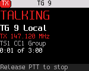

### DMR in the VFO

**\***, **4** in the VFO switches it between FM and DMR on the same frequency ("VFO: DMR"), and to P25 and NXDN after DMR on a
radio that runs them ([P25 in the VFO](#p25-in-the-vfo), [NXDN in the VFO](#nxdn-in-the-vfo)). In DMR the quick settings are the DMR ones:

| Key | Tile | What it does in the DMR VFO |
|---|---|---|
| **2** | Slot | Switches the timeslot, 1 or 2 |
| **3** | Color | Sets the color code, 0 to 15 (1 at first). Type it or use **Up** and **Down**, then **OK** |
| **8** | Talk to | Picks or types the talk target, a talkgroup or a person. Both **OK** and holding **OK** keep it for the VFO |

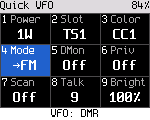

- Pick the color code and timeslot of the repeater or the simplex frequency you use. The radio talks to talkgroup 9 until
  you pick another target, with your own DMR ID.
- The VFO has no listen list. It plays calls to its talk target, all calls and private calls to you. Other talkgroups
  show as "Other TG: not played". To hear everything on the slot, turn on digital monitor.
- Home shows the frequency, the talk target, the timeslot and the color code. Changes here don't show a dot and
  **Back** doesn't undo them.
- The DMR VFO sends data messages and can start an emergency, as a DMR channel does. It sends no talker alias.

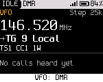

### P25 in the VFO

On a radio that runs P25 ([feature matrix](../feature-matrix.md)), P25 is one of the VFO's modes: **\***, **4** goes FM, DMR, P25, then FM again
("VFO: P25"). The VFO keeps the mode when the radio is switched off.

- It hears clear P25 voice calls on network access code 293, to every talkgroup. Encrypted calls stay silent.
- PTT sends a P25 voice call to talkgroup 1 from your P25 unit ID, or your DMR ID when the codeplug has none.
- Home shows "P25", what PTT calls ("TG 1") and the network access code ("NAC 293"). During a call it shows who calls
  and where ("ID 3101234 > TG 7"), or why the call isn't played ("Encrypted: not played", "Other TG: not played").
  FM's tone and width tiles say "FM only: this is a P25 channel".
- The code, talkgroup and talkaround can be changed only from a computer for now (`rfoundry_debug.py radio p25`), and the
  change lasts until the radio is switched off.

### P25 channels

A P25 channel comes from a codeplug written on a computer ([P25 and NXDN in the editor](04-programming.md#p25-and-nxdn)), a zone shared by another radio, the VFO (in P25, open
**Channels**, **New channel from current settings** and save it), or any channel: press **OK** on its Mode until it
says P25, set the NAC and save. A channel made P25 starts with NAC 293. The channel keeps the network access codes, the
talkgroup (when a contact has that talkgroup; else talkgroup 1) and talkaround. A shared one comes in receive only, as
every shared channel does: turn RX only off in its settings. On a radio without P25 the channel shows as P25 and stays
silent.

- Home shows it as in the VFO. It hears its talkgroup, calls to everyone and calls to your ID, unless the codeplug
  says to hear every call.
- The channel's settings show "P25" as the mode and only the settings P25 uses. Talkaround is On or Auto (on
  when RX and TX are the same frequency).
- **NAC** sets the network access code both ways. Type its hex digits; **Up** and **Down** step the last digit
  through 0-9 and A-F, so for 1A5 type 1, 9, **Up**, 5. F7E receives every NAC. The talk group is **TX contact**, your
  unit ID **Own ID**.
- **OK** on Mode steps to NXDN (on a radio that runs it), FM, DMR, then back to P25 with its settings as they were, so
  a slip costs nothing. Saving the channel as another mode removes its P25 settings: the radio asks first ("Save as
  FM?", "Save as DMR?", or "Unsaved Changes" for NXDN), and "No, keep editing" is the default. **Save as new channel** leaves the P25 channel as it is.
- Scan stops on P25 channels and holds on a call you would hear there. Dual watch takes one as A or B.

### P25 trunked channels

On a radio that runs P25 trunking, a channel can belong to a P25 trunked system (Phase 1 voice channels). The system
(its control channels, its identity, your unit ID) and its channels (one talkgroup each) come from a codeplug written
on a computer ([P25 and NXDN in the editor](04-programming.md#p25-and-nxdn)). A new system is listen only. The channel's settings show "P25T" as the mode.

| Home says | What the radio is doing |
|---|---|
| Finding system | Trying the system's control channels in turn |
| Control channel | On the control channel, waiting for a call to the channel's talkgroup |
| Following TG 201 | On the voice channel of a call. It goes back to the control channel when the call ends |
| Registering | Transmit is on: registering with the system and joining the talkgroup |
| TG 201 | Registered. PTT asks the system for a voice channel |
| Wait, Queued | PTT is held and the request is with the system. Talk when home shows the transmission |
| Denied, Reg. denied | The system refused the request or the registration |

- A system set to listen only, a channel set to RX only, or one without a unit ID or talkgroup never transmits: PTT
  says "RX only".
- Calls to other talkgroups are followed only when the channel is set to follow every group of the system.
- A system whose control messages fail their checksum is heard with the channel's **Accept Invalid CRC** on
  ([Accept invalid CRC](09-dmr.md#accept-invalid-crc)).
- Calls to one unit and emergency are not there yet.
- Phase 2 (TDMA) voice channels are not followed, and are unlikely ever to be: the radios' RF transceiver components
  can't send or receive Phase 2's modulation (H-CPM, H-DQPSK).
- Scan skips these channels and dual watch doesn't take them: a trunked channel follows its system instead.
- This has run against a test control channel only, not yet on a working system.

For a ham P25 trunked system, RadioFoundry recommends one identity: WACN 0x32350, any system ID, and NAC 0x293 on the
control channel. **Add Recommended Ham System** on the editor's **Systems** tab fills a P25 trunked system in with
those values and transmit on; the template [ham-p25-trunked.yaml](https://github.com/radiofoundry/radiofoundry/blob/main/docs/examples/ham-p25-trunked.yaml) holds the system, a channel
and the BrandMeister talkgroups. P25 talkgroups go up to 65535, so a BrandMeister talkgroup above that has no P25
number. The reasons are in [Recommended ham trunked systems](../spec/ham-trunking.md#3-p25-trunked).

### NXDN in the VFO

On a radio that runs NXDN, NXDN is one of the VFO's modes, after P25 ("VFO: NXDN"). It
is NXDN conventional voice at 9600 bit/s (12.5 kHz) or 4800 bit/s (6.25 kHz), through the radio's DMR voice codec.

- It hears clear voice calls on every radio access number (RAN), to every group. Encrypted calls stay silent.
- PTT sends a voice call to group 1 with RAN 1 at 9600 bit/s, as unit 1 until a computer sets another ID.
- Home shows "NXDN", what PTT calls ("TG 1"), the RAN sent and the rate ("RAN 1 9600"). During a call it shows who
  calls and where, or why the call isn't played. FM's tone and width tiles say "FM only: this is NXDN".
- The rate, the RANs, the unit ID and the group can be changed only from a computer for now
  (`rfoundry_debug.py radio nxdn`), and the change lasts until the radio is switched off.
- Some radios only transmit NXDN or only receive it ([feature matrix](../feature-matrix.md)). One that only receives
  says "This mode: receive only" on PTT.

### NXDN channels

An NXDN channel comes from a codeplug written on a computer ([P25 and NXDN in the editor](04-programming.md#p25-and-nxdn)), a zone shared by another radio, the VFO (in NXDN,
open **Channels**, **New channel from current settings** and save it), or any channel: press **OK** on its Mode until
it says NXDN, set the RAN and rate, and save. A channel made NXDN starts with RAN 1 at 9600 bit/s. The channel keeps the rate, the RANs, the
squelch and the group (when a contact has that group; else group 1).

- Home shows it as in the VFO. The channel's settings show "NXDN" as the mode.
- **OK** on Mode steps to FM, DMR, P25 (on a radio that runs it), then back to NXDN with its settings as they were.
  Saving the channel as another mode removes its NXDN settings: the radio asks first ("Save as FM?", "Save as
  DMR?", or "Unsaved Changes" for P25).
- **RAN** (0-63) and **Rate** (9600 or 4800 bit/s) are in the channel's settings, with the group (**TX contact**) and
  your unit ID (**Own ID**, up to 65519). RAN 0 receives every RAN. The squelch can be changed only from a computer.
- Scan stops on NXDN channels and holds on a call you would hear there, at a rate the radio can receive. Dual watch
  takes one as A or B.

### Leaving the VFO

Press **OK**, **4**, then **OK** on the VFO row again ("Back to channels"). Or pick a zone or channel. A **VFO/MR** key
or a side key set to "VFO/Channel" goes back to the channel you came from.

## Air band and FM broadcast

Some radios also receive the aircraft band in AM and FM broadcast stations ([Radio reference](23-radios.md)). There is
no mode to pick and no menu: the frequency decides.

| Tune to | You hear |
|---|---|
| 108 to 137 MHz | Air band, in AM. Home shows "Air Band AM" and the squelch level, and "AM" in place of "FM" |
| The broadcast band (65 to 108 MHz on most receivers) | FM broadcast, on the radio's broadcast receiver. Home shows "Broadcast FM" |

Tune there in the VFO (type **1** **1** **8** **1**, or **0** **8** **8** **1**, and press **OK**). A DMR VFO switches
to FM there and stays FM; DMR can't be picked in these bands. To keep a station, use **New from current** in the channel
list (or type the RX frequency in the channel editor): the channel becomes RX only, ready to save. Its Mode reads AM in
the air band and FM in the broadcast band, and OK on it doesn't switch to DMR; the tone rows are hidden. A channel
programmed on the frequency in the codeplug works too, even one stored as DMR. Both bands are receive only: PTT shows
"Air band: receive only" or "Broadcast: receive only" and the radio doesn't transmit. Sub-audio tones are ignored.

In the Codeplug Editor, a channel whose RX frequency is in one of these bands is set to **RX Only** with its TX
frequency on RX, and its mode shows as "AM (air band)" or "FM broadcast". The editor does this when you type the RX
frequency, and also for every channel in a codeplug you open, read from the radio or import. No radio transmits in
these bands, so a TX frequency typed there is refused with a warning, and the channel keeps its old TX frequency. A
channel opened or imported with only its TX frequency in either band is set to **RX Only**, and its TX frequency stays
open in the channel list so you can correct it. In every other case, while **RX Only** is set, the TX frequency, TX
tone and power are grayed out and blank in the channel list, and the channel form also grays out the TX timeout, VOX
and the tone burst. The Problems list warns about a DMR channel in either band.

In the air band the squelch works as on any FM channel. A broadcast station plays whatever the squelch level, so a
fading station isn't cut, and the screen shows it is receiving. The LED stays off: a station isn't a call. The squelch only stops a scan on a station:
while a scan runs, the broadcast band is quiet between stations.

In the broadcast band the knob and **Up** / **Down** step 200 kHz, landing on the odd tenths (88.1, 88.3 ... 107.9)
where stations are in the Americas. For 100 kHz steps set **Settings > Talk & listen > FM broadcast step** to 100 kHz.
Either way you can type any frequency, 90.2 for example. In the air band **Auto** steps 25 kHz; set the VFO step to
8.33 kHz for the narrow channels.

## Channels the radio can't use

Channels outside the radio's bands don't transmit ("Outside ..."). Receive-only channels show "RX only" as the talk
target.
