<!-- SPDX-License-Identifier: MIT -->

# Channels, Zones and the VFO

A **channel** is a saved frequency with its mode (FM or DMR) and settings. A **zone** is a named list of channels.
The **VFO** tunes any frequency by hand. Channels and zones come from the codeplug ([Programming the radio](04-programming.md)).

## Changing the channel

- Turn the channel knob, or press **Up** or **Down** on Home, to step through the zone's channels.
- Type the channel's position on Home and press **OK**. For example, **1**, **2**, **OK** goes to channel 12 of the
  zone.
- Type letters of the channel's name on Home (see [Find](05-keys-and-navigation.md#find)) and press **OK** on it.
- Press **OK**, **4** (Zones), focus the zone and press **#**. The zone's channels open. Focus one and press **OK**.

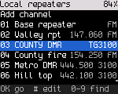

Changing the channel ends temporary changes, the reply window, digital monitor and a scan.

## Changing the zone

- Press **Next zone** or **Previous zone** ([Key roles](23-radios.md#key-roles) shows which keys these are on your
  radio). The radio shows "Zone:" and the name.
- Or press **OK**, **4** (Zones). The list opens with the current zone focused ("here"). Focus another zone and press
  **OK**. The radio switches to it and returns to Home.
- Or type the zone's name on Home. Find lists zones too.

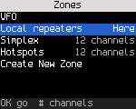

The Zones list shows the VFO first, then every zone with its number of channels. Type letters to filter it.

## Editing a zone

A zone's list (**OK**, **4**, focus the zone, **#**) also edits the zone. Each change is saved at once: there is
nothing to save or discard. On a radio without **#**, hold **OK** wherever this section says **#**.

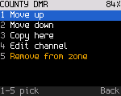

- **Add channel** (the first row) lists every channel the zone doesn't hold. Type letters or digits to filter it and
  press **OK** on one. It goes after the channel you are on, or at the end of a zone you are not using.
- **#** on a channel opens its actions:

  | Key | Action | Does |
  |---|---|---|
  | 1 | Move up | swaps it with the channel above. The menu stays open, so press **1** again to move it on |
  | 2 | Move down | swaps it with the channel below |
  | 3 | Copy here | opens a copy at the lowest free channel number, named with " 2" added. Change what differs and hold **OK**: the copy is saved and put after the channel in this zone |
  | 4 | Edit channel | opens the channel's settings ([Editing a channel](#editing-a-channel)) |
  | 5 | Remove from zone | takes it out of this zone. The channel stays in Channels and in any other zone |

- **Zone options** (the last row):

  | Key | Action | Does |
  |---|---|---|
  | 1 | Rename | type the new name and press **OK** |
  | 2 | Copy as new zone | makes a new zone with the same channels, named with " 2" added |
  | 3 | Delete zone | asks first, with "No, keep it" focused. The zone's channels stay in Channels |

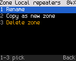

Moving, adding and removing keep the radio on its channel. Removing the channel you are on moves the radio to the
next channel in the zone. A zone holds a channel once, and the radio refuses a channel past the zone's size ("Zone
full"). A radio whose codeplug has no zones shows one zone, "All channels"; the first change saves it as a real zone.

Deleting the zone you are using moves the radio to the zone that comes after it in the list (or the one before, when
it was last). Dual watch keeps watching a channel from a deleted zone when another zone holds it, and otherwise
stops. A zone marked for roaming loses the mark when it is deleted; the other marks stay on their zones.

## Every channel

**OK**, **5** (Channels) lists every channel in the codeplug by number and name, whichever zones hold it. Each
row ends with the RX frequency and the talkgroup (DMR) or FM. A long name stays whole and the row shortens the rest:
"TG" goes first, then the frequency. The channel you are on is marked. Type letters to filter the list.

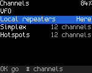

- **OK** on a channel opens its settings, where you can change them (below).
- **#** in the list goes to the channel: in the current zone if it holds it, otherwise in the first zone that does.
  A channel in no zone says "Not in any zone".
- The first row, **New from current**, starts a new channel from what the radio uses now (below).

## Editing a channel

The channel's page lists every setting: name, mode, RX and TX frequency, power, RX only, then bandwidth, tones and
VOX on FM, or color code, timeslot, TX contact, RX group list, own ID, direct mode, talk permit beeps and talker
alias on DMR, then TX time-out, scan, battery saver and the zones that hold it. The list scrolls.

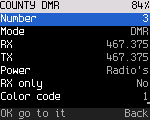

Focus a row and press **OK**:

| Row | What OK does |
|---|---|
| Two choices (mode, timeslot, bandwidth, RX only, scan, VOX, direct mode, beeps, talker alias, battery saver) | switches to the other one |
| Power, RX tone, TX tone, color code, TX time-out | opens a picker: turn the knob (or Up / Down) to the value, **OK** keeps it, **Back** cancels. Color code and time-out also take digits |
| RX, TX, own ID | type the digits, **OK** keeps them, **Back** takes the last digit back. Digits outside the radio's bands are refused as you type. A new RX moves TX with it, so a repeater keeps its offset. If that would put TX outside the radio's bands, TX is set to the new RX |
| Name | opens text entry (below) |
| TX contact, RX group list | opens the list of contacts or group lists; type letters to find one |

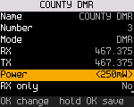

A changed row is marked until you save. **Hold OK** anywhere on the page to save, or pick the **Save** row. The radio
writes the channel in the background and says "Saved channel 3". **Back** with unsaved changes asks whether to
discard them; the answer starts on "No, keep editing". Saving any channel drops the quick-settings changes on the
channel you are on: the radio reloads it from the codeplug.

The radio won't save a channel without a name, with RX outside its bands, with TX where it can't transmit (set RX only
instead), or a DMR channel without a TX contact. It says which.

**Save as new channel** stores the edited copy at the lowest free number and leaves the original as it was.
**Go to it** tunes the channel; save or discard your changes first.

### Text entry

It works like a phone keypad. Keys **2** to **9** type their letters, then the digit, then the letters in the other
case: press **2** once for A, twice for B, four times for 2, five times for a. Press the same key again within a
second for the next character; another key, or a pause, moves on. **1** types punctuation (`. - / , ' & ( ) @ _ ! ?`
and 1), **0** a space, 0, `+`, `#` and `*`. The title shows the mode.

**#** switches the mode: ABC (capitals, the start), then 123 (each key types its digit), then abc (lower case), then
back to ABC. Holding a digit key types the digit in any mode. **Back** deletes the last character (**\*** does too).
**OK** keeps the name. To leave without changing it, press **Back** until the field is empty and once more. Names hold
up to 16 characters.

On a radio without a keypad, Up / Down change the last character, **OK** adds another, and holding **OK** keeps the
name.

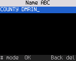

### New channel from current settings

**OK**, **5**, then the first row, **New from current**. It opens an unsaved copy of the channel you are on, with any
quick-settings changes, or of the VFO, at the lowest free channel number. The name gets " 2" added (from the VFO, the
frequency). Change what differs, then hold **OK** to save it. A new channel is in no zone yet: add it to one with **Add channel** in the
zone's list ([Editing a zone](#editing-a-zone)), or use **Copy here** there to make the copy and add it in one step.

## Saving changes to a channel

Change power, squelch, tone, bandwidth, timeslot, color code or mode with quick settings. Then hold **OK** on Home or
in quick settings. The radio writes the channel in the background and shows "Saved to channel". The squelch is saved
as the radio's default squelch, not in the channel.

A save that fails shows "Couldn't save: ..." and the change stays for now only.

## The VFO

The VFO is an FM VFO or, on a radio with DMR, a DMR VFO. It keeps its mode like its frequency. Everything you change in
the VFO (mode, color code, timeslot, talk target) is kept, also when you go to a channel and come back, and after a
restart.

1. **OK**, **4** (Zones). The VFO is the first row.
2. Press **OK**. Home shows the frequency large, and the radio says "VFO: type a frequency".

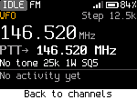

### Copy a channel to the VFO

To start from a channel, press **\***, **4** ("To VFO") on it. The channel's settings become the VFO's and Home shows
the VFO ("Copied to VFO"). On a radio with a **VFO/MR** key, hold it instead. **Settings > Keys** can give any side
key "Copy to VFO", on a press or a hold.

| Copied | Notes |
|---|---|
| RX and TX frequency | A repeater's offset stays until you step the frequency |
| Mode, bandwidth, power | Power stays "default" if the channel's is |
| Tones (FM) | CTCSS or DCS, RX and TX |
| Color code, timeslot, talk target (DMR) | The talk target is the contact's ID, as a group or private call. A channel with no contact gives what it would send now |

- The VFO gets what is in effect now, so a temporary change you made on the channel (a bandwidth, a power level, a
  talk target) is copied too.
- The channel stays as it was. The VFO keeps the values like its other settings, also after a restart.
- Not copied: the RX group list, the privacy key, roaming, the data and emergency settings, and the squelch level.
  The VFO uses the radio's own values for these.
- A channel the VFO can't hold is refused with a short message and nothing changes: a DMR channel on a radio build
  whose VFO is FM only (or the other way round), or a frequency outside the radio's bands.
- In the VFO the same key says "Already in VFO".

### Typing a frequency

On Home in the VFO, type the frequency digits from the hundreds of MHz down, without a decimal point. The radio shows
what you typed as you go.

| Keys | Frequency |
|---|---|
| **4** **4** **6** **0** **0** **0** | 446.000 MHz |
| **1** **4** **6** **5** **2** | 146.520 MHz |
| **4** **6** **1** **8** **6** **2** **5** | 461.8625 MHz |
| **0** **8** **8** **1** | 88.100 MHz (below 100 MHz, start with **0**) |

- Type at least the three MHz digits, then press **OK** (or **#** where the radio has that key) to tune.
- **Back** deletes the last digit.
- A digit that can't lead to a frequency in the radio's bands is refused, and the radio shows the bands. The bands
  depend on the radio ([Radio reference](23-radios.md)).
- Up to eight digits (10 Hz). After 10 s without a key, the entry is dropped.

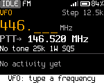

### Stepping

**Up**, **Down** and the channel knob change the VFO frequency by its step. The step is **Settings > Talk > VFO step**. Its
default, **Auto**, follows the width: 25 kHz at 25K (and in AM), 12.5 kHz at 12.5K, and the FM broadcast step in the
broadcast band. The step is in the status strip.

### DMR in the VFO

**\***, **4** in the VFO switches it between FM and DMR on the same frequency ("VFO: DMR"). In DMR the quick settings are the
DMR ones:

| Key | Tile | What it does in the DMR VFO |
|---|---|---|
| **2** | Slot | Switches the timeslot, 1 or 2 |
| **3** | Color | Sets the color code, 0 to 15 (1 at first). Type it or use **Up** and **Down**, then **OK** |
| **8** | Talk to | Picks or types the talk target, a talkgroup or a person. Both **OK** and holding **OK** keep it for the VFO |

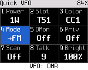

- Pick the color code and timeslot of the repeater or the simplex frequency you use. The radio talks to talkgroup 9 until
  you pick another target, with your own DMR ID.
- The VFO has no listen list. It plays calls to its talk target, all calls and private calls to you. Other talkgroups
  show as "Other TG: not played". To hear everything on the slot, turn on digital monitor.
- Home shows the frequency, the talk target, the timeslot and the color code. Changes here don't show a dot and
  **Back** doesn't undo them.
- The DMR VFO sends data messages and can start an emergency, as a DMR channel does. It sends no talker alias.

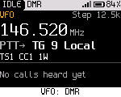

### Leaving the VFO

Press **OK**, **4**, then **OK** on the VFO row again ("Back to channels"). Or pick a zone or channel.

## Air band and FM broadcast

Some radios also receive the aircraft band in AM and FM broadcast stations ([Radio reference](23-radios.md)). There is
no mode to pick and no menu: the frequency decides.

| Tune to | You hear |
|---|---|
| 108 to 137 MHz | Air band, in AM. Home shows "Air Band AM" and the squelch level, and "AM" in place of "FM" |
| The broadcast band (65 to 108 MHz on most receivers) | FM broadcast, on the radio's broadcast receiver. Home shows "Broadcast FM" |

Tune there in the VFO (type **1** **1** **8** **1**, or **0** **8** **8** **1**, and press **OK**), or program an FM
channel on the frequency in the codeplug. Both are receive only: PTT shows "Air band: receive only" or "Broadcast: receive
only" and the radio doesn't transmit. Sub-audio tones are ignored.

In the air band the squelch works as on any FM channel. A broadcast station plays whatever the squelch level, so a
fading station isn't cut, and the screen and LED show it is receiving. The squelch only stops a scan on a station:
while a scan runs, the broadcast band is quiet between stations.

In the broadcast band the knob and **Up** / **Down** step 200 kHz, landing on the odd tenths (88.1, 88.3 ... 107.9)
where stations are in the Americas. For 100 kHz steps set **Settings > Talk & listen > FM broadcast step** to 100 kHz.
Either way you can type any frequency, 90.2 for example. In the air band **Auto** steps 25 kHz; set the VFO step to
8.33 kHz for the narrow channels.

## Channels the radio can't use

Channels outside the radio's bands don't transmit ("Outside ..."). Receive-only channels show "RX only" as the talk
target.
