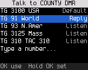
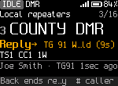
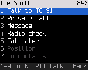
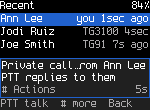
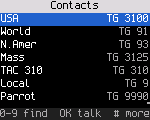
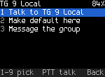
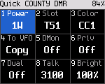
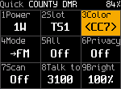

<!-- SPDX-License-Identifier: MIT -->

# DMR

The [Radio reference](23-radios.md) says which radios have DMR verified. DMR voice needs the codec
([Installing](02-installing.md)) and a DMR ID in the codeplug.

## Terms

| Term | Meaning |
|---|---|
| Talkgroup (TG) | A DMR group number with an optional name |
| Contact | A person: DMR ID, name, callsign |
| Talk target | Where **PTT** goes now: a talkgroup, a person, or all call |
| Listen list | The talkgroups a channel listens to (the codeplug's RX group list) |
| Recent | Stations heard and calls made, newest first |
| Hear all | Play every talkgroup on this timeslot (promiscuous mode) |
| Timeslot (TS) | One of the two time slots of a DMR channel |
| Color code (CC) | A number from 0 to 15 that a DMR channel uses, like a tone on FM |

## Who you hear

The radio plays a group call when one of these is true:

- its talkgroup is the talk target's talkgroup, or the call is an all call;
- its talkgroup is in the channel's listen list;
- it is the reply target during the reply window ([below](#replying));
- hear all is on.

The radio plays a private call addressed to your DMR ID. It shows every other call on the slot as "Other TG: not
played" and treats the channel as busy while it lasts.

## Who you talk to

**PTT** sends to, in this order:

1. The talkgroup or person with the focus in a list, once (one-shot).
2. The reply target, while the reply window runs.
3. A talk target chosen for now.
4. The channel's talk target from the codeplug. A channel without one uses talkgroup 9.

Home shows the result after "PTT→".

## Choosing a talk target

Hold **#** on a DMR channel to open the talk target picker: the channel's default, the reply target, the RX group
list's talkgroups, recent talkgroups, and "Type a number..." to dial an ID or talkgroup by hand. The **Talk target**
side key opens the same picker.

A talk target has three lifetimes.

| Lifetime | How | Lasts |
|---|---|---|
| Once | Focus a talkgroup or person in any list (Contacts, Recent, Find, the picker, actions) and press **PTT** | This call and its reply window |
| For now | Focus it and press **OK**. The radio shows "Talking to ..." | Until you change the channel or press **Back** on Home |
| Permanent | Focus it and hold **OK**. The radio shows "... is the default now" | Written to the channel |

A permanent talk target must be a contact in the codeplug. A typed number is used for now only. The radio shows
"Not a stored contact: for now only".

### The talk target picker

Press **Talk target** on a DMR channel (or **\***, **8**). The picker lists, in order:

| Row | Tag |
|---|---|
| The channel's talk target | default |
| The last call heard: its talkgroup, or the caller for a private call | reply |
| The talkgroups of the channel's listen list | listen |
| Talkgroups from Recent | recent |
| Type a number... | |

The focus starts on the reply row when there is one.

| Key | Does with the focused row |
|---|---|
| **PTT** | Talks to it once |
| **OK** | Uses it for now |
| Hold **OK** | Makes it the channel's default |
| **#** | Opens its actions |

"Type a number..." opens Find. Type the talkgroup or ID, focus the line you want and press **PTT** or **OK**.



On an FM channel **Talk target** shows "Talk target: DMR channels only".

### Typing a talkgroup or ID

On Home, type the number. Find lists "Talk to TG 3100" and "Private call 3100" (with a name when the ID is a contact).
Focus one and press **PTT** for one call, or **OK** for now.

## Replying

After a call the radio played, the reply window opens. During the window **PTT** answers the call. A group call is
answered on the same talkgroup, a private call to the caller. After your own call, **PTT** goes to the same target again. Home shows "Reply→" with
the target and a countdown.



The window lasts as long as **Settings > Talk & listen > Reply window** says (0 to 30 s). 0 turns it off. When that
setting is left at its start value, the codeplug's hang time applies. Without a hang time in the codeplug, the window
lasts 10 s. **Back** on Home ends the
window ("Reply ended").

## Calling back later

On Home, **#** opens the actions for the current or last caller. A digit picks an action.



| # | Action | What it does |
|---|---|---|
| 1 | Talk to | Talks to the talkgroup they were heard on, for now. After a private call, talks to them. **PTT** on this row talks once |
| 2 | Private call | Calls them privately, for now. **PTT** on this row calls them once |
| 3 | Message | Opens the message composer ([Messages](09-messages-and-signaling.md)) |
| 4 | Radio check | Checks that their radio is on and in range |
| 5 | Call alert | Pages their radio |
| 6 | Position | Not built yet |
| 7 | Save as contact | Not built yet. Add contacts in qdmr |
| 8 | Speak status | Not built yet |
| 9 | Save to channel | Shown only when the channel has temporary changes |

For a talkgroup the actions are Talk to, Make channel default and Message.

Without anyone heard yet, **#** shows "No calls heard yet".

## Recent

**OK**, **3**. Recent lists the last 12 stations heard and calls made, newest first. Calls you made
start with an arrow. Calls to you are highlighted, and private calls show "you" or "priv". Recent is kept in memory
and starts empty after a restart.



**PTT** talks to the focused entry (the talkgroup a station was heard on). **OK** uses it for now. Holding **OK** makes
it permanent. **#** opens its actions.

## Contacts

**OK**, **1** lists the codeplug's contacts and talkgroups. Type letters of the name, or digits of the ID, to filter.
**OK** talks to the focused entry for now. Holding **OK** makes it the channel's default. **PTT** talks to it once.
**#** opens its actions.




Contacts can't be added or edited on the radio yet. Use qdmr.

## Private calls

- From a contact: **OK**, **1**, find the person, **#**, **2** (Private call), then **PTT**. Or focus the person and
  press **PTT**.
- By ID: type the ID on Home, focus "Private call ..." and press **PTT**.
- To answer a private call, press **PTT** during the reply window.

While you talk, the top line says "Private" and the screen shows the contact's name
([Transmitting](05-home-screen.md#transmitting)).

## Timeslot and color code

On a DMR channel, **\*** opens these tiles:



| Key | Tile | What it does |
|---|---|---|
| **1** | Power | Steps through the radio's lowest level, its default and its highest ([power levels](16-battery-and-power.md#transmit-power)) |
| **2** | Slot | Switches between timeslot 1 and 2, for now |
| **3** | Color | Opens the color code editor |
| **4** | Mode | Listen and talk in FM on the same frequencies, for now |
| **5** | All | Hear all on or off |
| **6** | Privacy | Privacy on or off |
| **7** | Scan | Scan on or off |
| **8** | Talk to | Opens the talk target picker |
| **9** | Bright | Opens the brightness editor |
| **0** | | Opens Settings |

To change the color code, press **\***, **3**. Press **Up** or **Down**, or type the code (0 to 15). Press **OK** to
apply it. The new
color code takes effect when the editor closes.



Timeslot, color code and mode are temporary. They can't be changed while transmitting or in the VFO. Hold **OK**
to save them to the channel.

## Hear all

- Hold **Monitor**. The radio plays every talkgroup on this frequency and timeslot while you hold it.
- **\***, **5** latches hear all on. The radio shows "Hear all: every talkgroup", and the chips show "All". Hear all
  stays on until you turn it off, change the channel or the mode, or press **Back** on Home.

While hear all is on, the reply window lets you answer any call you heard with **PTT**.

## Privacy

ODR has two kinds of basic privacy: Motorola basic privacy (keys 1 to 255) and Anytone 16-bit basic privacy. Basic
privacy is a fixed scrambling of the voice. It keeps casual listeners out but isn't encryption. The scrambling hasn't
been checked against another radio yet ([Radio reference](23-radios.md)).

- The radio plays an encrypted call only when it has the matching key. Without the key the call shows as
  "Encrypted: not played".
- Calls with stronger encryption (they send a PI header) are never played.
- **\***, **6** turns privacy on for your calls ("Privacy on for now"). Home shows "Priv". **Back** on Home turns it
  off again.

To set the key on the radio, open **Settings > Privacy** (**OK**, **6**, **4**).

1. On **Key type**, press **OK** until it shows Motorola or Anytone.
2. On **Key**, press **OK**. Type the key in decimal with the number keys (Motorola 1 to 255, Anytone 0 to 65535).
   Press **OK** again.

The radio keeps the key across restarts. Setting the type back to Off removes the key and turns privacy off. qdmr
can't write privacy keys yet. Developers can also load a key over USB with the debug tool:

```
tools/odr_debug.py radio privacy moto 5          # Motorola basic privacy, key 5
tools/odr_debug.py radio privacy anytone 4660    # Anytone basic privacy, key 4660
tools/odr_debug.py radio privacy off
```

Without a key, the Privacy tile shows "No privacy key: set one in Settings > Privacy". The keys are stored without
protection in the radio's flash.

## Position in calls

Some DMR radios send their position inside a voice call (ETSI GPS Info). When a caller does, the receive screen shows
how far away it is and in which direction, for example "12.3 km NE". When the radio doesn't know your own position,
it shows the caller's coordinates. Recent keeps the distance with the call.

Your own position goes into your calls when **Tools > APRS > Position in DMR calls** is on (off by default) and the
radio knows where it is (see [APRS](17-aprs.md#position)). Every other superframe carries it, taking turns with your
talker alias.

## Talker alias

The receive screen shows the talker alias other radios send, as it arrives. **Settings > Talk & listen > Show talker
alias** turns this off. The radio sends your callsign from the codeplug (8 characters) as your own alias when the
channel's talker alias setting in the codeplug asks for it.

## Roaming

*Built and host-tested, not yet tested on air.*

On a system of DMR repeaters that carry the same talkgroups at different sites, the radio can move to a better
repeater by itself when the one it's on gets weak. You turn roaming on per zone.

1. Put the repeater channels of one system in a zone, each set to the same contact.
2. Pick one of them, then open **Tools > Roaming** and turn on **Roam in this zone**.

While idle, the radio watches the signal of the repeater it's on. When the signal stays below the threshold, the radio
listens to the zone's other sites and moves to the strongest one it can hear. It never moves during a call, a scan or
hotspot use, while you transmit, or in the 3 seconds after a call ends, when a reply may come. Home shows `Roam` next
to the repeater chip, or an amber `Roam?` when the current site is weak. The status strip shows `ROAM` during a search.
A toast says "Moved to" and the new channel's name.

| Row | Does |
|---|---|
| Roam in this zone | Turns roaming on or off for the current zone |
| Roam now | Searches the sites at once |
| Lock to this site | Stays on the current repeater until you unlock (Home shows `Lock`) |
| Site survey | How the repeaters' beacons line up: Synced (default), Per site, or Off |
| Beacon interval | How often the repeaters beacon: 60 s (default), 2, 5 or 10 min, 10 to 30 s, or None |
| Beacon length | How long each beacon lasts: 1 to 10 s (4 s by default) |
| Wake probe | On: the radio briefly keys up a quiet repeater to measure it. This transmits. Off by default |

Many repeater systems make every repeater transmit briefly while idle. This is a "beacon", for example 4 s every
minute, all at the same moment. The radio learns when its repeater's beacons come. During each beacon it hops to a few of
the other sites for under a second each, measures them and comes back. The screens keep showing your repeater. A key
press, **PTT** or a call on the visited site brings it straight back. A call that starts on your repeater while the
radio is away is joined up to about 3 s late, so the radio skips the survey for a while after traffic. When your
repeater gets weak, the radio checks the best site it measured at the next beacon and moves there, usually within a
minute. Set **Beacon interval** and **Beacon length** to match the system (ask its operator). If each repeater beacons
on its own schedule, pick **Per site**. If they don't beacon, pick **None**: the radio then relies on calls it hears.
The screen says "Beacons: learning" until the radio knows the schedule, then "Beacons: surveying".

A site is a repeater channel in the zone (TX and RX frequencies differ) with the same contact as the channel you
picked. When any channel in the zone has the codeplug's Roaming flag set, only flagged channels are sites. You need
at least two sites. Changing channel or zone yourself makes the new channel home.

The threshold (default -105 dBm), the hysteresis (6 dB) and the optional periodic search of the other sites are set
over the debug link for now ([dmr-roaming](../spec/dmr-roaming.md) section 5.1). The debug link also sets the idle
beacon that a hotspot running MMDVM SFR can send for roaming radios (`rpt_beacon`, off by default).
