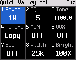
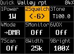

<!-- SPDX-License-Identifier: MIT -->

# FM

FM works on every radio. The [Radio reference](23-radios.md) says which radios have FM verified. Radios that can't send touch tones or detect tones are listed there too.

## Quick settings on an FM channel

Press **\*** on Home. The tiles are laid out like the keypad. A number key acts on its tile directly.

| Key | Tile | What it does |
|---|---|---|
| **1** | Power | Steps through the radio's lowest level, its default and its highest ([power levels](16-battery-and-power.md#transmit-power)) |
| **2** | Squelch | Opens the squelch editor |
| **3** | Tone | Opens the tone editor |
| **4** | Mode | Shows FM. Press it to listen and talk in DMR on the same frequencies, for now |
| **5** | Monitor | Latches the squelch open, or closes it again |
| **6** | VOX | Voice-operated transmit on or off |
| **7** | Dual | Dual watch on or off |
| **8** | Width | Bandwidth 12.5 or 25 kHz (also in the VFO) |
| **9** | Bright | Opens the brightness editor |
| **0** | | Opens Settings |

**Up** and **Down** move between the tiles. **OK** acts on the focused one. Press **\*** or **Back** to close. Every
change is temporary. Hold **OK** to save it to the channel.

On radios with a **Power level** key, that key also steps the power on Home, one level per press through all of the
radio's levels.

## Squelch

1. **\***, **2**. The squelch editor opens.
2. Press **Up** or **Down**, or a number key from **0** to **9**. The change is live, so you hear it.
3. Press **OK**, **\*** or **Back** to close.

The squelch level shows on Home as "SQ" and a number. The radio-wide default is in **Settings > Talk & listen >
Default squelch** (5 unless changed).

## Monitor

- Hold **Monitor** to open the squelch while you hold it. The status line shows RX and MON, and the LED is green.
- **\***, **5** latches the monitor on until you turn it off with **\***, **5** again.

## Tones (CTCSS and DCS)

1. **\***, **3**. The tone editor opens on the transmit tone. The radio shows "Up/Dn tone  # TX/RX".
2. Press **Up** or **Down** to step through the CTCSS tones and DCS codes. The change is live.
3. Press **#** to choose which tone you edit: both receive and transmit, transmit only, or receive only. The editor
   starts on both when they are the same.
4. Press **OK** or **\*** to close.

With a DCS code, the radio stays on the air for 0.3 s after you release PTT and sends the DCS turn-off tone.
Radios set to the same code close their squelch on it, so they don't hear a noise burst at the end.

Home shows the tone as a chip, for example "T100.0".

| Chip | Meaning |
|---|---|
| T | A transmit tone that differs from the receive tone |
| R | A receive tone without a transmit tone |
| No tone | No tone |

## Bandwidth

**\***, **8** switches between 12.5 and 25 kHz. Home shows "12.5k" or "25k".

## To VFO

**\***, **4** copies the channel to the VFO and opens it ("Copied to VFO"). A channel has no temporary mode change. To
try a frequency as DMR, copy it to the VFO and switch the VFO's mode there ([the VFO](07-channels-zones-vfo.md#copy-a-channel-to-the-vfo)).

## VOX

**\***, **6** turns VOX on for FM channels ("VOX on: speak to transmit"). The radio transmits when you speak and
stops 1.5 s after you stop. Received audio never keys it, and **PTT** works as usual. The sensitivity has no menu
item yet. Which radios have VOX is in the [feature matrix](../feature-matrix.md).

## Busy channel lockout, roger beep, tone burst

The radio core has busy channel lockout, a roger beep and a 1750 Hz tone burst for repeater access. There is no menu
item or key for them yet. Developers set them over the debug link.

## Transmit timeout

The radio stops transmitting after the transmit timeout and shows "TX time-out reached". A channel's own timeout from
the codeplug wins. When it is 0, **Settings > Talk & listen > TX timeout** applies (3 minutes unless changed). A
warning beep sounds 10 s before the timeout.

## Touch tones (DTMF)

Hold **PTT** on an FM channel and press **0** to **9**, **\*** or **#**: the radio sends that key's touch tone for as
long as you hold the key, and at least 0.1 s for a quick tap. The microphone is muted while a tone plays. Keys pressed
quickly one after another each send their own tone with a short pause between them. The second line of the transmit
screen shows "DTMF" and the last digits sent.

- A radio with extra keypad keys can send A to D ([Radio reference](23-radios.md)).
- Locked keys send nothing.
- On a DMR channel the keys do nothing while you transmit.
- During a 1750 Hz burst or the roger beep the keys do nothing.
- When the radio transmits on its own (an APRS beacon), or refuses to transmit ("NO TX"), the keys work as usual.

Stored DTMF codes and touch tone decoding are not built yet.
