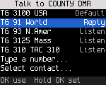
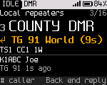
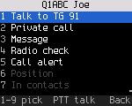
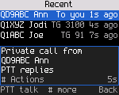
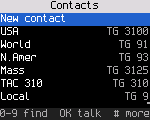
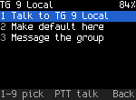
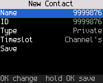
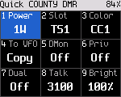
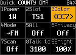

<!-- SPDX-License-Identifier: MIT -->

# DMR

The [Radio reference](23-radios.md) says which radios have DMR verified. DMR voice needs the codec
([Installing](02-installing.md)) and a DMR ID in the codeplug.

## Terms

| Term | Meaning |
|---|---|
| Talkgroup (TG) | A DMR group number with an optional name |
| Contact | A person: DMR ID, name, callsign |
| Talk target | Where **PTT** goes now: a talkgroup, a person, or all call |
| Listen list | The talkgroups a channel listens to (the codeplug's RX group list) |
| Recent | Stations heard and calls made, newest first |
| Digital monitor | Play every call on this frequency: any talkgroup, timeslot or color code (promiscuous mode) |
| Timeslot (TS) | One of the two time slots of a DMR channel |
| Color code (CC) | A number from 0 to 15 that a DMR channel uses, like a tone on FM |

## Who you hear

The radio plays a group call when one of these is true:

- its talkgroup is the talk target's talkgroup, or the call is an all call;
- its talkgroup is in the channel's listen list;
- it is the reply target during the reply window ([below](#replying));
- digital monitor is on.

The radio plays a private call addressed to your DMR ID. It shows every other call on the slot as "Other TG: not
played" and treats the channel as busy while it lasts.

Transmitting keeps the channel's color code even while listening on any color code.

Unless digital monitor is on, a repeater channel hears only its own timeslot. A call the radio joins partway
through shows that call's caller and talkgroup, never those of a call on the other timeslot or of an earlier call.

## Who you talk to

**PTT** sends to, in this order:

1. The talkgroup or person with the focus in a list, once (one-shot).
2. The reply target, while the reply window runs.
3. A talk target chosen for now.
4. The channel's talk target from the codeplug. A channel without one talks to the first talkgroup of its RX group
   list, and uses talkgroup 9 only when it has no list either.

Home shows the result after "PTT→".

## Choosing a talk target

Hold **#** on a DMR channel to open the talk target picker: the channel's default, the reply target, the RX group
list's talkgroups, recent talkgroups, and "Type a number..." to dial an ID or talkgroup by hand. The **Talk target**
side key opens the same picker.

A talk target has three lifetimes.

| Lifetime | How | Lasts |
|---|---|---|
| Once | Focus a talkgroup or person in any list (Contacts, Recent, Find, the picker, actions) and press **PTT** | This call and its reply window |
| For now | Focus it and press **OK**. The radio shows "Talking to ..." | Until you change the channel or press **Back** on Home |
| Permanent | Focus it and hold **OK**. The radio shows "... is the default now" | Written to the channel |

A permanent talk target must be a contact in the codeplug. A typed number is used for now only. The radio shows
"Not a stored contact: for now only".

### The talk target picker

Press **Talk target** on a DMR channel (or **\***, **8**). The picker lists, in order:

| Row | Tag |
|---|---|
| The channel's talk target | default |
| The last call heard: its talkgroup, or the caller for a private call | reply |
| The talkgroups of the channel's listen list | listen |
| Talkgroups from Recent | recent |
| Type a number... | |
| Select contact... | |

The focus starts on the reply row when there is one.

| Key | Does with the focused row |
|---|---|
| **PTT** | Talks to it once |
| **OK** | Uses it for now |
| Hold **OK** | Makes it the channel's default |
| **#** | Opens its actions |

"Type a number..." opens Find. Type the talkgroup or ID, focus the line you want and press **PTT** or **OK**.

"Select contact..." opens [Contacts](#contacts), every contact and talkgroup in the codeplug. Turn the knob, or press
**Up** and **Down**, to go through them, or type letters of the name or digits of the ID to find one. The keys are the
picker's. **Up** from the top goes to the last contact.



On an FM channel **Talk target** shows "Talk target: DMR channels only".

### Typing a talkgroup or ID

On Home, type the number. Find lists "Talk to TG 3100" and "Private call 3100" (with a name when the ID is a contact).
Focus one and press **PTT** for one call, or **OK** for now.

On a trunked channel, Find also lists "Phone call 5551234" last: **PTT** on it calls that number through the system's
telephone gateway (the system refuses it when it has none). A call from the telephone network shows the caller's
number, or "Phone line" when the system didn't send one.

## Replying

After a call the radio played, the reply window opens. During the window **PTT** answers the call. A group call is
answered on the same talkgroup, a private call to the caller. After your own call, **PTT** goes to the same target again. Home shows "Reply→" with
the target and a countdown.



The window lasts as long as **Settings > Talk & listen > Reply window** says (0 to 30 s). 0 turns it off. When that
setting is left at its start value, the codeplug's hang time applies. Without a hang time in the codeplug, the window
lasts 10 s. **Back** on Home ends the
window ("Reply ended").

## Calling back later

On Home, **#** opens the actions for the current or last caller. A digit picks an action.



| # | Action | What it does |
|---|---|---|
| 1 | Talk to | Talks to the talkgroup they were heard on, for now. After a private call, talks to them. **PTT** on this row talks once |
| 2 | Private call | Calls them privately, for now. **PTT** on this row calls them once |
| 3 | Message | Opens the message composer ([Messages](10-messages-and-signaling.md)) |
| 4 | Radio check | Checks that their radio is on and in range |
| 5 | Call alert | Pages their radio |
| 6 | Position | Not built yet |
| 7 | Save as contact | Opens New Contact with their ID and name ([Contacts](#contacts)). "In contacts" when they are one |
| 8 | Speak status | Not built yet |
| 9 | Save to channel | Shown only when the channel has temporary changes |
| last | Poll short data | Shown only on a trunked channel. Asks their radio for its short data; the answer arrives as a message. "Poll: no short data" when none comes |

For a talkgroup the actions are Talk to, Make channel default and Message, and 4 Save as contact when it isn't a contact.

Without anyone heard yet, **#** shows "No calls heard yet".

## Recent

**OK**, **3**. Recent lists the last 12 stations heard and calls made, newest first. Calls you made
start with an arrow. Calls to you are highlighted, and private calls show "you" or "priv". Recent is kept in memory
and starts empty after a restart.



**PTT** talks to the focused entry (the talkgroup a station was heard on). **OK** uses it for now. Holding **OK** makes
it permanent. **#** opens its actions.

## Contacts

**OK**, **1** lists the codeplug's contacts and talkgroups, all of them. Type letters of the name, or digits of the ID,
to filter. Contacts are for the talkgroups and people you call; the [ID database](04-programming.md#dmr-id-database-and-contacts-from-radioidnet)
names everyone else.
**OK** talks to the focused entry for now. Holding **OK** makes it the channel's default. **PTT** talks to it once.
**#** opens its actions.




### New contact

Make a contact on the radio from Contacts, a number or a call:

- In Contacts (**OK**, **1**), the first row is **New contact**. Press **OK**, then type the name and the ID and pick
  the type.
- On Home, type the ID or talkgroup. Find's last row is "Create contact 3100" when no contact has that number. Press
  **OK**. Up to 6 digits start as a talkgroup, 7 and more as a person.
- In a caller's or talkgroup's actions (**#**), pick **Save as contact**.



| Row | **OK** does |
|---|---|
| Name | Type the name with the keypad ([text entry](07-channels-zones-vfo.md#text-entry)) |
| ID | Type the ID. **Back** takes back a digit, **OK** keeps it |
| Type | Talkgroup or Private |
| Timeslot | Channel's, TS 1 or TS 2 |
| Save | Saves it. Holding **OK** on any row saves too |

The radio refuses a contact that is already there ("Already a contact: ..."). Editing or deleting a stored contact is
not built yet: use qdmr. A codeplug write from a CPS replaces the contacts you made on the radio, so read the codeplug
into the CPS first.

## Private calls

- From a contact: **OK**, **1**, find the person, **#**, **2** (Private call), then **PTT**. Or focus the person and
  press **PTT**.
- By ID: type the ID on Home, focus "Private call ..." and press **PTT**.
- To answer a private call, press **PTT** during the reply window.

While you talk, the top line says "Private" and the screen shows the contact's name
([Transmitting](06-home-screen.md#transmitting)).

## Timeslot and color code

On a DMR channel, **\*** opens these tiles:



| Key | Tile | What it does |
|---|---|---|
| **1** | Power | Steps through the radio's lowest level, its default and its highest ([power levels](16-battery-and-power.md#transmit-power)) |
| **2** | Slot | Switches between timeslot 1 and 2, for now |
| **3** | Color | Opens the color code editor |
| **4** | Mode | Shows DMR. Press it to listen and talk in FM on the same frequencies, for now |
| **5** | DMon | Digital monitor on or off |
| **6** | Privacy | Privacy on or off. In the VFO this tile is TX freq ([Split](07-channels-zones-vfo.md#split-repeater-offset)) |
| **7** | Dual | Dual watch on or off |
| **8** | Talk to | Opens the talk target picker |
| **9** | Bright | Opens the brightness editor |
| **0** | | Opens Settings |

To change the color code, press **\***, **3**. Press **Up** or **Down**, or type the code (0 to 15). Press **OK** to
apply it. The new
color code takes effect when the editor closes.



Timeslot and color code are temporary. They can't be changed while transmitting. Hold **OK**
to save them to the channel. In the VFO they are the VFO's own settings and are kept ([the VFO](07-channels-zones-vfo.md#dmr-in-the-vfo)).

## Waking a repeater

A repeater that is idle may need a wake-up before it carries your call. On a repeater channel (TX and RX frequencies
differ) the radio sends the wake-up when you press **PTT** and then waits for the repeater to answer. A short press is
enough: let go of **PTT** and the radio keeps trying, up to the usual number of attempts.

| What you hear | Meaning |
|---|---|
| The talk permit tone (if it is on) | The repeater answered. If you were still holding **PTT**, the call starts. If not, nothing more is sent, and you can press **PTT** again |
| The low error tone | No repeater answered. Check the color code and your range |

## The talk permit tone

The talk permit tone tells you the radio has the channel and you can talk. Turn it off for every channel in
**Settings > Sound > Talk permit tone**, or for one channel with the channel's **Talk permit beeps** field.

Most radios play two short beeps as your voice goes on air. A radio whose beeps would be transmitted plays one short
beep just before it transmits instead ([the radio's notes](23-radios.md)):

| Screen | What happens |
|---|---|
| WAKING RPT | On a repeater channel, the radio wakes the repeater (as above) |
| ADMITTED | The channel is yours: the beep plays while the radio is still receiving |
| TALKING | The radio transmits. Start talking |

The wait for the beep is under half a second. Releasing **PTT** during it cancels the call.

The beep at the end of a call you hear is the call end tone. The channel's **Talk permit beeps** field turns it off too.

## Digital monitor

Digital monitor plays every call on this frequency: any talkgroup, either timeslot, any color code. It plays one
call at a time, the first it hears, until that call ends. The call screen shows the call's timeslot, and its color code
when it differs from the channel's ("TS2 CC7"). To talk to them, set the channel to that timeslot and color code
(**\***, **2** and **\***, **3**).

- Press **Monitor** on a DMR channel (a short press; it acts when you let go). The radio shows "Digital monitor on" and
  the chips show "DMon". Press it again to turn it off. On an FM channel the same key opens the squelch while you hold it.
- Or **\***, **5**.

Digital monitor stays on until you turn it off, change the channel or the mode, or press **Back** on Home. A
[scan](12-scan.md) started with it on keeps it on at every channel. While it
is on, the reply window lets you answer any call you heard with **PTT**. **PTT** always sends on the channel's
timeslot and color code, so a call heard on another one doesn't hear the reply. While digital monitor plays a call on
the other timeslot, the channel counts as busy.

## Privacy

RadioFoundry has two kinds of basic privacy: Motorola basic privacy (keys 1 to 255) and Anytone 16-bit basic privacy. Basic
privacy is a fixed scrambling of the voice. It keeps casual listeners out but isn't encryption. The scrambling hasn't
been checked against another radio yet ([Radio reference](23-radios.md)).

- The radio plays an encrypted call only when it has the matching key. Without the key the call shows as
  "Encrypted: not played".
- Calls with stronger encryption (they send a PI header) are never played.
- Text messages and other data follow the key too. With a Motorola key they are scrambled the same way, and the
  radio reads scrambled data sent with its key. Messages in the **ETSI short** format can't be scrambled, so they
  fail with a Motorola key: use **ETSI** or **Motorola** ([Messages](10-messages-and-signaling.md)). Anytone basic privacy has no form for data, so with an Anytone key
  the radio sends no text messages or other data: a message you send fails. Scrambled data the radio can't read is
  not shown.
- **\***, **6** turns privacy on for your calls ("Privacy on for now"). Home shows "Priv". **Back** on Home turns it
  off again.

To set the key on the radio, open **Settings > Privacy** (**OK**, **7**, **4**).

1. On **Key type**, press **OK** until it shows Motorola or Anytone.
2. On **Key**, press **OK**. Type the key in decimal with the number keys (Motorola 1 to 255, Anytone 0 to 65535).
   Press **OK** again.

The radio keeps the key across restarts. Setting the type back to Off removes the key and turns privacy off. The codeplug
can't hold privacy keys yet. Developers can also load a key over USB with the debug tool:

```
tools/rfoundry_debug.py radio privacy moto 5          # Motorola basic privacy, key 5
tools/rfoundry_debug.py radio privacy anytone 4660    # Anytone basic privacy, key 4660
tools/rfoundry_debug.py radio privacy off
```

Without a key, the Privacy tile shows "No privacy key: set one in Settings > Privacy". The keys are stored without
protection in the radio's flash.

## Position in calls

Some DMR radios send their position inside a voice call (ETSI GPS Info). When a caller does, the receive screen shows
how far away it is and in which direction, for example "12.3 km NE". When the radio doesn't know your own position,
it shows the caller's coordinates. Recent keeps the distance with the call.

Your own position goes into your calls when the radio knows where it is (see [Position](17-settings.md#position))
and one of these asks for it:

| Where | Applies to |
|---|---|
| **Settings > Location > Send in DMR calls** (off by default) | every DMR call |
| The codeplug: a channel's talker alias setting for its timeslot set to APRS or Both | calls on that channel |

The codeplug setting is the one to use when radios are programmed from a computer: nothing has to be set on the radio. This works on a radio without APRS, and on a radio
without a GPS when you set a fixed position. Every other superframe carries it, taking turns with your
talker alias.

## Talker alias

The receive screen shows the talker alias other radios send, as it arrives. **Settings > Talk & listen > Show talker
alias** turns this off. The radio sends your callsign from the codeplug (8 characters) as your own alias when the
channel's talker alias setting in the codeplug asks for it.

## Roaming

On a system of DMR repeaters that carry the same talkgroups at different sites, the radio can move to a better
repeater by itself when the one it's on gets weak. You turn roaming on per zone.

1. Put the repeater channels of one system in a zone, each set to the same contact.
2. Pick one of them, then open **Tools > Roaming** and turn on **Roam in this zone**.

While idle, the radio watches the signal of the repeater it's on. When the signal stays below the threshold, the radio
listens to the zone's other sites and moves to the strongest one it can hear. It never moves during a call, a scan or
hotspot use, while you transmit, or in the 3 seconds after a call ends, when a reply may come. Home shows `Roam` next
to the repeater chip, or an amber `Roam?` when the current site is weak. The status strip shows `ROAM` during a search.
A toast says "Moved to" and the new channel's name.

| Row | Does |
|---|---|
| Roam in this zone | Turns roaming on or off for the current zone |
| Roam now | Searches the sites at once |
| Lock to this site | Stays on the current repeater until you unlock (Home shows `Lock`) |
| Site survey | How the repeaters' beacons line up: Synced (default), Per site, or Off |
| Beacon interval | How often the repeaters beacon: 60 s (default), 2, 5 or 10 min, 10 to 30 s, or None |
| Beacon length | How long each beacon lasts: 1 to 10 s (4 s by default) |
| Wake probe | On: the radio briefly keys up a quiet repeater to measure it. This transmits. Off by default |

Many repeater systems make every repeater transmit briefly while idle. This is a "beacon", for example 4 s every
minute, all at the same moment. The radio learns when its repeater's beacons come. During each beacon it hops to a few of
the other sites for under a second each, measures them and comes back. The screens keep showing your repeater. A key
press, **PTT** or a call on the visited site brings it straight back. A call that starts on your repeater while the
radio is away is joined up to about 3 s late, so the radio skips the survey for a while after traffic. When your
repeater gets weak, the radio checks the best site it measured at the next beacon and moves there, usually within a
minute. Set **Beacon interval** and **Beacon length** to match the system (ask its operator). If each repeater beacons
on its own schedule, pick **Per site**. If they don't beacon, pick **None**: the radio then relies on calls it hears.
The screen says "Beacons: learning" until the radio knows the schedule, then "Beacons: surveying".

A site is a repeater channel in the zone (TX and RX frequencies differ) with the same contact as the channel you
picked. When any channel in the zone has the codeplug's Roaming flag set, only flagged channels are sites. You need
at least two sites. Changing channel or zone yourself makes the new channel home.

The threshold (default -105 dBm), the hysteresis (6 dB) and the optional periodic search of the other sites are set
over the debug link for now ([dmr-roaming](../spec/dmr-roaming.md) section 5.1). The debug link also sets the idle
beacon that a hotspot running MMDVM SFR can send for roaming radios (`rpt_beacon`, off by default).

Polite channel access waits for recent activity to expire before transmitting. A quiet channel becomes available again even if no further bursts arrive.

## Trunked systems

A DMR Tier III trunked system gives out a channel for each call. The radio stays on the system's control channel,
registers there, and goes to the channel the system grants. The system sets the frequency, slot and color code of each
call, so a trunked channel has none of its own.

What has been checked on each radio is in the
[feature matrix](../feature-matrix.md#checked-on-each-radio).

### Setting one up

In the Codeplug Editor ([Programming](04-programming.md#digital-modes-and-systems)):

1. On the **Systems** tab add a system of type DMR Tier III Trunking. Enter its network model, NET, category and color
   code, and its channels with **Control** ticked on the control channels. The system's operator has these values.
2. Make a channel, set its **Mode** to DMR Tier III Trunking and pick the system. Set **TX Contact** to the default
   call destination and **RX Group List** to the talkgroups you want to follow.
3. Put the channel in a zone, with any other channels.

| Setting | Does |
|---|---|
| Transmit | Never (listen only): the radio follows the system and its calls, and never registers or transmits there. Use it until the operator has enabled your radio's ID |
| Needs its key | For a system that authenticates its radios. Enter the key in the form's **Key** section; without it the channel can't be used |
| Radio ID on this system | Your ID there, when it isn't the radio's DMR ID |
| Fallback channel | A conventional channel to use when the system can't be found (below). A channel can name its own, or none |

A channel that is receive only in the editor stays receive only on the system: the radio listens and refuses PTT.

### On the air

Select the channel. Home shows the system's name and what the radio is doing there, in place of slot and color code:

| Home shows | Meaning |
|---|---|
| Searching | Looking for the system's control channel |
| Other system | Looking for the system, and hearing only another one. The line below names what was heard ("Heard: Huge, net 0, site 83"): compare it with the system's network model and network number in the editor |
| Registering | Found; registering with the system |
| Reg. refused | The system doesn't accept this radio, most often because your DMR ID isn't in its records. Ask the system's administrator to add it. The radio keeps asking. PTT says "Registration refused" |
| Ready | On the control channel. Hold **PTT** to call |
| In call | On a channel the system granted, in a call |
| Refused | The system refused the registration. PTT is refused |
| Fallback | No control channel found: on the fallback channel |
| System not set up | The channel's system is missing, has no control channel or lacks its key. The channel is receive only |

If PTT says **Unknown channel N**, the system granted your call on channel N and the system's channel list doesn't
have it. Add channel N with its frequencies; on a site with one carrier, give the control channel the number N. The
number is the one the control channel sends. A site tool or scanner that counts each timeslot as a channel shows
2 × N + 1 and 2 × N + 2 instead (623 and 624 for 311); the radio takes those too.

Hold **PTT**: the radio asks the system for a channel and talks once the system grants it. When the system refuses or
doesn't answer, PTT is refused, and the screen says why: no control channel, another system heard, not registered yet,
denied by the system, or no answer. The talk target is the channel's contact, or one you pick as on any DMR channel
([Choosing a talk target](#choosing-a-talk-target)).

Zone and channel lists name a trunked channel's system where the frequency would be. A channel whose system isn't set
up is dimmed, and channel stepping passes it. Scan passes trunked channels by.

### Fallback

When the radio has found no control channel for the hold time (30 s unless the system sets another), it goes to the
fallback channel and works there as on any channel. While that channel is quiet it looks for the system again every
10 s. When it finds it, it goes back, beeps and says "Back on" with the system's name.

### Stun and kill

A system can disable a radio it no longer trusts. Both are off unless you turn them on for the system (**Accept a
stun**, **Accept a kill**).

| | What happens | Undone by |
|---|---|---|
| Stun | The radio stays on the system and can't call or follow calls there. Kept across power-off | The system's revive, or a factory reset |
| Kill | All DMR stops, on every channel and the hotspot. FM still works. Taken only from a system whose key the radio holds | A factory reset only |

On a system without a key a stun is taken as sent, from any transmitter that sends one: leave **Accept a stun** off
there.
