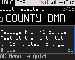
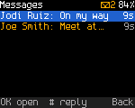
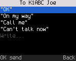
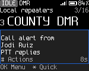
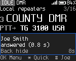

<!-- SPDX-License-Identifier: MIT -->

# Messages, call alert and radio check

Text messages, call alert and radio check work on DMR channels. They are built and pass the host tests, but haven't
been tested on air yet. None of them needs the codec. They need a DMR channel you may transmit on and your DMR ID.

## Receiving a message

When a message arrives, the radio shows a banner with the sender and the first words for 8 s. Press **#** while the
banner is up to open the message. The radio plays a short three-note tone with the banner unless **Settings > Sound >
Message tone** is off.

After the banner, the status line shows "M" and the number of unread messages, and the hub shows "1 new" next to
Messages.

## Reading messages

1. **OK**, **2** (Messages). The newest message is first; unread ones are highlighted.
2. Focus a message and press **OK**. The radio shows the sender, how long ago it arrived and the text, and marks it
   read.
3. Below the text:

   | Row | Does |
   |---|---|
   | Reply "OK" | Sends "OK" to the sender |
   | Reply "On my way" | Sends "On my way" to the sender |
   | Call | Makes the sender the talk target for now |
   | Delete | Deletes the message. There is no undo |

**#** on a message opens the actions for its sender. **PTT** in an open message calls the sender.

The radio keeps the last 4 messages received, in memory. They are lost when the radio turns off.

## Sending a message

1. Open the actions for the person or talkgroup: **#** on Home for the last caller, or **#** on a contact.
2. Press **3** (Message, or "Message the group").
3. Pick a text: "OK", "On my way", "Call me" or "Can't talk now". Press **OK** to send.

The radio shows "Sending to ..." and returns to Home. In the ETSI short and Motorola formats a message to a person asks
for a confirmation and is tried twice; the result comes as a banner: "Delivered to ..." or "No answer from ...", with
"Not delivered: send it again" under it. The message isn't kept for a retry: send it again from the actions. A message
to a talkgroup, and a message in the ETSI format (the default), has no confirmation: the banner says "Sent to ..." once
it has gone out.

Typing your own text isn't built yet: "Write..." is dimmed. Messages you send aren't stored in the radio.

## Message formats

**Settings > Connections > Message format** picks the format of the messages you send. The radio reads all three,
whatever the setting, and a reply goes in the format of the message it answers.

| Format | Use it for |
|---|---|
| ETSI (default) | The standard DMR text message (ETSI IP text). Radios and dispatch software set to "DMR standard" text read it. No delivery confirmation |
| ETSI short | Radios that only show ETSI short data messages. Delivery is confirmed |
| Motorola | MOTOTRBO radios and dispatch software set to Motorola text messages (TMS). Delivery is confirmed. Not in builds made without Motorola TMS support |

If your radio was set up before ETSI became the default and its data settings were saved, it keeps sending Motorola
messages until you change the setting.

## Call alert

A call alert pages another radio: it rings there, even when that radio's user isn't listening to your talkgroup.

1. Open the actions for the person (**#** on Home, or **#** on a contact).
2. Press **5** (Call alert). The radio shows "Call alert to ..." and returns to Home.
3. The radio tries up to 3 times. The result is a banner: "... answered the alert" or "No answer from ...".

When someone sends you a call alert, the radio shows "Call alert from ..." with "PTT replies". Press **#** while the
banner is up for the caller's actions. Your radio acknowledges the alert unless **Settings > Connections > Answer call
alerts** is off.

## Radio check

A radio check asks another radio to answer, without its user doing anything. It shows whether that radio is on and in
range.

1. Open the actions for the person.
2. Press **4** (Radio check). The radio shows "Checking ...".
3. The result is a banner: "... answered (0.8 s)" with the round-trip time, or "...: no answer" with "Off, out of range
   or elsewhere". The radio tries up to 3 times.

Your radio answers radio checks from others only when **Settings > Connections > Answer radio checks** is on. It is off
by default, because an answer makes the radio transmit without you asking.

## Registration (ARS) and location (LRRP)

ARS registers the radio with a presence server at power-up and after a channel change. It is off until a server ID is
set, and there is no menu item for it yet; developers set it over the debug link.

LRRP answers location requests from a dispatcher. The DM-1701 has no GPS, so it answers "no fix". **Settings >
Location > Answer GPS requests** turns the answers off.
