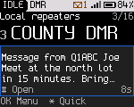
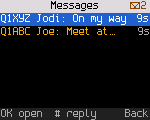
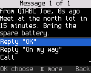
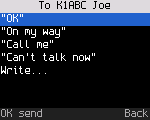
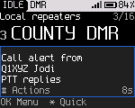
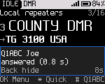

<!-- SPDX-License-Identifier: MIT -->

# Messages, Call Alert and Radio Check

DMR text messages, call alert and radio check work on DMR channels. APRS text messages can also be sent over FM on
builds with an AFSK transmit path. The [Radio reference](23-radios.md) says which radios have each path verified.
None of them needs the codec. DMR sending needs a DMR channel you may transmit on and your DMR ID; APRS sending
needs a valid callsign in **Settings > My radio**, an amateur APRS frequency and a board with AFSK transmit.

## Receiving a message

When a message arrives, the radio shows a banner with the sender and the first words for 8 s. Press **#** while the
banner is up to open the message. The radio plays a short three-note tone with the banner unless **Settings > Sound >
Message tone** is off. On a radio with a vibration motor it also vibrates twice, unless **Settings > Sound > Vibrate**
is off. A call alert or a private call to you gives one long vibration, an emergency four.

After the banner, the status line shows "M" and the number of unread messages, and the hub shows "1 new" next to
Messages.

## Reading messages

1. Press **OK**, **2** (Messages). The newest message is first. Unread messages are highlighted.
2. Focus a message and press **OK**. The radio shows the sender, how long ago it arrived and the text. It marks the
   message read.
3. Below the text:

   | Row | Does |
   |---|---|
   | Reply "OK" | Sends "OK" to the sender |
   | Reply "On my way" | Sends "On my way" to the sender |
   | Call | Makes the sender the talk target for now |
   | Delete | Deletes the message. There is no undo |

**#** on a message opens the actions for its sender. **PTT** in an open message calls the sender.

The radio keeps the last 4 messages received, in memory. They are lost when the radio turns off.

## Sending a message

1. Open the actions for the person or talkgroup. Press **#** on Home for the last caller, or **#** on a contact.
2. Press **3** (Message).
3. Pick a preset ("OK", "On my way", "Call me" or "Can't talk now"), or choose **Write...** to type your own text.
   Press **OK** to send. Presets are sent in the radio's language (Settings > Display > Language).

The radio shows "Sending to ..." and returns to Home. A message to a person asks for a confirmation. When none comes, the radio tries again, in every format. The result
comes as a banner:

| Banner | Meaning |
|---|---|
| "Delivered to ..." | The person's radio confirmed the message |
| "No answer from ...", with "Not delivered: send it again" | No confirmation came. The message isn't kept for a retry. Send it again from the actions |
| "Sent to ..." | A message to a talkgroup has gone out. Talkgroup messages have no confirmation |

With confirmed IP data turned off (`tools/rfoundry_debug.py data ip-settings auto off`), ETSI messages to a person also go
once, with "Sent to".

In **Write...**, use the number keys to enter letters, **#** to switch between ABC, 123 and abc, and **Back** to
delete. A DMR message can hold up to 143 characters. Messages you send aren't stored in the radio.

### Sending over APRS

1. Set **Settings > Connections > Message format** to **APRS**.
2. Open **Messages > New APRS message**. Select **To callsign** and enter the recipient's callsign, with an optional
   SSID (for example, `K1ABC-9`). Press **OK** to keep it.
3. Choose **Request acknowledgment** and **Include position** if needed, then pick a preset or **Write...** and press
   **OK** to send. Both choices apply only to this message. APRS messages hold up to 67 characters. Presets use the
   radio's language; accented letters are sent without accents to keep the AX.25 text printable. The radio queues
   the APRS message on the configured FM frequency. "Sending to ..." means queued, not delivered.

**Request acknowledgment** starts on. The radio retries while waiting for a reply. Turn it off for a one-shot message
that needs no delivery confirmation. **Include position** starts off. When on, the radio adds the current GPS, computer
or fixed position as decimal coordinates to the message text. It refuses to send if no position is available or the
text plus coordinates exceeds 67 characters. The position is part of the message body, not a separate position beacon.

The APRS destination is a callsign, not a DMR ID. Sending is refused if the callsign or text is invalid, another
APRS message is still waiting, or the APRS RF path is unavailable. **Tools > APRS** shows the configured frequency
and any blocking reason. APRS reception and APRS messages in the shared inbox are not available in this flow.

## Message formats

**Settings > Connections > Message format** picks the format of new messages you send. The radio reads all three DMR
formats, whatever the setting. A reply to a DMR inbox message still uses DMR.

| Format | Use it for |
|---|---|
| ETSI (default) | The standard DMR text message (ETSI IP text). Radios and dispatch software set to "DMR standard" text read it. Delivery to a person is confirmed |
| ETSI short | Radios that only show ETSI short data messages. Delivery is confirmed |
| Motorola | MOTOTRBO radios and dispatch software set to Motorola text messages (TMS). Delivery is confirmed. Not in builds made without Motorola TMS support |
| APRS | Addressed AX.25 text over FM to a callsign. Shown only in builds with APRS; selection requires an AFSK transmit path. The APRS engine retries while waiting for an acknowledgment |

If your radio was set up before ETSI became the default and its data settings were saved, it keeps sending Motorola
messages until you change the setting.

## Call alert

A call alert pages another radio. It rings there, even when that radio's user isn't listening to your talkgroup.

1. Open the actions for the person (**#** on Home, or **#** on a contact).
2. Press **5** (Call alert). The radio shows "Call alert to ..." and returns to Home.
3. The radio tries up to 3 times. The result is a banner: "... answered the alert" or "No answer from ...".

When someone sends you a call alert, the radio shows "Call alert from ..." with "PTT replies". Press **#** while the
banner is up for the caller's actions. Your radio acknowledges the alert unless **Settings > Connections > Answer call
alerts** is off.

## Radio check

A radio check asks another radio to answer, without its user doing anything. It shows whether that radio is on and in
range.

1. Open the actions for the person.
2. Press **4** (Radio check). The radio shows "Checking ...".
3. The radio tries up to 3 times. The result is a banner. "... answered (0.8 s)" gives the round-trip time. "...: no
   answer" comes with "Off, out of range or elsewhere".

Your radio answers radio checks from others while **Settings > Connections > Answer radio checks** is on, the default.
An answer is a short transmission the radio makes without you pressing PTT; turn the setting off if you don't want that.

## Registration (ARS) and location (LRRP)

ARS registers the radio with a presence server at power-up and after a channel change. It is off until a server ID is
set. There is no menu item for it yet. Developers set it over the debug link.

LRRP answers location requests from a dispatcher. A radio without GPS ([Radio reference](23-radios.md)) answers "no
fix". **Settings > Location > Answer GPS requests** turns the answers off.
