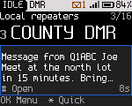
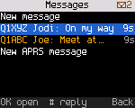
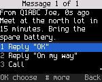
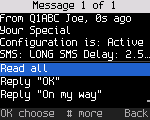
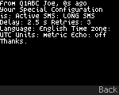
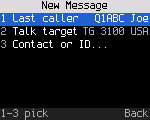
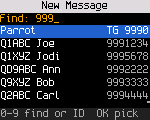
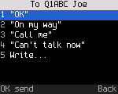
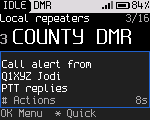
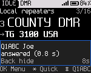

<!-- SPDX-License-Identifier: MIT -->

# Messages, Call Alert and Radio Check

DMR text messages, call alert and radio check work on DMR channels. APRS text messages can also be sent over FM on
builds with an AFSK transmit path. The [Radio reference](23-radios.md) says which radios have each path verified.
None of them needs the codec. DMR sending needs a DMR channel you may transmit on and your DMR ID; APRS sending
needs a valid callsign in **Settings > My radio**, an amateur APRS frequency and a board with AFSK transmit.

## Receiving a message

When a message arrives, the radio shows a banner with the sender and the first words for 8 s. Press **#** while the
banner is up to open the message. The radio plays a short three-note tone with the banner unless **Settings > Sound >
Message tone** is off. On a radio with a vibration motor it also vibrates twice, unless **Settings > Sound > Vibrate**
is off. A call alert or a private call to you gives one long vibration, an emergency four.

After the banner, the status line shows "M" and the number of unread messages, and the hub shows "1 new" next to
Messages.

## Reading messages

1. Press **OK**, **2** (Messages). The first row is **New message** (see [Sending a message](#sending-a-message)).
   The newest message is under it and has the focus. Unread messages are highlighted. With no messages, the list
   shows "No messages yet" and **New message** has the focus.
2. Focus a message and press **OK**. The radio shows the sender, how long ago it arrived and the text. It marks the
   message read.
3. Below the text are the actions. Press a row's number, or focus the row and press **OK**:

   | Key | Row | Does |
   |---|---|---|
   | | Full message | Shows the whole text on its own page. **Up** and **Down** scroll it, **Back** returns. Only when the text is too long for the screen, which ends it with "…" |
   | **1** | Reply "OK" | Sends "OK" to the sender |
   | **2** | Reply "On my way" | Sends "On my way" to the sender |
   | **3** | Call | Makes the sender the talk target for now |
   | **4** | Delete | Deletes the message. There is no undo |

   For example, **OK**, **2**, **OK**, **4** deletes the newest message.

**#** on a DMR message opens the actions for its sender. **PTT** in an open DMR message calls the sender. The Call
action is unavailable for APRS messages, whose sender is a callsign. **#** on an APRS message opens a composer addressed
to that callsign.

The radio keeps DMR and APRS messages in memory. They are lost when the radio turns off.

## Sending a message

From Messages:

1. Press **OK**, **2** (Messages), then **OK** on **New message**.
2. Choose who gets the message:

   | Key | Row | Sends to |
   |---|---|---|
   | **1** | Last caller | The station heard last, by name or ID. Unavailable until a call is heard |
   | **2** | Talk target | Where **PTT** talks now, such as the channel's talkgroup, shown beside the row. DMR channels only |
   | **3** | Contact or ID... | A contact: type letters to find it by name, as in Contacts. To send to a station that isn't a contact, type its ID and pick "Private ID ..." or "TG ..." |

3. The composer opens. Continue at step 3 below. **Back** in the composer returns to Messages.

From a person or talkgroup:

1. Open the actions for the person or talkgroup. Press **#** on Home for the last caller, or **#** on a contact.
2. Press **3** (Message).
3. Pick a preset ("OK", "On my way", "Call me" or "Can't talk now") by its number, or focus it and press **OK**. To
   type your own text, choose **Write...** (**5**), type the text and press **OK** to send. Presets are sent in the
   radio's language (Settings > Display > Language).

The radio shows "Sending to ..." and returns to Home. A message to a person asks for a confirmation. When none comes, the radio tries again, in every format. The result
comes as a banner:

| Banner | Meaning |
|---|---|
| "Delivered to ..." | The person's radio confirmed the message |
| "No answer from ...", with "Not delivered: send it again" | No confirmation came. The message isn't kept for a retry. Send it again from the actions |
| "Sent to ..." | A message to a talkgroup has gone out. Talkgroup messages have no confirmation |

With confirmed IP data turned off (`tools/rfoundry_debug.py data ip-settings auto off`), ETSI messages to a person also go
once, with "Sent to".

In **Write...**, use the number keys to enter letters, **#** to switch between ABC, 123 and abc, and **Back** to
delete. A DMR message can hold up to 143 characters. Messages you send aren't stored in the radio.

### Sending over APRS

1. Open **Messages > New APRS message** when APRS is built and your callsign is set. You can also open **Stations heard**,
   select a station and choose **Message** to fill its callsign.
2. Select **To callsign** and enter the recipient's callsign, with an optional
   SSID (for example, `K1ABC-9`). Press **OK** to keep it.
3. Choose **Request acknowledgment** and **Include position** if needed, then pick a preset or **Write...** and press
   **OK** to send. Both choices apply only to this message. APRS messages hold up to 67 characters. Presets use the
   radio's language; accented letters are sent without accents to keep the AX.25 text printable. The radio queues
   the APRS message on the configured FM frequency. "Sending to ..." means queued, not delivered.

**Request acknowledgment** starts on. The radio retries while waiting for a reply. Turn it off for a one-shot message
that needs no delivery confirmation. **Include position** starts off. When on, the radio adds the current GPS, computer
or fixed position as decimal coordinates to the message text. It refuses to send if no position is available or the
text plus coordinates exceeds 67 characters. The position is part of the message body, not a separate position beacon.

The APRS destination is a callsign, not a DMR ID. A new outgoing message replaces one still awaiting an acknowledgment.
Sending is refused if the callsign or text is invalid or the APRS RF path is unavailable. **Tools > APRS** shows the
configured frequency and any blocking reason. Received APRS messages appear in Messages; replies go over APRS.

## Message formats

**Settings > Connections > Message format** picks the encoding of new DMR messages. The setting does not affect
reception. Canned inbox replies use the received format where available. Text sent from the composer uses the
selected setting.

| Format | Use it for |
|---|---|
| Automatic (default) | Uses Tier III control-channel short data for up to 23 characters on a Tier III channel without data privacy. Longer messages and messages on other channels use ETSI IP text. |
| ETSI | The standard DMR text message (ETSI IP text). Radios and dispatch software set to "DMR standard" text read it. Delivery to a person is confirmed |
| ETSI short | Radios that only show ETSI short data messages. Delivery is confirmed |
| TMS | Commercial radios and dispatch software set to TMS text messages. Delivery is confirmed. Not in builds made without TMS support |

If your radio was set up before ETSI became the default and its data settings were saved, the radio keeps sending TMS
messages until you change the setting.

## Call alert

A call alert pages another radio. It rings there, even when that radio's user isn't listening to your talkgroup.

1. Open the actions for the person (**#** on Home, or **#** on a contact).
2. Press **5** (Call alert). The radio shows "Call alert to ..." and returns to Home.
3. The radio tries up to 3 times. The result is a banner: "... answered the alert" or "No answer from ...".

When someone sends you a call alert, the radio rings twice and shows "Call alert from ..." with "PTT replies". A
radio with a vibration motor also vibrates once, unless **Settings > Sound > Vibrate** is off. The ring has no setting
of its own: **Settings > Sound > Tone volume** sets the ring's loudness, and 0 silences every tone. Press **#** while
the banner is up for the caller's actions. Your radio acknowledges the alert unless **Settings > Connections > Answer call
alerts** is off.

## Radio check

A radio check asks another radio to answer, without its user doing anything. It shows whether that radio is on and in
range.

1. Open the actions for the person.
2. Press **4** (Radio check). The radio shows "Checking ...".
3. The radio tries up to 3 times. The result is a banner. "... answered (0.8 s)" gives the round-trip time. "...: no
   answer" comes with "Off, out of range or elsewhere".

Your radio answers radio checks from others while **Settings > Connections > Answer radio checks** is on, the default.
An answer is a short transmission the radio makes without you pressing PTT; turn the setting off if you don't want that.

Radio checks work both ways with commercial DMR portables. Radio checks between a newer and an older RadioFoundry
build get no answer until both radios are updated.

## Registration (ARS) and location (LRRP)

ARS registers the radio with a presence server at power-up and after a channel change. It is off until a server ID is
set: **Settings > Connections > Data services > ARS server**. Type the server's DMR ID and press **OK**; 0 turns ARS
off. The screen shows the registration: Registering, Registered, Refused or No answer. The ID is saved in the
codeplug, so the [Codeplug Editor](04-programming.md) can set it too.

LRRP answers location requests from a dispatcher. A radio without GPS ([Radio reference](23-radios.md)) answers "no
fix". Periodic reports go 30 s to 1 day apart, whatever the dispatcher asks. **Settings > Location > Answer GPS
requests** turns the answers off.
