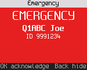

<!-- SPDX-License-Identifier: MIT -->
<!-- Copyright (c) 2026 The RadioFoundry Authors -->

# Emergency

Don't rely on the alarm and emergency calls for safety.

## When someone else declares an emergency

When the radio hears an emergency alarm, or plays a call marked as an emergency, to you or to a talkgroup you listen to,
it opens the emergency screen and plays an alert tone (a warble of about 1 second). A radio with a vibration motor also
vibrates four times, unless **Settings > Sound > Vibrate** is off. The screen shows EMERGENCY and the station's name or
ID.



| Key | Does |
|---|---|
| **OK** | Acknowledge: closes the screen ("Emergency acknowledged") |
| **#** | Closes the screen and opens the actions for that station: talk to them, call them privately, or check their radio |
| **Back** | Hides the screen |

The same radio's emergency again within 30 seconds of its last activity (repeated alarms, the call that follows) doesn't
raise a second alert.

## Declaring an emergency

The radio can send an emergency alarm and start an emergency call with a hot microphone. By default, it sends the alarm
3 times. Then it keys the transmitter for 10 seconds, so the people listening hear you without you pressing **PTT**.
Every call you make until you cancel carries the emergency flag and goes to the channel's talk target. Pressing **PTT**
during the hot mic takes over the transmission.

1. Hold the **Power level** key for 1.5 seconds. The screen says "EMERGENCY sent: hold again to cancel".
2. To cancel, hold the key again for 1.5 seconds. The screen says "Emergency canceled".

A short press of the same key still changes the power level. Letting go before 1.5 seconds never starts an emergency.
Where an emergency can't start (see the end of this page), the radio says "Emergency needs a DMR channel and ID".

Only radios with a **Power level** key can declare an emergency from the keys. [Key roles](23-radios.md#key-roles)
says which radios have one.

Developers can also start and cancel it over the debug link:

```
tools/rfoundry_debug.py data emergency start
tools/rfoundry_debug.py data emergency cancel
```

The mode (alarm only, alarm then call, call only), the target, the number of alarms and the hot mic time are set the
same way (`tools/rfoundry_debug.py data em-settings`). For details, see
[DMR emergency](../spec/dmr-emergency.md).

An emergency can't start on an FM channel or the FM VFO, a receive-only channel, in hotspot mode, or without a DMR ID.
The DMR VFO works as a DMR channel does.
