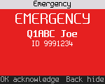
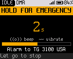
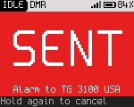
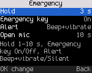

<!-- SPDX-License-Identifier: MIT -->

# Emergency

Don't rely on the alarm and emergency calls for safety. The [Radio reference](23-radios.md) says what has been checked on each radio.

## When someone else declares an emergency

When the radio hears an emergency alarm, or plays a call marked as an emergency, to you or to a talkgroup you listen
to, it opens the emergency screen and plays an alert tone (a warble of about 1 s). A radio with a vibration motor also
vibrates four times, unless **Settings > Sound > Vibrate** is off. The screen shows EMERGENCY and the station's name or
ID.



| Key | Does |
|---|---|
| **OK** | Acknowledge: closes the screen ("Emergency acknowledged") |
| **#** | Closes the screen and opens the actions for that station: talk to them, call them privately, radio check |
| **Back** | Hides the screen |

The same radio's emergency again within 30 s of its last activity (repeated alarms, the call that follows) doesn't
raise a second alert.

## Declaring an emergency

The radio core can send an emergency alarm and start an emergency call with a hot microphone. By default it sends the
alarm 3 times. Then it keys the transmitter for 10 s, so the people listening hear you without you pressing **PTT**. Every
call you make until you cancel carries the emergency flag and goes to the channel's talk target. Pressing **PTT**
during the hot mic takes over the transmission.

Hold the **Power level** key (or a side key set to **Emergency** as its hold, [Settings](17-settings.md#keys-key-8)).
After 0.3 s the screen counts down: an amber "HOLD FOR EMERGENCY" banner, the seconds left in large amber digits with
a "beep" (and "vibrate") cue beside them, a bar that fills, where the alarm goes ("Alarm to TG 3100 USA") and "Let go to stop". Each second the radio beeps and, if it has a vibration
motor, pulses. Keep holding to the end (3 s from the press by default) and the radio starts the emergency: SENT on a
red screen with its own two-tone sound, then hold again to cancel.

| You | The radio |
|---|---|
| Press the key shortly (under 0.3 s) | The key's own role: the next power level. No countdown |
| Hold, then let go before the end | Nothing is sent. The previous screen comes back |
| Hold, then press **Back** | The same: nothing is sent |
| Hold to the end | The emergency starts: SENT on a red screen |
| Hold again, during an emergency | "HOLD TO CANCEL" counts down; at the end CANCELED. Let go early and it stays on |




Where it can't start (see below) the radio says "Emergency needs a DMR channel and ID". The red LED lights while the
alarm and the hot mic transmit, as for any transmission.

### Emergency settings

**Settings > Keys > Emergency** (only in builds with emergency):

| Setting | Values | Default | Does |
|---|---|---|---|
| Hold | 1-10 s | 3 s | How long the key is held, from the press, to start or cancel |
| Emergency key | On, Off | On | Off: holding the key does nothing emergency-related (its short press still works) |
| Alert | Beep+vibrate, Silent | Beep+vibrate | Silent: the countdown and SENT stay on the screen, with no beep, no vibration, no beep cue and no red screen |
| Open mic | Off, 5 s ... 1 min | 10 s | How long the radio keys itself after the alarm (the hot mic). Off: you key the emergency call with **PTT** |

 Keys > Emergency">

The alarm goes to the channel's talk target, or to the target set over the debug link (below). The countdown shows
which.

Radios with a **Power level** or **SOS** key, or a side key set to Emergency, can declare an emergency from the keys.
The [Radio reference](23-radios.md#key-roles) says which radios have one.

Developers can also start and cancel it over the debug link:

```
tools/rfoundry_debug.py data emergency start
tools/rfoundry_debug.py data emergency cancel
```

The mode (alarm only, alarm then call, call only), the target, the number of alarms and the hot mic time are set the
same way (`tools/rfoundry_debug.py data em-settings`). See [docs/spec/dmr-emergency.md](../spec/dmr-emergency.md).

An emergency can't start on an FM channel or the FM VFO, a receive-only channel, in hotspot mode, or without a DMR ID.
The DMR VFO works as a DMR channel does.
