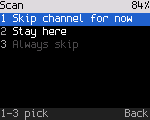

<!-- SPDX-License-Identifier: MIT -->

# Scan and dual watch

Zone scan (including stopping for DMR calls), VFO band scan and dual watch are verified on the DM-1701.

## Starting and stopping

| Start | Stop |
|---|---|
| Hold **SK2** | Hold **SK2** again |
| **\***, **7** | **\***, **7** again |
| **OK**, **5** (Tools), **1** (Scan) | **Back** on Home |

On a channel the radio scans the current zone ("Scanning this zone"). In the VFO it sweeps the band the VFO frequency
is in ("Scanning the band"). The status line shows SCAN, and the channel name changes as the scan moves.

A scan needs at least one other channel to go to. It doesn't run in hotspot mode or while you transmit.

## How the scan moves

- The scan visits the zone's channels in order, from the one it started on. It skips empty positions and channels
  the codeplug marks to skip. FM and DMR channels can be mixed.
- On each channel it listens for 150 ms. An FM channel stops the scan when the squelch opens (with the channel's tone,
  if it needs one). A DMR channel stops it when the radio plays a call.
- On a signal the scan holds. It moves on 2 s after the signal ends, and stays if the signal comes back.
- Holding **SK1** (monitor) pauses the scan.

## While scanning

| Key | Does |
|---|---|
| **PTT** | Stops on the channel that last held the scan and talks there. While the scan is still searching, it goes back to the start channel and talks there |
| **#** | Opens the scan actions for the channel that stopped the scan |
| **Back** | Stops the scan |
| Changing channel, zone or VFO yourself | Ends the scan where you put it |

The scan actions:

| # | Action | Does |
|---|---|---|
| 1 | Skip channel for now | Skips the channel until the scan stops ("Skipped until the scan stops") |
| 2 | Stay here | Stops the scan on this channel |
| 3 | Always skip | Not built yet: edit scan lists in qdmr |

## Dual watch

The radio core can alternate between the current channel and a second one (dual watch), and scan a VFO range set by
two frequencies. There is no menu item for either yet.
