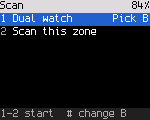
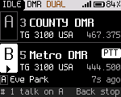

<!-- SPDX-License-Identifier: MIT -->

# Scan and dual watch

Which radios have scan and dual watch verified is in the [Radio reference](23-radios.md).

## Starting and stopping

| Start | Stop |
|---|---|
| Hold **Talk target** | Hold **Talk target** again |
| **\***, **7**, **2** (Scan this zone) | **\***, **7** again |
| **OK**, **6** (Tools), **1** (Scan), **2** | **Back** on Home |

On a channel the radio scans the current zone ("Scanning this zone"). In the VFO it sweeps the band the VFO frequency
is in ("Scanning the band"). The status line shows SCAN, and the channel name changes as the scan moves.

A scan needs at least one other channel to go to. It doesn't run in hotspot mode or while you transmit.

## How the scan moves

- The scan visits the zone's channels in order, from the one it started on. It skips empty positions and channels
  the codeplug marks to skip. FM and DMR channels can be mixed.
- On each channel it listens for 150 ms. An FM channel stops the scan when the squelch opens (with the channel's tone,
  if it needs one). A DMR channel stops it when the radio plays a call.
- On a signal the scan holds. It moves on 2 s after the signal ends, and stays if the signal comes back.
- Holding **Monitor** pauses the scan.

## While scanning

| Key | Does |
|---|---|
| **PTT** | Stops on the channel that last held the scan and talks there. While the scan is still searching, it goes back to the start channel and talks there |
| **#** | Opens the scan actions for the channel that stopped the scan |
| **Back** | Stops the scan |
| Changing channel, zone or VFO yourself | Ends the scan where you put it |

The scan actions:

| # | Action | Does |
|---|---|---|
| 1 | Skip channel for now | Skips the channel until the scan stops ("Skipped until the scan stops") |
| 2 | Stay here | Stops the scan on this channel |
| 3 | Always skip | Not built yet. Edit scan lists in qdmr |

## Dual watch

Dual watch listens on two channels, A and B, and you talk on one of them. Each can be any channel of any zone, or the
VFO. It is two frequencies, not the two timeslots of one DMR frequency.

- **A** is the channel you are on when you start. **B** is the one you add.
- One of them is **selected**. **PTT** talks on it. Up, Down, the knob and the quick settings act on it, as they do on
  the normal Home. Dual watch goes on after you transmit.
- The radio has one receiver, so it alternates between A and B. A call on one can be missed while the radio is on the
  other. Home says "Alternating A and B". A radio with two receivers would hear both and say "Listening to both".
  No radio does yet ([Radio reference](23-radios.md#dual-watch-on-each-radio)).
- The radio can only alternate between two channels of the same zone so far. For a B in another zone or the VFO it
  says "This radio watches 2 channels of one zone". Pick B from the zone you are in.

### Start it

1. Go to the channel you want as A.
2. Press **\***, then **7**. The Scan screen opens: **1** Dual watch, **2** Scan this zone.
3. Press **1**. The first time, the radio asks for B (next step). Later it starts at once with the last B, shown on
   the row: "Dual watch + Metro DMR". So `*`, `7`, `1` is all it takes.

Home shows both channels, A over B, and "DUAL" in the status strip.

### Pick B

The list shows the channels of the zone you are in, with their frequency and mode. Press a channel's number, type part
of its name, or move to it and press **OK**. The channel you are on is dimmed with "A": it can't be B.

For a channel of another zone, or the VFO, go up to the **Zone** row and press **OK**. The list shows **VFO** first,
then the zones. Pick a zone to see its channels, or **VFO** to watch the VFO frequency.

To pick another B later, press **\***, **7** and then **#** on the Dual watch row.

### Read Home

Each channel has a letter, its name, what **PTT** talks to (the talkgroup, or the frequency on FM), its frequency and
its zone.

| You see | It means |
|---|---|
| **PTT** and a filled letter | This is the selected channel: **PTT** talks here |
| **TX** (red) and "TALKING on A" | You are transmitting on A |
| **RX** (green) and "Receiving on B" | A call is coming in on B. The channel shows who is calling |
| "Alternating A and B" | One receiver, taking turns |
| "B Joe Smith TG 91 10s ago" | The last calls, newest first, with their channel |
| "Heard 7s ago" (amber, on the channel) | On small screens: when the last call came in on this channel |
| "# 1 talk on B" | A call came in on B in the last 10 s. **#**, **1** talks back there |

A call on the other channel never moves **PTT**. You choose.

### Talk on B

Press **#**, **1** ("Talk on B"). B is now the selected channel. On a radio with a Left / Right pair (DM-1801 Pro,
DM-32UV), **Right** selects B and **Left** selects A. If a side key is set to **A/B** (Settings > Keys), one press of
it switches. Hold **PTT** to talk. The watch goes on after you let go.

### Change A or B

Press **#** on Home. The actions are:

| # | Action | Does |
|---|---|---|
| 1 | Talk on B (or A) | Selects the other channel |
| 2 | Change A | Opens the picker for A |
| 3 | Change B | Opens the picker for B |
| 4 | Caller | The actions for the last caller (dim until a call was heard) |
| 5 | Stop, stay on A (or B) | Ends dual watch on the selected channel |

A channel can't be both A and B. Changing A or B clears the calls listed for it.

**Up** / **Down** and the knob move the selected channel through its zone, skipping the other channel. On the VFO they
step the frequency.

### Stop it

Press **Back** on Home. The radio stays on the selected channel ("Dual watch off: on B"). These stop it too: **\***,
**7**; the **Scan** key; holding **Talk target**; **#**, **5**; and a side key set to **Dual watch**. If the radio ends it
itself, for example in hotspot mode, Home says "Dual watch stopped".

### Keys

| Key | Does |
|---|---|
| **PTT** | Talks on the selected channel |
| **#** | The dual watch actions |
| **\*** | The quick settings of the selected channel |
| **Up** / **Down**, the knob | The selected channel moves through its zone (VFO: a step) |
| **A/B** key (Settings > Keys), **Left** / **Right** | The other channel / A / B. With dual watch off, the **A/B** key starts it |
| **Dual watch** key (Settings > Keys) | Starts (with the last B) and stops |
| **Back** | Stops, staying on the selected channel |

While dual watch runs, the Scan key and **Talk target** hold stop it instead of starting a zone scan. Starting dual watch stops a zone scan. The last B is remembered until the
radio is switched off. With **Large text** on (Settings > Display) Home shows one line per channel, the selected one
marked with a bar.

[Design and layouts for every display](../ux/dual-watch.md)

The radio core can also scan a VFO range set by two frequencies. There is no menu item for that yet.
