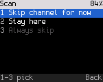
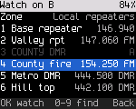
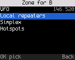
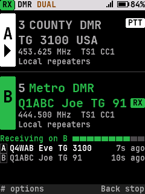
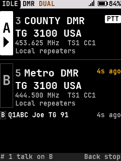
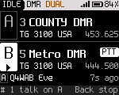
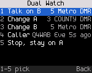

<!-- SPDX-License-Identifier: MIT -->
<!-- Copyright (c) 2026 The RadioFoundry Authors -->

# Scan and Dual Watch

Which radios have scan and dual watch verified is in the [Radio reference](23-radios.md).

## Starting and stopping

| Start | Stop |
|---|---|
| **OK**, **6** (Tools), **1** (Scan) | **Back** on Home |
| A side key set to **Scan** (Settings > Keys) | The same key again |

On a channel the radio scans the current zone ("Scanning this zone"). In the VFO it sweeps the band the VFO frequency
is in ("Scanning the band"). The status line shows SCAN, and the channel name changes as the scan moves.

A scan needs at least one other channel to go to. It doesn't run in hotspot mode or while you transmit.

If dual watch is running, starting a scan stops it. The radio stays on the selected channel and scans from there.

## How the scan moves

- The scan visits the zone's channels in order, from the one it started on. It skips empty positions and channels
  the codeplug marks to skip. FM, DMR, P25 and NXDN channels can be mixed. P25 trunked channels are skipped.
- On each channel it listens for 150 ms. An FM channel stops the scan when the squelch opens (with the channel's tone,
  if it needs one). A DMR, P25 or NXDN channel stops it when the radio plays a call. On a signal it listens up to
  1.5 s for a call it would play.
- Turn on [digital monitor](09-dmr.md) before you start the scan to stop on a call to any talkgroup, not only
  the channel's talkgroup and RX group list. It stays on at every channel and on the one the scan ends on. Pressing
  **Monitor** on a DMR channel during the scan turns it off or on for the rest of the scan.
- On a signal the scan holds. It moves on 2 s after the signal ends, and stays if the signal comes back.
- Holding **Monitor** pauses the scan.

## While scanning

| Key | Does |
|---|---|
| **PTT** | Stops on the channel that last held the scan and talks there. While the scan is still searching, it goes back to the start channel and talks there |
| **#** | Opens the scan actions for the channel that stopped the scan |
| **Back** | Stops the scan |
| Changing channel, zone or VFO yourself | Ends the scan where you put it |

The scan actions:

| # | Action | Does |
|---|---|---|
| 1 | Skip channel for now | Skips the channel until the scan stops ("Skipped until the scan stops") |
| 2 | Stay here | Stops the scan on this channel |
| 3 | Always skip | Not built yet. Edit scan lists in qdmr |

A noisy channel takes two presses this way (**#**, then **1**). Set a side key to **Scan skip** in
[Settings > Keys](17-settings.md), on its press or its long press, and one press does what action 1 does.
With no scan running the key only says "Not scanning".

## Dual watch

Dual watch listens on two channels, A and B, and you talk on one of them. Each can be any channel of any zone, or the
VFO. It is two frequencies, not the two timeslots of one DMR frequency.

- **A** is the channel you are on when you start. **B** is the one you add. The first time, B is the next channel of
  the zone.
- One of them is **selected**. **PTT** talks on it. Up, Down, the knob, the quick settings, the talk target and the
  menus act on it, as they do on the normal Home, even while the radio is listening to the other channel. Dual watch
  goes on after you transmit.
- Each channel keeps its changes for now (power, squelch, tones, talk target and the like) while the radio goes back
  and forth between them.
- The radio has one receiver, so it alternates between A and B. A call on one can be missed while the radio is on the
  other. A radio with two receivers would hear both and show a call on each channel at once. No radio has that yet
  ([Radio reference](23-radios.md#dual-watch-on-each-radio)).
- A or B can be a P25 or NXDN channel, but not a trunked P25 channel. On a radio with two receivers, the second one
  doesn't take P25 or NXDN: the radio alternates when the channel not selected is one.

### Start it

1. Go to the channel you want as A.
2. Press **\***, then **7** (the **Dual watch** quick tile). The first time, B is the next channel in A's zone
   (in a zone of one channel: the first channel of the next zone, or the VFO). Later it starts with the last B. Two
   presses are all it takes. Holding the **A/B** key does the same.

Home shows both channels, A over B, and "DUAL" in the status strip.

If dual watch is on when you switch the radio off, it starts again when you switch it on. The radio also keeps the
last B when you switch it off. It is found again by its channel number: in A's zone first, then in
the first zone that holds it. If the channel is gone from the codeplug, B is the next channel again.

If you stop dual watch with B selected, the radio stays on B. The next start watches the same two channels.

### Change B

Select B (**A/B** key, or **#**, **1**) and change its channel the way you do on Home: **Up**, **Down**, the
knob, digits, Find, Zones, or the **VFO** key. The same goes for A.

Or press **#**, **3** (Change B) for the picker. The list shows the channels of the zone you are in, with their frequency and mode. Press a channel's number, type part
of its name, or move to it and press **OK**. The channel you are on is dimmed with "A": it can't be B.

For a channel of another zone, or the VFO, go up to the **Zone** row and press **OK**. The list shows **VFO** first,
then the zones. Pick a zone to see its channels, or **VFO** to watch a VFO frequency.

### Read Home

Each channel has a letter, its name, what **PTT** talks to (the talkgroup, or the frequency on FM), its frequency and
its zone. The selected channel has an arrow under its letter.

| You see | It means |
|---|---|
| **PTT**, a filled letter and an arrow | This is the selected channel: **PTT** talks here |
| **TX** (red) and "TALKING on A" | You are transmitting on A |
| **RX** (green) and "Receiving on B" | A call is coming in on B. The channel shows who is calling, with RX at the right of that line |
| "B Joe Smith TG 91 10s ago" | The last calls, newest first, with their channel |
| "Heard 7s ago" (on the channel) | When the last call on this channel ended, where it fits: amber for the newest call, dim for the other channel |
| **Busy** (green, on the channel) | The radio is waiting for a reply on the other channel and found a signal here. It is not played yet: the radio goes to it when the wait ends |
| "# 1 talk on B" | A call came in on B in the last 10 s. **#**, **1** talks back there |
| "# 1 back to A" | Talk back is on and **PTT** is on B (see below) |

By default a call on the other channel never moves **PTT**. You choose.

### The wait after a call

The radio has one receiver, so it switches between A and B. When a call ends, it stays on that channel for 1 s so it
hears the reply. While it waits, it takes short looks at the other channel. A call there shows **Busy** but doesn't
interrupt: when the wait ends, the radio goes to it. Change the wait with **Settings > Talk > Dual watch delay**
(0.5 s to 5 s). Shorter finds the other channel sooner; longer keeps more of a reply that starts late.

### Talk back

Turn on **Settings > Talk > Dual watch talk back** (off by default) and **PTT** follows the call. When a call ends on
the other channel, that channel becomes the selected one ("Talk back on B"), so **PTT** answers there. The 10 s timer
starts over with each reply and each call there. After it, the selection goes back ("Talking on A"). **#**, **1**, the
**A/B** key or **Left** / **Right** go back at once. While it is on, the hint row says "# 1 back to A  Back stop".

### Talk on B

Press **#**, **1** ("Talk on B"). B is now the selected channel. On a radio with a Left / Right pair, **Right** selects B and **Left** selects A. A press of the **A/B** key
switches, and so does any side key set to **A/B** (Settings > Keys). With dual watch off, the **A/B** key only says "Turn on dual watch first". Hold **PTT** to talk. The watch goes on after you let go.

### Change A or B

Press **#** on Home. The actions are:

| # | Action | Does |
|---|---|---|
| 1 | Talk on B (or A) | Selects the other channel |
| 2 | Change A | Opens the picker for A |
| 3 | Change B | Opens the picker for B |
| 4 | Caller | The actions for the last caller (dim until a call was heard) |
| 5 | Stop, stay on A (or B) | Ends dual watch on the selected channel |

A channel can't be both A and B. Changing A or B clears the calls listed for it.

**Up** / **Down** and the knob move the selected channel through its zone, skipping the other channel. On the VFO they
step the frequency. In a zone with no other channel to go to, the radio says so ("Only one channel in this zone").

A channel you pick in Find, Channels or Zones becomes the selected channel; picking the other channel selects it. The
**VFO** key puts the selected channel on a VFO, and a second press takes it back to its channel. Copy to VFO copies
the selected channel into a VFO. A and B each get their own VFO, so both can be VFOs on different frequencies; the
radio remembers both. To set a VFO pane's frequency, select it and type the frequency. The digits appear on that pane
as you type; **Back** deletes a digit. Press **OK** or **#** to tune. Dual watch continues on the new frequency. With
no frequency being typed, **#** opens the dual watch actions. Hotspot mode and a codeplug write don't stop dual watch.

The zone keys (**Previous zone** and **Next zone**) move the selected channel to the
previous or next zone, on the zone's first channel that isn't the other one ("A zone: Simplex"). Dual watch goes on.
The **Home zone** key moves it to the first zone. If **Up** / **Down** are set to **Zone** (Settings > Keys), they do
the same, and the knob still steps the channel.

### Stop it

Press **Back** twice on Home. The first press says "Press Back again to stop dual watch", so a stray press doesn't stop
it. If you entered a frequency or changed a setting for now, **Back** clears that first. The radio stays on the
selected channel ("Dual watch off: on B"). These stop it too: **\***, **7**; holding the **A/B** key; **#**, **5**; and a side
key set to **Dual watch**. Starting a scan (**OK**, **6**, **1**, or the **Scan** key) stops it, staying on the selected
channel. **Tools > Spectrum analyzer** pauses it until you leave the analyzer, then resumes the same pair. If the
radio can't go on with a channel (it was deleted, for example), Home says where
the radio is: "Dual watch off: on COUNTY DMR".

### Keys

| Key | Does |
|---|---|
| **PTT** | Talks on the selected channel |
| **#** | The dual watch actions |
| **\*** | The quick settings of the selected channel |
| **Up** / **Down**, the knob | The selected channel moves through its zone (VFO: a step) |
| **A/B** key (a press, or Settings > Keys), **Left** / **Right** | The other channel / A / B. With dual watch off, the **A/B** key says "Turn on dual watch first" |
| **Previous zone**, **Next zone**, **Home zone** | The selected channel goes to another zone |
| **Monitor** (held) | Opens the squelch on the selected channel. Dual watch waits there until you let go |
| **Dual watch** key (Settings > Keys), hold the **A/B** key | Starts (with the last B) and stops |
| **VFO** | The selected channel to the VFO, and back |
| **Back**, twice | Stops, staying on the selected channel |

Starting dual watch stops a zone scan. With **Large text** on (Settings > Display) Home shows one line per channel, the selected one
marked with an arrow.

[Design and layouts for every display](../ux/dual-watch.md)

The radio core can also scan a VFO range set by two frequencies. There is no menu item for that yet.

## Spectrum analyzer

Open **Tools > 0 Spectrum analyzer** (**OK**, **6**, **0**). The main screen shows center frequency at the left,
the listening tuner in a dim color at the right, Peak, and the graph. Frequencies keep five decimal places,
for example 145.06250 MHz. Narrow screens omit repeated MHz units; small screens also omit the title.

Type a new center frequency directly on the keypad, then press **OK** to apply it: `438250` means 438.25000 MHz.
Reception stays where it was until confirmation. Back deletes a digit, then cancels an empty entry. The tuner is
read only in the top row: move it with **Left / Right** or the channel knob. Its white marker moves without
changing the graph's frequency range while it is inside the window. With **Center tuner** off, moving past
either edge scrolls the whole window by one **Sweeping** step. The tuner stays at that edge and listens to the next
frequency. Reverse direction to move it back inside the window; scrolling stops at the receiver band limits.

On the graph, `#` runs **Bandwidth** and `*` runs **Center tuner** by default. Change either assignment in
Spectrum Settings with `# key` and `* key`. **OK** cycles **Bandwidth / Auto peak / Filter / Center tuner**;
both keys may use the same action. Choosing an assignment does not change that parameter until you press the key
on the graph. A toast shows the result. Assignments and parameter values are remembered. While typing a number,
# remains the separator and * does not run its assigned action.

Press **OK** outside frequency entry for **Spectrum Settings**. **Up / Down** choose a row:

| Setting | How to change it |
|---|---|
| Squelch | OK, type magnitude 0..160, OK. The minus is automatic: `80` gives **-80 dBm**, `0` gives **0 dBm**. Default -80 dBm. |
| Sweeping | OK, type spacing in kHz, OK. **#** is the decimal point: `6 # 2 5` means 6.25 kHz. Range 1.00..100.00 kHz. |
| Bandwidth | OK cycles 65 / 97 / 129 points. MHz is calculated from count and spacing. |
| Dwell time | OK, type milliseconds per scanned frequency, OK. Range 10..1000 ms; default 10. Higher is slower. |
| Filter | OK switches **Wide (25 kHz)** / **Narrow (12.5 kHz)**. Wide by default. It applies to scanning and listening. |
| Auto peak | OK cycles **After sweep** (default) / **Immediate** / **Off**. |
| Center tuner | OK switches **Off** (default) / **On**. On keeps the tuner centered and moves the window with Left / Right or the knob. |
| # key | OK cycles the action for #. Default **Bandwidth**. |
| * key | OK cycles the action for *. Default **Center tuner**. |

Back in an editor deletes, then cancels. Back in the menu returns to the running graph. The menu leaves reception
and scanning running. Back on the graph closes the analyzer; long Back returns Home from either screen.

Without a keypad, OK opens a numeric editor at its current value. Use **Up / Down** or the encoder to change it,
then **OK** to save or **Back** to cancel. Squelch steps by 1 dB, Sweeping by 0.01 kHz and Dwell time by 1 ms.
These radios also have **Center** (center frequency) at the end of Spectrum Settings. Its preview moves by the sweep
spacing and skips gaps between available receiver bands. Reception changes only after OK. If a microphone provides
digits, typing starts direct numeric entry instead. Keypad radios keep the nine-row menu and digit entry above.

With **Center tuner** on, **Left / Right** and the knob move the whole window by the **Sweeping** step.
The tuner normally stays in the middle and listens at the new center frequency. The graph's overlapping
measurements slide with the window; the new edge fills as scanning continues. Movement stops before an endpoint
leaves the receiver band. The option is remembered.

Auto peak temporarily moves the tuner to the signal while the window stays in place. When the signal ends and
the short hold expires, the tuner returns to the center before scanning resumes. If you press **Left / Right** or
turn the knob during the signal, it stops listening to that peak, returns the tuner to the middle and moves the
window from its original center by the selected step. A blocked move at a band edge still returns the tuner to
the center. Turning the option off restores independent tuner movement.

Key beeps and their audio cleanup continue during scanning and listening. The analyzer is unavailable during an
active diagnostic detour; wait for it to return or end the detour before opening the analyzer.

**Up / Down on the graph move the dBm scale**, rather than changing frequency. From -40 / -80 / -120, one Down
gives -60 / -100 / -140; another gives -80 / -120 / -160. Two Up presses from the default give 0 / -40 / -80. Movement stops at those limits. This changes
only the displayed scale. The actual signal strength, tuner and frequency endpoints stay the same.

Squelch uses **-160..0 dBm** directly. More negative opens more easily. **-160 dBm** opens at the receiver floor;
**0 dBm** is the highest threshold. Type only the number: `80` is shown as `-80 dBm`; zero loses the minus. With
noise at -120 dBm, a threshold of -120 opens while -80 stays quiet. Older saved levels are converted without changing
their threshold: the former `80` becomes **-80 dBm**.
Changing Filter keeps the frequency but clears the graph history and checks the signal with the new width.

**Auto peak: After sweep** scans the window, chooses its strongest reading at or above squelch, then tunes and confirms it before
playing continuous audio. A signal that has already ended does not open audio from its old peak. While a
signal plays, it stays there rather than interrupting it to search for another one. When it ends, the sweep resumes
after a short hold. The manually selected tuner is checked when starting, so a carrier there can also be heard.

**Auto peak: Immediate** stops on the first frequency at or above squelch and plays it straight away. It does not
finish the sweep first. When the signal ends, scanning resumes at the following frequency after the short hold
and, with Center tuner on, a check of the center frequency.
Both enabled modes keep listening continuously while the signal lasts. Changing the mode preserves current audio.

In the **air band (108 to below 137 MHz)**, scanning and listening automatically use **AM** on a radio with AM
receive support. Elsewhere they use FM. Type an air-band center frequency directly, or open the analyzer from an
air-band channel. The frequency being received decides the mode, including when the window crosses 137 MHz.
Closing the analyzer restores the original channel and its mode. The separate broadcast FM receiver remains outside
the analyzer; available receive bands and AM support depend on the radio ([feature matrix](../feature-matrix.md)).

**Auto peak Off** leaves the tuner where you put it. Scanned signals update the graph; they do not make it jump.
Between short batches the radio checks your tuner and can stop to listen there. An open squelch keeps it listening.
Dwell time controls scanning, while a held signal keeps the fast squelch checks even at long dwell settings.

At 12.50 kHz spacing, the three windows span **0.8 / 1.2 / 1.6 MHz**; at 6.25 kHz they span **0.4 / 0.6 / 0.8 MHz**.
At the default 10 ms dwell, After sweep targets about 0.7 / 1.0 / 1.3 seconds per quiet sweep; Immediate and Off
take about 0.8 / 1.1 / 1.5 seconds because they also check the tuner between batches. Tuning and scheduling add time.
This is a sequential RSSI scan, not an FFT or a laboratory analyzer. Short bursts can fall between visits.

Peak marks and the Peak row show approximately the last five seconds. Old peaks expire even during listening.
Changing center, spacing or BW clears that history. Labels are inside the full-width plot; endpoints are below it.

Center, the manual tuner, squelch, spacing, bandwidth, dwell, automatic mode, filter and the dBm offset are remembered after reopening
and power-off. Changes save after about two seconds, or at normal power-off. Automatic capture leaves the saved
manual tuner untouched. Upgrading preserves old settings and adds defaults for new ones.

The analyzer is receive only: PTT is inhibited and automatic transmissions are suspended. Normal scan stops.
**Dual watch pauses while the analyzer is open and resumes when you leave**, including Back or Home from Spectrum
Settings. It keeps the same A/B channels, selected pane and temporary settings; if it was off, it stays off.
Closing it restores the original channel, mode and temporary talk target. It cannot start during transmission,
in hotspot or trunking mode, during satellite tracking or on the separate broadcast receiver's range.
