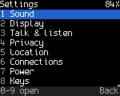
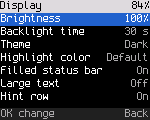
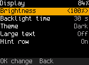
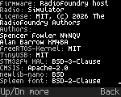
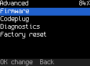
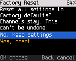
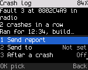
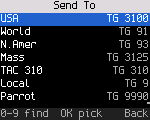
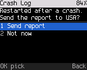

<!-- SPDX-License-Identifier: MIT -->

# Settings

Open Settings with **OK**, **7**, or with **\***, **0**. Settings are grouped by what they are for. A number key opens
a group directly. Find also reaches each setting by name: type its first letters on Home.

## Changing a setting

Each row shows its current value.

- On/off and list settings change with **OK**: each press goes to the next value.
- Number settings open an editor on **OK**. Change the value with **Up** and **Down** (or the channel knob), or type
  it with the number keys, press **OK** to keep it, **Back** to leave it unchanged. A typed value outside the range,
  or between steps, isn't taken: the radio says "Not changed" with the range.
- A setting takes effect and is saved as soon as you change it. There is no separate save step.

Some settings are on the menu before the feature behind them exists, or don't apply to this radio. They are dimmed.
**OK** on a dimmed row says why. The Status column of each table shows this:

| Status | Meaning |
|---|---|
| Works | Acts now and is kept across power off |
| Works, not kept | Acts now, back to the default after power off |
| Dimmed | Not built yet, or not on this radio. **OK** says why |

## Reference

### Sound (key 1)

| Setting | Values | Default | What it does | Status |
|---|---|---|---|---|
| Key tones | On, Off | On | A short beep on each key press | Works |
| Volume | 0 to 16 | 8 | The speaker volume, on radios without a volume knob only (the DB25-D PRO; the row is not shown on the others). 0 is mute. The **Volume** key opens a screen that changes it faster ([Radio reference](23-radios.md#db25-d-pro-keys)) | Works |
| Tone volume | 0 to 10 | 5 | Volume of the radio's beeps, relative to the radio's volume | Works |
| Talk permit tone | On, Off | On | The beep when a DMR transmission starts ([DMR](08-dmr.md)) | Works |
| Voice prompts | On, Off | Off | Spoken prompts. There is no recorded speech yet | Dimmed |
| Message tone | On, Off | On | A three-note tone when a text message arrives | Works |
| Vibrate | On, Off | On | The radio vibrates for a text message, a call alert, a private call to you and an emergency it hears. Only on radios with a vibration motor ([Radio reference](23-radios.md)) | Works |

### Display (key 2)

| Setting | Values | Default | What it does | Status |
|---|---|---|---|---|
| Brightness | 10 to 100 %, steps of 10 | 100 % | Backlight brightness. Also in quick settings, tile 9 | Works |
| Backlight time | 5 s, 10 s, 30 s, 1 min, 2 min, Never | 30 s | The backlight dims after this time without a key press and goes off after four times as long | Works |
| Theme | Dark, Light, High contrast | Dark | The screen colors. Not on radios with a monochrome screen | Works |
| Highlight color | Default, Red, Orange, Yellow, Teal, Light blue, Purple, Pink | Default | The color of the selected row or tile and of the channel number on Home. Not on radios with a monochrome screen | Works |
| Filled status bar | On, Off | On | Fills the top status line with the highlight color (light gray with Default, white in the high-contrast theme) and draws its text black. Not on radios with a monochrome screen | Works |
| Large text | On, Off | Off | Home shows only the status line, the channel and the talk target, large | Works |
| Hint row | On, Off | On | The bottom line with key hints | Works |

### Talk & listen (key 3)

| Setting | Values | Default | What it does | Status |
|---|---|---|---|---|
| Reply window | 0 to 30 s | The codeplug's hang time, else 10 s | How long **PTT** answers the last call ([DMR](08-dmr.md#replying)). 0 turns it off | Works |
| TX timeout | Off, 30 s, 1, 2, 3, 5, 10 min | 3 min | Longest transmission, for channels without their own timeout in the codeplug | Works |
| Default squelch | 0 to 9 | 5 | The FM squelch level when a channel doesn't set one | Works |
| VFO step | Auto, 2.5, 5, 6.25, 8.33, 10, 12.5, 20, 25, 50, 100 kHz | Auto | The step of Up, Down and the knob in the VFO. Auto is 25 kHz at width 25K and in AM, else 12.5 kHz. Only on radios with a VFO | Works |
| Mic gain | 0 to 10 | 5 | Microphone level, 2 dB a step. 5 is the radio's normal level. Sets DMR, and FM on the radios that set the level in their microphone path ([Radio reference](23-radios.md)). A change counts from the next transmission. Shows "AGC" and can't be changed while Mic AGC is on | Works (DMR); FM not checked on air |
| Mic AGC | On, Off | Off | Evens out your level on DMR: a quiet voice is raised and a loud one lowered, so you don't need to set Mic gain. While it's on, Mic gain stays at 5. Dimmed on radios whose voice codec can't do it | Needs an on-air check (DMR) |
| Mic noise reduction | On, Off | On | Reduces steady background noise (fans, engines, wind) in what you send on DMR, also between words. Turn it off if a steady sound you want heard is cut. Dimmed on radios whose voice codec can't do it | Needs an on-air check (DMR) |
| Monitor by default | On, Off | Off | Digital monitor (DMR: every talkgroup, promiscuous) goes on each time you select a DMR channel. **Back** on Home turns it off until the next channel | Works |
| Show talker alias | On, Off | On | Show received talker aliases (names) under the caller's ID | Works |
| Dual watch talk back | On, Off | Off | Off: a call on the other channel never moves **PTT**. On: when a call ends on the other channel, that channel becomes the selected one for 10 s (restarting with each reply and call there), so **PTT** answers there ([Dual watch](11-scan.md#talk-back)) | Works |
| Dual watch delay | 0.5 s, 1 s, 1.5 s, 2 s, 3 s, 5 s | 1 s | How long dual watch stays on a channel after a call ends, for the reply. It looks at the other channel meanwhile and shows **Busy** there ([Dual watch](11-scan.md#the-wait-after-a-call)) | Works |

### Privacy (key 4)

| Setting | Values | Default | What it does | Status |
|---|---|---|---|---|
| Key type | Off, Motorola, Anytone | Off | The kind of basic privacy key ([DMR](08-dmr.md#privacy)). Off removes the key | Works |
| Key | Motorola 1 to 255, Anytone 0 to 65535 | | The key value, typed with the number keys. Dimmed until a type is chosen | Works |
| Auto lock | Off, 30 s, 1 min, 5 min | Off | Locks the keys after this time without a key press | Works |
| PTT when locked | On, Off | On | Whether **PTT** works while the keys are locked. Off: **PTT** does nothing until you unlock | Works |

### Location (key 5)

| Setting | Values | Default | What it does | Status |
|---|---|---|---|---|
| GPS | On, Off | On | The GPS receiver, on radios that have one ([Radio reference](23-radios.md)). Off powers the module down and the radio has no fix (APRS and DMR use the computer's or the fixed position); the change takes effect at once. Without GPS the row is dimmed and says "No GPS on this radio" | Dimmed without GPS |
| Position format | Degrees, Deg min sec, Grid | Degrees | How positions are shown | Dimmed without GPS |
| Send position | Off, 1 min, 5 min, 15 min | Off | Send your position at this interval | Dimmed without GPS |
| Answer GPS requests | On, Off | On | Answer LRRP location requests (Find also finds it as "position"). Without GPS the answer is "no fix" | Works |

### Connections (key 6)

| Setting | Values | Default | What it does | Status |
|---|---|---|---|---|
| Hotspot allowed | On, Off | On | Lets a hotspot host on USB put the radio in hotspot mode ([Hotspot](13-hotspot.md)) | Works |
| Answer radio checks | On, Off | Off | Answer radio checks from other radios ([Radio check](09-messages-and-signaling.md#radio-check)) | Works |
| Answer call alerts | On, Off | On | Acknowledge call alerts, so the caller knows the page arrived | Works |
| TFTP codeplug write | On, Off | On | Lets a computer write the codeplug over TFTP in USB network mode ([USB network](14-usb-network.md#programming-over-the-network)). Reading is always possible | Works (not tested on the radio yet) |
| Message format | ETSI, ETSI short, Motorola | ETSI | The format of the text messages you send ([Messages](09-messages-and-signaling.md#message-formats)). Messages in any format are received | Works (not tested on air yet) |
| USB network at start | On, Off | Off | The radio starts as a USB network adapter instead of a serial port ([USB network](14-usb-network.md#starting-in-network-mode)) | Works (not tested on the radio yet) |
| PC answers data | On, Off | Off | Control station mode: while the computer is connected in USB network mode, it answers the data sent to your radio instead of the radio ([USB network](14-usb-network.md#control-station-for-dispatch-software)) | Works (not tested on the radio yet) |
| USB address | By DMR ID, 192.168.10.x | By DMR ID | The addresses of the USB network link: from your DMR ID, or the fixed pair 192.168.10.1 (radio) and 192.168.10.2 (computer) | Works (not tested on the radio yet) |

### Power (key 7)

| Setting | Values | Default | What it does | Status |
|---|---|---|---|---|
| Battery saver | On, Off | Off | On an idle FM channel the receiver sleeps between short listening windows ([Battery and power](16-battery-and-power.md)) | Works |
| Auto power off | Off, 30 min, 1 h, 2 h | Off | Switch off after this time without use ([Battery and power](16-battery-and-power.md#auto-power-off)) | Works |
| Low battery warning | 5 to 30 %, steps of 5 | 15 % | Warn when the battery falls to this level ([Battery and power](16-battery-and-power.md)) | Works |

### Keys (key 8)

| Setting | Values | Default | What it does | Status |
|---|---|---|---|---|
| Long press time | 400 to 1200 ms, steps of 100 | 600 ms | How long you hold a key for a long press | Works |
| Key repeat | 60 to 300 ms, steps of 20 | 120 ms | The repeat rate of **Up** and **Down** while held | Works |
| Up/Down on Home | Channel, Zone, Talk target | Channel | What **Up** and **Down** change on Home. Talk target steps through the channel's contact and its listen list on DMR channels. On FM channels they change the channel | Works |
| Side key 1, Side key 2, Top key | Default, Nothing, Monitor, Talk target, Power level, Next zone, Previous zone, Scan, Key lock, Home zone, Copy to VFO, Call back | Default | What a press of the key does. Default is what the [key roles](23-radios.md#key-roles) say. Monitor opens the squelch while you hold the key on FM, and turns digital monitor on or off on DMR. Key lock locks and unlocks the keys. Call back talks to the last call heard. Home zone goes to the codeplug's first zone: put your home zone first in the CPS. Copy to VFO copies the channel to the VFO and opens it ([the VFO](06-channels-zones-vfo.md#copy-a-channel-to-the-vfo)); in the VFO it says "Already in VFO". The list offers it on radios with a VFO | Works |
| Side key 1 hold, Side key 2 hold, Top key hold | Default, Nothing, Talk target, Power level, Next zone, Previous zone, Scan, Emergency, Key lock, Home zone, Copy to VFO, Call back | Default | What holding the key does. Emergency needs a 1.5 s hold. With Monitor as the press, the hold works on DMR channels; on FM holding the key keeps the squelch open (for an open squelch that stays, use **\***, **5**) | Works |

The side key settings are also in the codeplug, so a codeplug written to the radio can set them, and a change here is
written to the codeplug. Rows for keys your radio doesn't have are dimmed.

### My radio (key 9)

| Setting | What it shows |
|---|---|
| DMR ID and name | Your DMR ID from the codeplug ("not set: set it in qdmr" without one) and the radio model |

### Advanced (key 0)

| Item | What it does |
|---|---|
| About | "OpenDigitalRadio", the firmware version (commit) and the radio model. Then the authors and the license of each part: ODR (MIT), the third-party libraries, and the AMBE+2 codec. The codec shows as "stock": it comes from your radio's own firmware and isn't part of ODR. The page is text in small print, with nothing cut short and no status bar. The status bar comes back during a call. **Up**, **Down** or the knob scroll a page longer than the screen |
| Codeplug | Where the channels come from (built-in or from the CPS), the number of zones and channels |
| Diagnostics | The diagnostics page (also **OK**, **6**, **7**) |
| Factory reset | Puts every setting back to its default ([below](#factory-reset)) |
| Crash log | What the last crash left, and sending it to the developers ([below](#crash-log)) |
| Hardware | Only on radios that need it: facts about the radio the firmware can't read, such as the MD-9600's board revision. **OK** steps through the choices, holding **OK** stores the one shown. "Not set" shows until one is stored. A revision applies from the next start-up |

 Advanced > About">

## Factory reset

**Settings > Advanced > Factory reset** asks "Reset all settings to factory defaults? Channels stay. This can't be
undone." The focus starts on "No, keep settings". Focus "Yes, reset" and press **OK**.

The reset puts every setting back to its default (brightness, radio settings, the privacy key, the channel
position), erases ODR's own data area, and restarts the radio. The codeplug and the calibration stay.

## Crash log

When the firmware crashes, the radio keeps a short record of where and why, and restarts. **Settings > Advanced >
Crash log** shows the record: what happened, how many crashes in a row, how long the radio ran and the firmware
build. Without a record it says "No crash recorded." Switching the radio off may lose the record: look before you
turn it off.

 Advanced > Crash log">

| Item | What it does |
|---|---|
| Send report | Sends the record over DMR to the Send to contact, on the current channel. Takes a few seconds on the air; "Crash report sent" or "Crash report not sent" follows |
| Send to | The contact the report goes to, private or group: pick it from your contacts (type to find) |
| After a crash | Off: nothing happens at the restart. Ask: the radio asks whether to send the report. Auto: it sends the report without asking. Off is the default |
| Clear | Forgets the record |

With **After a crash** at Ask, the radio asks once after the restart:

Ask and Auto need a Send to contact and a DMR channel the radio may transmit on. The report is at most about 150 bytes and
holds no audio, messages or location: only the crash record and the firmware build. Nothing on the air confirms
that it arrived.

## Settings without a menu

A few settings exist in the radio but not yet on the menu:

- busy channel lockout and the roger beep;
- the scan's resume mode and timing;
- VOX sensitivity;
- the ARS server and the emergency settings;
- the IP data settings (header compression, confirmed data) and the SNMP communities;
- the roaming threshold, hysteresis and periodic search;
- the SFR idle beacon.

Developers change them over the debug link (`tools/odr_debug.py radio set ...`, `data settings ...`,
`data ip-settings ...`, `snmp ...`). The radio keeps them. The roaming survey and beacon settings are in **Tools >
Roaming** ([DMR](08-dmr.md#roaming)).

A build without the Settings menu (`CONFIG_UI_SETTINGS=n`) shows "Set them with qdmr" instead, and keeps the stored
values.
