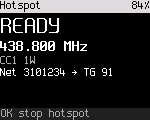

<!-- SPDX-License-Identifier: MIT -->

# Hotspot mode

In hotspot mode the radio is a DMR modem for a computer running MMDVMHost, Pi-Star or a similar host. The host
connects the radio to a DMR network (BrandMeister, TGIF and others). The radio carries the calls to and from radios
nearby on one frequency. The radio speaks the MMDVM modem protocol over its serial port. On radios with USB this is
the USB serial port. On radios without USB it is the programming cable ([Radio reference](23-radios.md)).

Some radios leave hotspot mode out of their default image. On those radios **Tools > Hotspot** is dimmed. The
[Radio reference](23-radios.md) lists them and says where hotspot mode is verified.

## What you need

- A computer with MMDVMHost (Linux, macOS), or a Pi-Star style image on a Raspberry Pi.
- The radio's USB cable, or its programming cable on a radio without USB.
- The codec isn't needed: the radio passes the DMR frames through without decoding the voice.
- **Settings > Connections > Hotspot allowed** on (the default).

## Setting up MMDVMHost

Point MMDVMHost's modem at the radio's serial port and run it as a simplex DMR hotspot. The parts of `MMDVM.ini` that
matter:

```
[General]
Duplex=0

[Info]
RXFrequency=438800000
TXFrequency=438800000

[Modem]
Protocol=uart
UARTPort=/dev/ttyACM0
UARTSpeed=115200

[DMR]
Enable=1
ColorCode=1

[DMR Network]
Enable=1
Slot1=0
Slot2=1
```

- On USB the port is `/dev/ttyACM0` (or the next number) on Linux and `/dev/cu.usbmodem...` on macOS. The radio's
  USB ID is 1FC9:0094.
- Use the same frequency for receive and transmit, inside the radio's bands ([Radio reference](23-radios.md)).
- The radio uses timeslot 2 only: enable network slot 2 and disable slot 1.
- The baud rate is ignored on USB. 115200 works.
- Leave the other modes (D-Star, YSF, P25, NXDN, POCSAG, FM) off. The radio refuses them. POCSAG is accepted but never
  transmitted.

On Pi-Star style images, choose a USB MMDVM modem on the radio's serial port and the settings above. This hasn't been
tested with Pi-Star yet.

The radio reports itself to the host as "OpenDigitalRadio", the radio model (for example "OpenDigitalRadio DM-1701")
and the firmware version.

## Starting

The radio enters hotspot mode by itself when the host opens the port and sends its first MMDVM request. The screen
changes to the hotspot screen.



The hotspot screen shows:

- the state: STARTING, HOTSPOT, RX RF while a radio nearby talks, TX NET while a network call goes out;
- the frequency, the color code and the power;
- the current or last call, with its source ("RF" or "Net"), the caller and the talkgroup.

**OK**, **5** (Tools), **3** (Hotspot) shows how to start hotspot mode. While it runs, the page has a "Stop hotspot"
row.

## While in hotspot mode

- **\*** switches between the hotspot screen and the diagnostics page.
- **PTT** doesn't transmit ("Hotspot mode: PTT off").
- Any other key shows "Hotspot on: OK stops it".
- If the host asks for a CW ID, the radio sends it in Morse on FM on the hotspot frequency, then returns to DMR. The
  Morse is 20 words per minute at 800 Hz.

## Stopping

The radio leaves hotspot mode and returns to its channel when:

- you press **OK** or hold **Back** ("Hotspot stopped");
- the host closes the port, or the USB cable is unplugged;
- the host sends nothing for 20 s.

To stop the radio from entering hotspot mode at all, turn **Settings > Connections > Hotspot allowed** off.

## MMDVM SFR (single frequency repeater)

In MMDVM SFR the hotspot repeats a call heard on timeslot 1 on timeslot 2 of the same frequency. It also sends the
call to the network. Radios nearby in direct mode hear both. It isn't on every radio ([Radio reference](23-radios.md)).

The host turns MMDVM SFR on by running duplex with the receive and transmit frequencies equal (`Duplex=1`,
`RXFrequency` = `TXFrequency`). Setting `Duplex=0` or different frequencies turns it off.

The repeat timing measured on air is in the [Radio reference](23-radios.md).
Standalone SFR isn't built yet. It would give a channel the repeater and user roles without a host.
**Tools > Single-freq repeater** shows only an information page. Details are in [docs/spec/sfr.md](../spec/sfr.md).

## Two radios as a duplex repeater

Experimental: two radios, each on its own port of one computer, act as one full duplex repeater. One receives, the
other transmits. Both need split duplex in their image ([Radio reference](23-radios.md)). The computer runs
`tools/split_duplex_host.py`. The slot numbering is still being checked on the bench. Details are in
[docs/spec/split-duplex.md](../spec/split-duplex.md).
