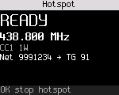

<!-- SPDX-License-Identifier: MIT -->
<!-- Copyright (c) 2026 The RadioFoundry Authors -->

# Hotspot mode

In hotspot mode, the radio is a DMR modem for a computer that runs MMDVMHost, Pi-Star, or a similar host. The host
connects the radio to a DMR network (BrandMeister, TGIF and others). The radio carries the calls to and from radios
nearby on one frequency. The radio speaks the MMDVM modem protocol over its serial port. On radios with USB, this is
the USB serial port. On radios without USB, it's the programming cable ([Radio reference](23-radios.md)).

Some radios leave hotspot mode out of their default image. On those radios, **Tools > Hotspot** is dimmed. The
[feature matrix](../feature-matrix.md) lists them.

## What you need

- A computer with MMDVMHost (Linux, macOS), or a Pi-Star style image on a Raspberry Pi.
- The radio's USB cable, or its programming cable on a radio without USB.
- You don't need the codec: the radio passes the DMR frames through without decoding the voice.
- **Settings > Connections > Hotspot allowed** on (the default).

## Setting up MMDVMHost

Point MMDVMHost's modem at the radio's serial port and run it as a simplex DMR hotspot. The parts of `MMDVM.ini` that
matter:

```
[General]
Duplex=0

[Info]
RXFrequency=438800000
TXFrequency=438800000

[Modem]
Protocol=uart
UARTPort=/dev/ttyACM0
UARTSpeed=115200

[DMR]
Enable=1
ColorCode=1

[DMR Network]
Enable=1
Slot1=0
Slot2=1
```

- On USB the port is `/dev/ttyACM0` (or the next number) on Linux and `/dev/cu.usbmodem...` on macOS. The radio's
  USB ID is 1FC9:0094.
- Use the same frequency for receive and transmit, inside the radio's bands ([Radio reference](23-radios.md)).
- The radio uses timeslot 2 only: enable network slot 2 and disable slot 1.
- On USB, the radio ignores the baud rate. 115200 works.
- Leave the other modes (D-Star, YSF, P25, NXDN, POCSAG, FM) off. The radio refuses them. The radio accepts POCSAG but
  never transmits it.

On Pi-Star-style images, choose a USB MMDVM modem on the radio's serial port and the settings above.

The radio reports itself to the host as "RadioFoundry", the radio model (for example "RadioFoundry XR-100UV")
and the firmware version.

## Starting

The radio enters hotspot mode by itself when the host opens the port and sends its first MMDVM request. The screen
changes to the hotspot screen.



The hotspot screen shows:

- The state: STARTING, HOTSPOT, RX RF while a radio nearby talks, or TX NET while a network call goes out.
- The frequency, the color code, and the power.
- The current or last call, with its source ("RF" or "Net"), the caller, and the talkgroup.

**OK**, **6** (Tools), **3** (Hotspot) shows how to start hotspot mode. While it runs, the page has a "Stop hotspot"
row.

## While in hotspot mode

- **\*** switches between the hotspot screen and the diagnostics page.
- **PTT** doesn't transmit ("Hotspot mode: PTT off").
- Any other key shows "Hotspot on: OK stops it".
- If the host asks for a CW ID, the radio sends it in Morse on FM on the hotspot frequency, then returns to DMR. The
  Morse is 20 words per minute at 800 Hz.

## Stopping

The radio leaves hotspot mode and returns to its channel when one of these happens:

- You press **OK** or hold **Back** ("Hotspot stopped").
- The host closes the port, or you unplug the USB cable.
- The host sends nothing for 20 seconds.

To stop the radio from entering hotspot mode at all, turn **Settings > Connections > Hotspot allowed** off.

## MMDVM SFR (single-frequency repeater)

In MMDVM SFR, the hotspot repeats a call heard on timeslot 1 on timeslot 2 of the same frequency. It also sends the
call to the network. Radios nearby in direct mode hear both. For which radios have it, see the
[feature matrix](../feature-matrix.md).

The host turns MMDVM SFR on by running duplex with the receive and transmit frequencies equal (`Duplex=1`,
`RXFrequency` = `TXFrequency`). Setting `Duplex=0` or different frequencies turns it off.

## Standalone SFR

A channel can be a single-frequency repeater, or a radio that uses one, without a host. Set the channel's SFR role in
the Codeplug Editor. The channel must have one frequency (receive = transmit).

The VFO can take a role too, with no codeplug change. In the DMR VFO, open **Tools > Single-freq repeater**:

- **Role** steps through Off, User, User (ERDM), Repeater, and Repeater (ERDM style).
- **Inbound slot** switches between TS1 and TS2.

The VFO keeps its role, also after you turn the radio off. The role works only in DMR with one frequency: with a TX
offset, the page says the role is off. The VFO's color code is the repeater's on both slots. **Copy to VFO** brings a
channel's role along.

| Role | What the radio does |
|---|---|
| Repeater (Rpt, Rpt Moto) | Repeats every call heard on the inbound slot on the other slot. **PTT** is off ("Repeater channel"). The radio shows receiving while it repeats, and the red LED lights while it sends. While transmit is inhibited, the battery is critical, or a scan or dual watch runs, the channel works as an ordinary channel. **Settings > Talk & listen > SFR CW ID** makes the repeater send its callsign in Morse every 5 to 30 minutes, after traffic |
| User (User, ERDM) | Talks on the inbound slot, in step with the repeater, and plays the repeater's copy of a call. **Settings > Talk & listen > SFR receive** can also take the talker's own copy: the first to arrive, or both, with each damaged frame taken from the other copy (Dual-path RX) |

All radios on the frequency must use the same inbound slot: two setups can't share a frequency. **Tools >
Single-freq repeater** shows the channel's role, its slots, and what the repeater is doing. For the timing, the slots,
and how the roles work, see [Single-frequency repeater](../spec/sfr.md).

## Two radios as a duplex repeater

Two radios, each on its own port of one computer, act as one full-duplex repeater. One receives, and the other
transmits. Both need split duplex in their image. For which radios offer it, see the
[feature matrix](../feature-matrix.md). The computer runs `tools/split_duplex_host.py`. For details, see
[Split duplex](../spec/split-duplex.md).
