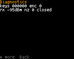

<!-- SPDX-License-Identifier: MIT -->

# Troubleshooting

## Installing

| Problem | Cause and fix |
|---|---|
| "no radio bootloader found" | The radio isn't in its bootloader, or the cable is charge-only. Turn the radio off, hold **PTT** and **SK1**, turn it on; the screen stays dark. Try another USB port or cable |
| "access denied" | Linux: add the udev rule odrflash prints, then unplug and replug. Windows: install WinUSB for "STM32 BOOTLOADER" (0483:DF11) with Zadig |
| "the bootloader is busy" | Another program has it open (a CPS, a virtual machine with USB passthrough). Close it and replug |
| "unknown stock file ... not a supported codec source" | odrflash knows the stock files by SHA-256 (DM-1701: V02.06 CSV). Download that exact file |
| "... is an official Baofeng/TYT firmware file, not an OpenDigitalRadio image" | You gave the stock file as the image. Give the ODR image (or `--release`) and the stock file with `--stock` |
| "odrflash can't tell whether the radio holds the codec" | Start the radio with ODR and run `odrflash probe`, or give `--stock` so odrflash writes the codec |
| "no libusb found" (running from source) | Install libusb (`brew install libusb`, or `apt install libusb-1.0-0`), or use the odrflash executable, which carries it |
| The screen stays dark after flashing | The radio is still in its bootloader. Turn it off and on again without holding any key |
| Flashing stopped half way | Put the radio in its bootloader and run the same command again. odrflash never erases the bootloader |

## Everyday use

| Problem | Cause and fix |
|---|---|
| DMR calls show but there is no audio, "No codec: voice off" | The radio has no usable codec. See [Installing, no codec](02-installing.md#no-codec-no-codec-voice-off) |
| A DMR call shows "Other TG: not played" | Its talkgroup isn't the talk target, in the listen list or the reply target. Hold **SK1**, use hear all, or add the talkgroup to the channel's RX group list in qdmr |
| "Encrypted: not played" | The call uses basic privacy and the radio has no matching key, or stronger encryption the radio can't play |
| "No DMR ID in codeplug" when transmitting | Write a codeplug with your DMR ID ([Programming with qdmr](15-programming-qdmr.md)) |
| "Channel busy (polite)" | Someone is talking on the timeslot. Wait for the call to end |
| "No repeater answered" | The repeater didn't respond. Check the frequency, the color code, the timeslot and your distance to the repeater |
| No audio on FM | The squelch is closed or the channel needs a tone. Hold **SK1** to open the squelch; check the tone with **\***, **3** |
| A key does nothing and the screen says "Keys locked" | Hold **\*** to unlock. Check **Settings > Privacy > Auto lock** |
| "Not used here" | That key has no function on this screen |
| "... isn't in this build" | The feature is switched off in this build, or isn't built yet |
| The radio is stuck on the hotspot screen | A host has the serial port open. Press **OK**, or stop the host program. Turn **Settings > Connections > Hotspot allowed** off to prevent it |
| Zone or channel changed by itself | A scan is running (SCAN in the status line). Press **Back** on Home |
| qdmr, odrflash or a hotspot host doesn't find the radio's serial port | USB is in network mode. Switch back in **Tools > USB network**, or turn off **Settings > Connections > USB network at start** and restart. The debug link and MMDVM also answer on UDP port 3334 ([USB network](14-usb-network.md#serial-tools-in-network-mode)) |
| In network mode the computer gets no address | The radio goes back to serial when the computer doesn't set the adapter up within 10 s. Check that the computer shows a new network adapter, then switch again |

## Settings are not kept

If settings go back to their defaults after a restart, and qdmr writes fail, the radio has found another firmware's
data in the flash area where ODR keeps its settings. ODR doesn't erase it, so you don't lose data by accident. The
radio runs on the defaults in memory.

To give the area to ODR (developers, over the debug link):

```
tools/odr_debug.py storage info     # shows region=foreign
tools/odr_debug.py storage claim --out ~/odr-backup    # saves a copy of the area, then erases it for ODR
```

`storage claim` saves the area's old contents and the calibration copy to files in the `--out` directory before it
erases anything. It refuses to save inside a git work tree.

Some settings are "not kept" by design today: see the Status column in [Settings](12-settings.md).

## Diagnostics

**OK**, **5**, **7** (Tools > Diagnostics) shows raw readings for bench checks: keys, receiver levels, the DMR
modem's state and counters, battery, the board's own lines. **\*** pages through them. **Back** leaves.



Developers get the same and more over USB with `tools/odr_debug.py diag` and `tools/odr_debug.py view`.

## Reporting a problem

Open an issue in the project repository. Include the firmware version (**Settings > Advanced > About**), the radio
model, what you did, what you expected and what happened. A screenshot helps: `tools/odr_debug.py screenshot -o
screen.png` saves one over USB.
