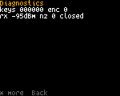

<!-- SPDX-License-Identifier: MIT -->
<!-- Copyright (c) 2026 The RadioFoundry Authors -->

# Troubleshooting

This chapter lists symptoms and their fixes. The web installer's **Select the Symptom** step shows most of the
installer entries on screen.

## Installing

These rows also apply to the `rfoundry` command line.

| Problem | Cause and fix |
|---|---|
| "no radio bootloader found" | The radio isn't in its bootloader, or the cable is charge-only. Turn the radio off, hold its bootloader keys (your radio's "Installing" section in the [Radio reference](23-radios.md)), and turn it on. The screen stays dark. Try another USB port or cable. On Windows, install the bootloader's driver ([steps](02-installing.md#windows-the-bootloader-driver)) |
| "access denied" | On Linux, add the udev rule that rfoundry prints, then unplug the radio and plug it in again. On Windows, install the bootloader's driver with Zadig ([steps](02-installing.md#windows-the-bootloader-driver)) |
| "the bootloader is busy" | Another program has it open, such as a CPS or a virtual machine with USB passthrough. Close it, then unplug the radio and plug it in again |
| The web installer says the radio's port or USB connection is in use | Close the other program or browser tab that uses the radio (a CPS, qdmr, a hotspot host, a second installer tab), then try again. On Windows, install the bootloader's driver ([steps](02-installing.md#windows-the-bootloader-driver)). On Linux, give your user access to the device |
| The web installer can't use a firmware file | The installer says why. See [When the installer can't use a file](#when-the-installer-cant-use-a-file) |
| The radio stays in update mode after an interrupted backup or install, and the power switch does nothing | See [A radio left in update mode](#a-radio-left-in-update-mode) |
| The screen stays dark after flashing | The radio is still in its bootloader. Turn it off and on again without holding any key |
| A white, backlit screen and a solid red LED at every power-on, and the radio never starts | The radio is in its factory update mode because the firmware is missing or incomplete. Nothing else is damaged. Install again with the web installer. Your radio's "Installing" section in the [Radio reference](23-radios.md) says whether this applies |
| "Preparing the radio failed", or the radio doesn't respond on its programming cable | Push the cable plug fully in and try again, or use a cable with an FTDI, CP210x, or PL2303 chip. If it still fails, see [When the cable can't prepare the radio](#when-the-cable-cant-prepare-the-radio) |
| The web installer reports "Cable Problem Detected" | The programming cable is at fault, not the radio. See [Cable problems](#cable-problems) |
| Flashing stopped partway | Put the radio in its bootloader and run the same install again. The installer never erases the bootloader |

### When the installer can't use a file

When the installer can't use a firmware file, it says what it found and what to do:

| It says | Do this |
|---|---|
| This File Is for Another Radio | Pick your radio's file, or open the installer for the radio the file is for |
| This Is Not the Manufacturer's Firmware File | Pick the manufacturer's file. A build from another open firmware project doesn't work |
| This File Is Not for the (your radio) | The file is for another model, or is a modified build. Pick the manufacturer's file for your radio |
| This Version's Codec Is Not Supported Yet | Pick one of the supported files listed under the message, or send the file so that the version can be added |
| The File Is Damaged or Incomplete | Download the file again |
| The Radio Programming Utility Could Not Use This File | The file is fine. The installer reports the fault, or shows how to report it. You can send the file to help |

A version without codec support can still give the bootloader key; the notice says so. You can also continue without a
usable file. The installer then keeps the codec that's already in the radio, and says before it writes that DMR voice
depends on that codec.

**Technical details** shows the exact message. The installer offers to send a file only when it's the manufacturer's
firmware file, and sends it only when you click. An automatic error report names the file (name, size, and checksum),
never its contents.

### A radio left in update mode

A backup or installation that a cable pull or a closed page interrupts can leave the radio in its loader (update
mode). There, the power switch might do nothing.

1. On the installer's first page, choose **Radio Stuck in Update Mode**, and pick the radio.
2. On a radio that the installer programs through its cable, pick the cable too. The installer restarts the radio into
   normal mode. For other radios, the page says how to restart the radio by hand.

If the loader doesn't answer, turn the radio off and on. If the power switch does nothing, take the battery out for a
few seconds.

When you connect for any other task and the loader is already running, the connect step offers **Restart Radio** next
to **Continue**. After a **Back Up**, **Restart Radio** ends the task on a finished screen that offers **Install** or
**Finish**, and **Update** when the radio runs RadioFoundry.

### Cable problems

Programming cables with a CH340 chip can be unreliable for backups and installations. If one fails, use a cable with
an FTDI, CP210x, or PL2303 chip. The installer warns you when it sees a CH340 cable.

The connect step tells a faulty cable from a radio that doesn't answer, and names the problem:

| The installer says | What it found |
|---|---|
| The cable keeps delivering data that nothing asked for | The line never goes quiet, so the installer can't hear the radio. **Continue Anyway** continues with the same cable |
| The cable disconnected from the computer | The cable left the computer's USB while the page used it |
| The cable stopped taking data from the computer | The cable's adapter or its driver stopped sending. The page checks this each time it opens the cable. Some adapters stay this way until you unplug them |
| The radio received none of this page's answers | The radio's greeting came through when it turned on, but nothing the page sent reached the radio, and the radio started normally. The cable carries data from the radio only. Such a cable can also hold the radio's PTT line: unplug it from the radio |

To fix any of these:

1. Unplug the cable from the computer and wait a few seconds.
2. Plug the cable straight into the computer, not through a hub.
3. Push the plug fully into the radio.
4. Select **Try Again**.

If the problem comes back, replace the cable with a better one, preferably one with an FTDI chip.

While the installer waits for the radio to turn on, it shows how much the cable has carried, in bytes and line
errors. If the count stays at zero while you turn the radio off and on, the plug isn't making contact or the cable is
faulty. If the count moves but the installer doesn't find the radio, the cable reads the radio badly: push the plug
fully in, or use a cable with another chip.

### When the cable can't prepare the radio

A radio that installs over its programming cable first gets a small loader in its memory. When the radio turns on, it
waits only about 1/20 of a second for the installer's answer, and some cables and USB hubs are slower than that. So the
installer keeps sending its answer while the radio starts. Turn the radio off, select **Radio Is Off**, then turn the
radio on. A radio that already runs RadioFoundry skips this step.

If loading fails ("Preparing the radio failed"), the radio starts normally instead, or the radio never answers, the
installer offers **Use Factory Update Mode**. This is the radio's own update mode, which you enter by holding keys while
you turn the radio on (your radio's "Installing" section in the [Radio reference](23-radios.md)). The installer can't
read anything from the radio this way, so it takes no backup, and the voice codec comes from a file: the original
firmware file, or a program memory backup of the radio when the installer knows no original file for it. Troubleshooting
in the installer offers the same route (**Reinstall in Factory Update Mode**), and Restore uses it too.

## Command-line installs (advanced)

The web installer shows these problems on screen and walks you through the fixes. These rows apply when you install
with `rfoundry`, including from the installer's
[manual install kit](02-installing.md#install-from-the-command-line-with-a-kit).

| Problem | Cause and fix |
|---|---|
| "unknown stock file ... not a supported codec source" | rfoundry recognizes the original firmware files by their SHA-256 hash. Download the exact file that your radio's "Installing" section in the [Radio reference](23-radios.md) names |
| "... is an official Baofeng/TYT firmware file, not a RadioFoundry image" | You gave the original firmware file as the image. Give the RadioFoundry image (or `--release`), and the original firmware file with `--stock` |
| "rfoundry can't tell whether the radio holds the codec" | Start the radio with RadioFoundry and run `rfoundry probe`, or give `--stock` so that rfoundry writes the codec |
| "no libusb found" (running from source) | Install libusb (`brew install libusb` or `apt install libusb-1.0-0`), or use the rfoundry executable, which includes it |

## No codec ("No codec: voice off")

DMR calls show on the screen, but there's no audio: the radio has no usable codec. Run the web installer again and give
it the original firmware file. From a terminal, run:

```sh
rfoundry flash --release latest --codec merge --stock STOCK.bin
```

## Everyday use

| Problem | Cause and fix |
|---|---|
| DMR calls show but there's no audio, and the radio shows "No codec: voice off" | The radio has no usable codec. See [No codec](#no-codec-no-codec-voice-off) |
| A DMR call shows "Other TG: not played" | The call's talkgroup isn't the talk target, in the listen list, or the reply target. Press **Monitor** (digital monitor), or add the talkgroup to the channel's RX group list. A parrot's playback of your own call (your own ID as the source) plays like any other call |
| "Encrypted: not played" | The call uses basic privacy and the radio has no matching key, or the call uses stronger encryption that the radio can't play |
| "No DMR ID in codeplug" when you transmit | Write a codeplug with your DMR ID ([Programming the radio](04-programming.md)) |
| "Channel busy" | Someone is talking on the timeslot. Wait for the call to end |
| "No repeater answered" | The repeater didn't respond. Check the frequency, the color code, the timeslot, and your distance to the repeater |
| No audio on FM | The squelch is closed, or the channel needs a tone. Hold **Monitor** to open the squelch. Check the tone with **\***, **3** |
| A key does nothing and the screen says "Keys locked" | Hold **\*** to unlock. Check **Settings > Key lock > Auto lock** |
| "Not used here" | That key has no function on this screen |
| "...: not in this build" | The feature is switched off in this build |
| The radio is stuck on the hotspot screen | A host has the serial port open. Press **OK**, or stop the host program. To prevent this, turn off **Settings > Connections > Hotspot allowed** |
| The zone or channel changed by itself | A scan is running (SCAN in the status line). Press **Back** on Home |
| qdmr, rfoundry, or a hotspot host doesn't find the radio's serial port | USB is in network mode. Switch back in **Tools > USB network**, or turn off **Settings > Connections > USB network at start** and restart the radio. The debug link and MMDVM also answer on UDP port 3334 ([USB network](15-usb-network.md#serial-tools-in-network-mode)) |
| In network mode, the computer gets no address | The radio goes back to serial when the computer doesn't set up the adapter within 10 seconds. Check that the computer shows a new network adapter, then switch again |
| Writing a codeplug fails with "The radio refused to write the codeplug" | If the radio came straight from its original firmware, choose **Write to Radio** again. The Codeplug Editor offers **Prepare Radio**, which erases the original firmware's data from the area where RadioFoundry keeps its settings. Without this, the radio refuses every write and forgets its settings when you turn it off. If the error comes back, use **Report a Problem** |

## Settings are not kept

If settings go back to their defaults after a restart, and qdmr writes fail, the radio has found another firmware's
data in the flash area where RadioFoundry keeps its settings. RadioFoundry doesn't erase that data, so you don't lose
it by accident. The radio runs on the defaults in memory.

Developers can give the area to RadioFoundry over the debug link:

```sh
tools/rfoundry_debug.py storage info     # shows region=foreign
tools/rfoundry_debug.py storage claim --out ~/rfoundry-backup    # saves a copy of the area, then erases it
```

`storage claim` saves the area's old contents and the calibration copy to files in the `--out` directory before it
erases anything. It refuses to save inside a git work tree.

## Diagnostics

**OK**, **6**, **7** (**Tools > Diagnostics**) shows raw readings for bench checks: keys, receiver levels, the DMR
modem's state and counters, the battery, and the board's own lines. **\*** pages through them. **Back** closes the page.



Developers get the same readings and more over USB with `tools/rfoundry_debug.py diag` and
`tools/rfoundry_debug.py view`.

## Getting help

Ask in the [RadioFoundry community group](https://www.facebook.com/groups/radiofoundry/) on Facebook. Other users and
the developers answer questions there, help with installations, and post news. The web installer links the group and
the GitHub issues under every error message.

## Reporting a problem

### From the radio

Open an issue in the [project repository](https://github.com/radiofoundry/radiofoundry/issues/new/choose). Include:

- The firmware version (**Settings > My radio > About**).
- The radio model.
- What you did, what you expected, and what happened.
- A screenshot, if it helps. `tools/rfoundry_debug.py screenshot -o screen.png` saves one over USB.

If the radio restarted by itself, open **Settings > Advanced > Crash log** ([Settings](17-settings.md#crash-log)) and
copy its lines into the issue. Developers get the whole record with `tools/rfoundry_debug.py crash`.

For gaps in received digital speech, include the mode, the signal strength, and whether the gaps occur throughout the
call or only at its start or end.

### From the web installer or the Codeplug Editor

On radiofoundry.org, the pages report most errors by themselves: the message says so and gives a reference. Type what
you were doing in the box under the message, and click **Send Details**. The developers review every report.

To send more, or where reporting is off or blocked, use **Report a Problem**. In the web installer, it's under every
failure, in the bar of buttons under every step, and on the **Verify** step. Use it when the page seems stuck with no
error, before you reload: a reload loses the page's log.

- In the web installer, **Report a Problem** sends what the installer decided and its last steps. You can add a
  message, an email address for a reply, and the files it lists (the original firmware file, a backup, the firmware
  read from the radio). A backup holds your channels, your contacts, and the radio's calibration: clear its check box
  to leave it out. Attached files and your email address are deleted within 90 days.
- Under an error message, **Report a Problem** also lets you describe what you were doing and download the report: a
  `.zip` file with the steps the page took, the errors, and your browser's details. Email it to the developers, attach
  it to a GitHub issue, or share it in the [community group](https://www.facebook.com/groups/radiofoundry/). If the
  problem is reading or writing a codeplug, select the check box that includes it. A codeplug holds your callsign, DMR
  ID, and contacts, so it's left out unless you add it.

Developers can also open the browser's console (F12), where every error is printed with its details.
