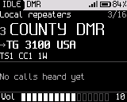

<!-- SPDX-License-Identifier: MIT -->
<!-- Copyright (c) 2026 The RadioFoundry Authors -->

# Radio reference

The rest of this manual describes what RadioFoundry does on every radio. This chapter lists what differs from radio
to radio: which physical key does each job, the power levels, the battery, the power switch, the display, and what a
radio lacks. For which radio has a feature, see the [feature matrix](../feature-matrix.md).

<!-- generated: tools/boards.py docs radios; edit boards/*/board.toml [status] -->
| Radio | Also sold as | What works |
|---|---|---|
| [Baofeng DM-32UV](#baofeng-dm-32uv) |  | FM and DMR voice both ways, CTCSS/DCS, APRS both ways, GPS data, the hotspot and each split duplex half work on air. Open: FM deviation at 12.5 kHz and an outdoor GPS fix. |
| [Baofeng DM-1701](#baofeng-dm-1701) | Retevis RT84 | FM, DMR voice and data, text messages, alerts, emergency, scan, the hotspot, single frequency repeating, each split duplex half and the USB network services work on air. Open: standalone SFR and a two-radio split duplex pair. |
| [Baofeng DM-1801 Pro](#baofeng-dm-1801-pro) | Baofeng DM-1801 | FM with CTCSS/DCS, DMR voice with the radio's own codec, DMR data and text, the hotspot, single frequency repeating, the PPP network services and each split duplex half work on air. Open: VHF transmit and VOX. |
| [Radioddity DB25-D PRO](#radioddity-db25-d-pro) | Kydera CDR-300UV | FM and DMR voice both ways, the hotspot, the DMR VFO, the PPP network services, cable programming and settings storage work on the radio. The older FD6818 batches run the same image, untested on a radio. Open: the Retevis RT73. |
| [TYT MD-380](#tyt-md-380) | TYT MD-390, Retevis RT3 | FM with CTCSS both ways, DMR voice and SMS in simplex and through a repeater or hotspot on either slot, and codeplug and ID database programming work on a UHF radio. Open: DCS, the tone deviation and the untested VHF image. |
| [TYT MD-UV380](#tyt-md-uv380) | TYT MD-UV390, Retevis RT3S, TYT MD-UV390 Plus 10 W | Built on the UV380 family code, with the MD-UV380's keys, display, power tables and GPS. Run on radios by community testers. |
| [TYT MD-9600](#tyt-md-9600) | Retevis RT90 | One image serves every board revision. On a V1-V3 radio, FM and DMR on both bands, DMR voice and data, text messages, roaming, scan, dual watch, APRS, the hotspot, each split duplex half and the USB network services work on air, with every power level checked on a wattmeter on both bands. V4A/V5 boards are detected; on older boards the radio asks for the revision once. Open: V4 and V4A/V5 boards have not run on a radio, and SFR loses inbound voice frames. |
| [Retevis RT10](#retevis-rt10) |  | Boots from the boot ROM with the host link, stub entry, the watchdog and the crash log. FM receive with CTCSS/DCS decode, FM transmit, DMR transmit and receive with the radio's own codec, P25 (conventional, and trunked transmit) and NXDN at 4800 bit/s on stored channels, and APRS transmit work on the radio. |
<!-- end generated -->

[Planned radios](#planned-radios) lists the radios that aren't in a release.

## Key roles

The manual names keys by the job they do. Each radio puts those jobs on its own keys:

| Name in this manual | Job (press / hold) | DM-1701 | MD-380 | MD-UV380 | DM-32UV | DB25-D PRO | DM-1801 Pro |
|---|---|---|---|---|---|---|---|
| **OK** | Open or choose / save, make permanent | Green Menu key | Green Menu key | Green Menu key | Green Menu / OK key | Menu / OK key, or push the knob | Menu key |
| **Back** | Back one level / Home | Red Back key | Red Back key | Red Back key | Red Back key | B/E key | Back key |
| **Up**, **Down** | Move the focus / repeat | Arrow keys | Arrow keys | Arrow keys | Up and Down keys | None: turn the knob | Up and Down keys |
| **\*** | Quick settings / lock or unlock the keys | **\*** | **\*** | **\*** | **\*** | P1 | **\*** |
| **#** | Actions / talk target picker | **#** | **#** | **#** | **#** | P2 | **#** |
| **0** to **9** | Number keys | Number keys | Number keys | Number keys | Number keys | None | Number keys |
| **Monitor** | FM: squelch open while held. DMR: digital monitor on / off | SK1 | SK1 | SK1 | SK1 | P3 | SK1 |
| **Talk target** | Talk target picker | Hold **#** | Hold **#** | Hold **#** | Hold **#** | Hold **P2** | Hold **#** |
| **A/B** | Dual watch: the other channel / dual watch on or off | SK2 | SK2 | SK2 | SK2 | TONE/T.SEL | A/B key, SK2 |
| **Power level** | Next power level / emergency (held 1.5 s) | SK3 | None | None | None | None | None |
| **Previous zone**, **Next zone** | Step the zone on Home | P1, P2 | None | None | P1, P2 | None | Left, Right |
| **VFO** | Between the channel and the VFO / copy the channel to the VFO | None | None | None | None | None | VFO/MR key |
| **Volume** | Open the volume editor. Radios without a volume knob only | None: the knob | None: the knob | None: the knob | None: the knob | VOL/SQL | None: the knob |
| **PTT** | Transmit | PTT | PTT | PTT | PTT | PTT on the microphone | PTT |
| Channel knob | One step per click | Channel knob | Channel switch (16 positions) | Channel knob | Channel knob | Front knob | None: Up and Down |

These are the defaults. In **Settings > Keys**, you can give other jobs to every key that the menus don't need
([Settings](17-settings.md#keys-key-8)):

| Radio | Keys you can set |
|---|---|
| DM-1701 | SK1, SK2, SK3, P1, P2 |
| MD-380 | SK1, SK2 |
| MD-UV380 | SK1, SK2 |
| DM-32UV | SK1, SK2, and P1, P2 on Home |
| DB25-D PRO | P3, TONE/T.SEL, the microphone's P4 and P5 |
| DM-1801 Pro | SK1, SK2, SOS, A/B, VFO/MR |

**OK**, **Back**, the arrows, the number keys, **\***, **#**, **PTT**, and the volume keep their jobs. On the DM-32UV,
the arrows are printed P1 and P2: the jobs you set for them work on Home only, and in the menus they stay left and
right. On the DB25-D PRO, the fixed keys include P1, P2, and the microphone's P6 and P7, which are **\*** and **#**
there.

The hints at the bottom of the screen use these names. A radio that knows its own name for a key shows that name
instead (the MD-9600 shows "P1 Quick", not "\* Quick"). A radio without number keys leaves out the hints that need
them.

On a radio without a key for a job, use the menus:

| Job | Without the key |
|---|---|
| Power level | **\***, **1** (quick settings, Power) |
| Change the zone | **OK**, **4** (Zones), then pick a zone |
| Talk target | **\***, **8** |
| Monitor | **\***, **5** turns it on until you turn it off |
| Emergency | Give it to a side key's hold in **Settings > Keys** |

## Dual watch on each radio

[Dual watch](12-scan.md#dual-watch) listens on two channels, A and B. Every supported radio has one receiver, so dual
watch alternates between A and B. The radio can miss a call on one channel while it listens on the other.

| Radio | Start | Switch A / B |
|---|---|---|
| DM-1701 | **\***, **7**, or hold **SK2** | **SK2** (a press), or **#**, **1** |
| MD-380 | **\***, **7**, or hold **SK2** | **SK2** (a press), or **#**, **1** |
| MD-UV380 | **\***, **7**, or hold **SK2** | **SK2** (a press), or **#**, **1** |
| DM-32UV | **\***, **7**, or hold **SK2** | **SK2** (a press), or **Left** / **Right** |
| DB25-D PRO | Hold **TONE/T.SEL** | **TONE/T.SEL** (a press) |
| DM-1801 Pro | Hold the **A/B** key, **\***, **7**, or hold **SK2** | The **A/B** key or **SK2** (a press), or **Left** / **Right** |

With dual watch off, a press of the switch key shows "Turn on dual watch first". On the DM-1801 Pro, the zones are on
a hold of **Left** / **Right**, or in the Zones menu. The DB25-D PRO's second BK4819 chip is a local oscillator for
the receive chain, not a second receiver.

A and B can be any channel of any zone, or the VFO ([how the core does it](../spec/radio-features.md#21-dual-watch)).

## The volume bar

On a radio whose volume knob RadioFoundry reads, turning the knob shows the volume at the bottom of the screen: a bar
of 16 steps and the step number. On a screen that uses its bottom row, such as Quick settings, the bar is at the top.
The bar goes away 3 seconds after you stop turning, and the screen under it carries on (a call, a menu). Turning the
knob also turns on the backlight. On a radio without a knob, the **Volume** key opens the volume screen instead. A
radio whose volume control acts after the radio chip can't know the level, and shows nothing.



## Setting the volume from a PC

`rfoundry_debug.py volume` prints the volume the radio uses and where it comes from. `rfoundry_debug.py volume 12`
sets step 12 of 16 (0 is mute), and `rfoundry_debug.py volume knob` gives control back to the knob. Over the serial
cable of the DM-32UV, add `--port /dev/ttyUSB1` or the port of your cable. What this does depends on the radio:

| Radio | Volume from a PC |
|---|---|
| DM-1701 | Yes. The radio reads the knob and sets the audio gain itself, so the PC's level replaces the knob's until you send `knob` or restart the radio. The level isn't saved |
| MD-380 | No. The knob acts on the audio path directly, and the radio answers "not supported" |
| MD-UV380 | Yes, as on the DM-1701 (the same audio path) |
| DM-32UV | No. The knob acts on the audio amplifier directly, and the radio answers "not supported" |
| DB25-D PRO | Yes. There is no knob: the level is the radio's own volume setting, so the PC changes that setting and the radio saves it, as if you had set it on the radio. `knob` sets it back to the default (step 8) |

## Programming

The [Codeplug Editor](04-programming.md#the-codeplug-editor) programs every radio in this chapter. qdmr needs a radio
on the port and the addresses that its driver knows.

| Radio | Cable | qdmr |
|---|---|---|
| DM-1701 | USB | Radio type 8 (10 on the other screen variant). qdmr's driver for the UV380 family |
| MD-380 | USB | Radio type 7 |
| DM-32UV | Programming cable (no USB) | Can't program it directly. RadioFoundry keeps the codeplug 7 MB into the radio's data flash, so the addresses that qdmr's driver uses land in the original firmware's area, where RadioFoundry refuses writes. Edit the codeplug in qdmr, save it as YAML, and write it with `dm32_migrate.py restore --yaml FILE` ([Moving from the original firmware on the DM-32UV](#moving-from-the-original-firmware-on-the-dm-32uv)), which adds the offset. The radio reports radio type 6 (MD-UV380) |
| DB25-D PRO | Programming cable, K1 jack ([Programming the DB25-D PRO over the cable](#programming-the-db25-d-pro-over-the-cable)) | Reports type 6. The codeplug sits at the DM-1701's addresses, so qdmr's MD-UV380 driver might work with it |
| DM-1801 Pro | Programming cable | Not listed |

### Codeplug files from the original firmware

The Codeplug Editor converts these files when you open them ([Files](04-programming.md#files)).

| Radio | Files it opens | Convert first |
|---|---|---|
| DM-1701, RT84 | The web installer's backup, a dump of the radio's data flash | The manufacturer's MD-UV380 family CPS file (`.rdt`): `dmrconf decode --manufacturer --radio dm1701 FILE.rdt FILE.yaml`, then open the YAML |
| MD-380, MD-390, RT3 | The web installer's backup, a dump of the radio's data flash, the manufacturer's CPS file (`.rdt`) | |
| DM-32UV | The web installer's backup taken on the original firmware, its `data-memory.bin` or `original-channels.bin` (the first 84 channels) | Past 84 channels, or offline: `tools/backup_codeplug.py BACKUP.zip -o DIR`, then open `DIR/<name>-ported.yaml` ([From a web installer backup](#from-a-web-installer-backup)) |

## Baofeng DM-1701

Also sold as the Retevis RT84. A handheld for 136-174 and 400-480 MHz with a keypad, a channel knob, a volume knob
with the power switch, three side keys, and a color screen.

### Installing on the DM-1701

Follow [Installing](02-installing.md) with these values:

| Item | DM-1701 |
|---|---|
| Original firmware file | Baofeng's `DM-1701(CSV)-V02.06.bin` or `DM-1701(noCSV)-V02.06.bin` (V02.06), or Radioddity's V02.01, V02.02, or V02.03 file (`Firmware-DM-1701(CSV)-V02.01.bin`, `DM-1701(CSV)-V02.02.bin`, `DM-1701(CSV)-V02.03 Only for Radioddity.bin`, `DM-1701-V02.03 Only for Radioddity.bin`). Each gives the bootloader key and the voice codec. An archive of V02.06 is at github.com/daniel5600/BAOFENG-DM1701-Original-Firmware |
| MD-9600 files | Any TYT MD-9600 V16.45 or V06.09 file (`MD9600-CSV(V4)-V16.45.bin` and the rest) gives the voice codec, the one an OpenGD77-family install leaves on the radio. It doesn't give the bootloader key, and the installer never writes it back as the radio's firmware. Also select a DM-1701 file, or read the radio first (**Another open firmware**, which finds this codec in the radio) |
| `--stock-installed` | The version the radio runs, for example `"V02.06 CSV"` |
| Bootloader keys | Hold **PTT** and **SK1** together while you turn the radio on with the volume knob |
| Bootloader USB device (Zadig) | "Digital Radio in USB mode" (0483:DF11), [driver steps](02-installing.md#windows-the-bootloader-driver) |
| Board name | `dm1701` |
| Going back to the original firmware | Baofeng's firmware upgrade tool, in the original firmware archive. It writes the application and the resource area that the original firmware keeps in the SPI flash |

### DM-1701 keys

| Key | Where | Role |
|---|---|---|
| Green Menu key | Keypad | **OK** |
| Red Back key | Keypad | **Back** |
| Arrow keys | Keypad | **Up**, **Down** |
| P1, P2 | The two front function keys | **Previous zone**, **Next zone** |
| SK1 | The top side key, above **PTT** | **Monitor**. Held with **PTT** at power-on, it starts the bootloader |
| SK2 | The side key below **PTT** | **A/B**: press to switch A / B in dual watch, hold to turn dual watch on or off. The talk target picker is on a hold of **#** |
| SK3 | The lowest side key | **Power level**. Press: the next power level. Hold for 1.5 seconds: emergency. A build without emergency says "Voice prompts: not in this build" on a hold |
| **PTT** | | **PTT** |
| Channel knob | | Channel knob |

The side keys are, top to bottom, SK1, **PTT**, SK2, and SK3.

### DM-1701 power levels

Five levels: 100 mW, 500 mW, 1 W, 2.5 W, and 5 W. The values are nominal and use the radio's factory calibration.

| Way to change it | Levels |
|---|---|
| A channel without a power in the codeplug | 1 W |
| **\***, **1** | 100 mW, 1 W, 5 W |
| SK3 on Home | All five, one per press |

### DM-1701 battery

A 2-cell Li-ion pack. The percentage follows the resting voltage: 4.10 V a cell is full and 3.20 V is empty.

| Level | Below |
|---|---|
| Low | 6.2 V |
| Critical | 6.0 V |

### DM-1701 power switch

The power switch is on the volume knob. Turn it clockwise past the click to switch on, and counterclockwise to the
click to switch off. The switch cuts the battery sense line, so the radio sees "off" as a reading below 5.5 V. It
finishes what it's doing, saves, and drops its own power. A deeply discharged battery reads the same way, and the
radio shuts down.

If the radio can't cut its own power while the knob is still on (auto power off), it comes back after 2 seconds and
shows "Couldn't switch off / Turn the knob off".

### DM-1701 display

A 160 x 128 color screen with the top 8 rows hidden: 160 x 120 visible. The screenshots in this manual are this size.

### What the DM-1701 lacks

- No GPS from the factory. LRRP location requests get "no fix". APRS positions come from a computer or a fixed
  position. If you fit a GPS module yourself, wire its NMEA output to PA10 (STM32 pin 69) and its power enable, if it
  has one, to PA9. The radio finds the module at start-up and powers it only while **Settings > Location > GPS** is
  on.
- APRS receive needs the squelch open: the radio hears packets strong enough to open the squelch, not weaker ones.
- No APRS iGate (passing heard packets to APRS-IS) in the release image: it doesn't fit in the flash.
- No vibration motor: **Settings > Sound > Vibrate** isn't in the image.
- As a [standalone SFR](14-hotspot.md#standalone-sfr) user, the radio hears one copy of a call at a time. **SFR
  receive** "First copy" and "Dual-path RX" switch to the other copy only between calls, and never mix the copies.
- In hotspot mode, MMDVM SFR repeats a whole call about 210 ms after the original, not 90 ms.

## TYT MD-380

Covers the TYT MD-380, the MD-390, and the Retevis RT3. To install with your codeplug from the original firmware, see
[Moving from the original firmware on the MD-380](#moving-from-the-original-firmware-on-the-md-380).

> **Check your frequency.** Some MD-380s receive and transmit 2 to 2.5 kHz high, enough that an MMDVM hotspot never
> decodes them. Check yours against an external reference (a frequency counter, a service monitor, or a hotspot's
> MMDVMCal BER test). Then correct it with **Settings > Advanced > Freq trim**: enter the error with the sign reversed
> (2 kHz high at 448.7 MHz: -4.5 ppm). With that correction, such a radio decodes on the hotspot at a BER under 0.1%.

### Installing on the MD-380

Follow [Installing](02-installing.md) with these values.

| Item | MD-380 |
|---|---|
| Original firmware file | The manufacturer's `MD-380-D2.32(AD).bin` (D002.032), or TYT's `TYT-72310-11-MD380-D35.14.bin` (D35.14) or `TYT-72310-11-MD390-S35.14.bin` (S35.14). It gives the bootloader key and the voice codec. The archive at md380.org/firmware/orig/ has every release |
| Bootloader keys | Hold **PTT** and the side key just above it while you turn the radio on |
| Images | One for each band: UHF and VHF. rfoundry takes `--option BAND=vhf` |
| Bootloader USB device (Zadig) | "Digital Radio in USB mode" (0483:DF11), [driver steps](02-installing.md#windows-the-bootloader-driver) |
| Board name | `md380` |

### Moving from the original firmware on the MD-380

[Moving from the original firmware](18-moving-from-stock.md) describes the steps. The MD-380 values:

| Item | MD-380 |
|---|---|
| Migration program | `tools/md380_migrate.py` |
| qdmr | 0.12 or later |
| Python packages | `pip install pyusb pyserial`, plus libusb: macOS `brew install libusb`, Linux `apt install libusb-1.0-0` |
| Image | `rfoundry_md380_codec.bin` (codec included), or `rfoundry_md380.bin` with `--stock "MD-380-D2.32(AD).bin"`, which merges the codec in. Use the image for your radio's band |
| Original firmware file | `MD-380-D2.32(AD).bin` (D2.32) gives the bootloader key and the voice codec. D2.30 gives the key only. A key file (`--key`) works too. TYT's download page (tyt888.com/download.html) ships the update as a Windows program with the `.bin` inside, and md380.org/firmware/orig/ has every release as plain files. The web installer also takes TYT's download zip as it is |
| Update-mode keys | Turn the radio off. Hold **PTT** and the upper side key, and turn the radio on. The screen stays dark |
| Codeplug files for `--from` | `.rdt` (262,709 bytes) from the TYT CPS, `.dfu` from dmrconf, `.yaml` from qdmr |
| Work directory | `~/RadioFoundry-MD380-migration/<date-time>/` |
| Going back | `python3 md380_migrate.py flash --image "MD-380-D2.32(AD).bin"`. Then write your `backup-stock.rdt` or `backup-stock.dfu` with the TYT CPS or qdmr (`dmrconf write --radio md390`) |

```sh
python3 md380_migrate.py all --image rfoundry_md380_codec.bin --stock "MD-380-D2.32(AD).bin" --dry-run
```

To build the image yourself ([Building](../dev/building.md)), run `make BOARD=md380` for UHF
(`build/md380/rfoundry_md380.bin`) or `make BOARD=md380 BAND=vhf` for VHF (`build/md380-vhf/rfoundry_md380.bin`).
With `MD-380-D2.32(AD).bin` in `codecs/`, the build also writes `rfoundry_md380_codec.bin`.

- The original firmware holds up to 250 zones and 250 RX group lists.
- If the screen stays dark and the LED keeps blinking after you go back, the radio is still in the bootloader. Turn it
  off and on. If that does nothing, remove the battery and refit it. The program tells you when it sees this.
- Windows: to install, bind the bootloader (0483:DF11) to WinUSB with Zadig
  ([steps](02-installing.md#windows-the-bootloader-driver)). That replaces the driver that the TYT CPS uses for the
  same USB ID, so run the backup step first.
- Linux: if access is denied, the program prints the udev rule for 0483:DF11.

### MD-380 keys

| Key | Role |
|---|---|
| Green Menu key | **OK** |
| Red Back key | **Back** |
| Arrow keys | **Up**, **Down** |
| SK1 | **Monitor** |
| SK2 | **A/B** |
| **PTT** | **PTT** |
| Channel switch | Channel knob. A 16-position switch, not an endless knob: RadioFoundry turns each change of position into steps |

The MD-380 has no **P1**, **P2**, or **SK3**, so it has no **Power level** key, no zone keys, and no emergency key.
Change the zone with **OK**, **4**, and the power with **\***, **1**. The bootloader starts when you hold **PTT** and
the side key just above it at power-on.

### MD-380 bands and power levels

One band for each radio: UHF (400-480 MHz) or VHF (136-174 MHz). There is one image for each band, and an image
refuses the other band.

Five power levels: 100 mW, 500 mW, 1 W, 2.5 W, and 5 W. 1 W and 5 W come from the factory calibration, and the radio
sets the others from them. A channel without a power in the codeplug uses 1 W. **\***, **1** steps through 100 mW,
1 W, and 5 W. The radio refuses to transmit without a valid factory calibration.

### MD-380 battery

A 2-cell Li-ion pack, with the same percentage curve and the same thresholds as the DM-1701: low below 6.2 V, critical
below 6.0 V.

### MD-380 power switch

The power switch is on the volume knob. It switches the supply directly, so RadioFoundry doesn't see the knob turn
off. When RadioFoundry switches itself off (auto power off), it drops its power latch.

### MD-380 display

A 160 x 128 color screen, every row visible.

### What the MD-380 lacks

- A build with `CONFIG_SUBTONE=n` ([build switches](../build-config.md)) opens a channel with a tone on any carrier,
  and sends no tone.
- No roger beep, 1750 Hz burst, touch tones (DTMF), or APRS on FM: the transmit tone path isn't written. APRS
  positions over DMR work.
- No APRS receive.
- No single-frequency repeating (SFR): the radio's DMR chip (HR_C5000) can't send what SFR needs. No split duplex
  repeater: it isn't written for this radio. Hotspot mode is in.
- Audio linking (USRP, [USB network](15-usb-network.md#linking-audio-allstarlink-and-dvswitch)) carries DMR only: the
  FM transmit path from the processor isn't written.
- GPS only on the "G" models. The radio listens for the GPS module for 5 seconds at start-up, and hides the GPS
  features if it hears nothing. Once heard, the module is powered only while **Settings > Location > GPS** is on,
  which takes effect at once.
- No vibration motor: **Settings > Sound > Vibrate** isn't in the image.
- Some early VHF radios have a 1 MB memory chip instead of 16 MB. RadioFoundry keeps settings and the codeplug on it
  as on other radios, but the DMR ID database is limited to what fits.

## TYT MD-UV380

Covers the TYT MD-UV380, the MD-UV390, the Retevis RT3S, and the MD-UV390 Plus 10 W, with or without GPS. It is the
DM-1701's board design. The image is built from the DM-1701's code with this radio's keys, display, power tables, and
GPS.

### Installing on the MD-UV380

Follow [Installing](02-installing.md) with these values.

| Item | MD-UV380 |
|---|---|
| Original firmware file | Any supported TYT or Retevis file: 18.11, 18.16, 19.06, 19.26, 19.74, 219.60, or 219.74. It gives the bootloader key and the voice codec. The codec is the same in all of them, so any of them works on any of these radios |
| Bootloader keys | Hold **PTT** and the side key just above it (SK1) while you turn the radio on |
| Images | Two: 5 W (the MD-UV380, MD-UV390, and RT3S) and 10 W (the MD-UV390 Plus). rfoundry takes `--option POWER=10w`. **Pick by the label on the radio or its box.** The two versions swap the transmitter's band select and the backlight pins, and the radio can't tell them apart, so nothing catches a wrong image |
| Bootloader USB device (Zadig) | "Digital Radio in USB mode" (0483:DF11), [driver steps](02-installing.md#windows-the-bootloader-driver) |
| Board name | `mduv380` |

### MD-UV380 keys

| Key | Role |
|---|---|
| Green Menu key | **OK** |
| Red Back key | **Back** |
| Arrow keys | **Up**, **Down** |
| SK1 (upper side key) | **Monitor** |
| SK2 (lower side key) | **A/B** |
| **PTT** | **PTT** |
| Channel knob | Channel knob |

The MD-UV380 has no **P1**, **P2**, **SK3**, or top key, so it has no **Power level** key, no zone keys, and no
emergency key. Change the zone with **OK**, **4**, and the power with **\***, **1**.

### MD-UV380 power levels

Nine levels: 50 mW, 250 mW, 500 mW, 750 mW, 1 W, 2 W, 3 W, 4 W, and 5 W. On the MD-UV390 Plus 10 W image, the top four
are 2, 3, 5, and 10 W. A channel without a power in the codeplug uses 1 W. The radio refuses to transmit without a
valid factory calibration.

### MD-UV380 battery

A 2-cell Li-ion pack, with the DM-1701's percentage curve and thresholds: low below 6.2 V, critical below 6.0 V. The
voltage scale is the MD-UV380's own.

### MD-UV380 power switch

As on the DM-1701: the switch is on the volume knob, and RadioFoundry sees it turn off through the battery line.

### MD-UV380 display

A 160 x 128 color screen, every row visible.

### What the MD-UV380 lacks

- No vibration motor: **Settings > Sound > Vibrate** isn't in the image.
- GPS only on the G models. The radio powers the module for 5 seconds at start-up, and hides the GPS features and
  switches the module off again if it hears nothing. Once heard, the module is powered only while **Settings >
  Location > GPS** is on, which takes effect at once.

## Baofeng DM-32UV

A handheld for 136-174 and 400-480 MHz with a keypad, left and right arrow keys, a channel knob, and a color screen.
Broadcast receive covers 65 to 108 MHz ([Air band and FM
broadcast](07-channels-zones-vfo.md#air-band-and-fm-broadcast)). As a [standalone SFR](14-hotspot.md#standalone-sfr)
repeater, it repeats calls 90 ms later and sends its CW ID. To install with your codeplug from the original firmware,
see [Moving from the original firmware on the DM-32UV](#moving-from-the-original-firmware-on-the-dm-32uv).

### Installing on the DM-32UV

Follow [Installing](02-installing.md) with these values.

| Item | DM-32UV |
|---|---|
| Original firmware file | The manufacturer's `DM32.01.01.049.bin` |
| Cable | The USB-serial programming cable. The radio has no USB of its own |
| Update mode | Hold **PTT** and **SK1** while you switch the radio on. The green LED lights |
| If the cable can't prepare the radio | **Use Factory Update Mode**: the update mode above, with the original firmware file for the codec. It takes about 2.5 minutes, and the radio restarts by itself |
| Board name | `dm32` |

### Moving from the original firmware on the DM-32UV

[Moving from the original firmware](18-moving-from-stock.md) describes the steps. The DM-32UV values:

| Item | DM-32UV |
|---|---|
| Migration program | `tools/dm32_migrate.py` |
| qdmr | 0.15 or later |
| Python packages | `pip install pyserial` |
| Image | `rfoundry_dm32_codec.bin`, with the codec merged in. An image without the codec works with `--codec-from DM32.01.01.049.bin` |
| Cable | The USB-serial programming cable (CH340, FTDI, or CP210x). The original firmware, the bootloader, and RadioFoundry all use it. With one cable plugged in, the program finds it. Otherwise, add `--port /dev/ttyUSB0` (Linux), `--port /dev/cu.usbserial-XXXX` (macOS), or `--port COM5` (Windows) |
| Update-mode keys | Turn the radio off. Hold **PTT** and **SK1** (the side key just below **PTT**), and turn the radio on. The green LED lights. The radio erases its old firmware first, which takes up to 15 seconds |
| Extra step 3b | Data flash backup: the program reads the original firmware's codeplug and calibration area (800 KB, about 2 minutes) into the work directory. `--flash-backup full` saves all 16 MB (about 30 minutes), and `--flash-backup none` skips it |
| Codeplug files for `--from` | A `.dfu` file (`dmrconf read --radio dm32uv`) or a `.yaml` file saved with qdmr. Files from Baofeng's CPS aren't supported: read the radio with qdmr and save the codeplug from there. `import --from FILE` converts and checks a file with no radio |
| Conversion report | `conversion-report.txt` lists the counts before and after, names that get shortened, channels outside 136-174 and 400-480 MHz, and the parts of the codeplug that RadioFoundry doesn't use. Roaming, APRS settings, encryption keys, and the contact database of the original firmware aren't carried over either |
| ID database | The radio holds about 300,000 records. When the list is longer, the program keeps the ones nearest your ID |
| Work directory | `~/RadioFoundry-DM32-migration/<date-time>/` |
| Going back | `python3 serial_loader.py --stock DM32.01.01.049.bin` |

```sh
python3 dm32_migrate.py all --image rfoundry_dm32_codec.bin --dry-run
```

RadioFoundry never writes the bootloader, so update mode always works. It never writes the data flash below 7 MB
either, where the original codeplug, the factory calibration, and the original contact database are. When you go back
to the original firmware, the radio comes back with your old codeplug. If it doesn't, write `backup-stock.dfu` with
qdmr (`dmrconf write --radio dm32uv`). RadioFoundry's own data stays at 7 MB and up, and the original firmware might
reuse that space later.

To install an image without touching the codeplug, use `serial_loader.py`:

```sh
python3 serial_loader.py --model dm32 rfoundry_dm32_codec.bin   # a raw image (a _BFUV32.bin file needs no --model)
python3 serial_loader.py --list-ports                            # the cables it sees
```

- If the radio doesn't start after an installation, remove the battery and refit it. Update mode still works.
- Windows: install the cable's driver (CH340 or FTDI) first.

### From a web installer backup

At the end of an installation from the original firmware, the web installer brings your codeplug over by itself.
Without qdmr, the [Codeplug Editor](04-programming.md#the-codeplug-editor) and the Tools page convert the original
codeplug from a data flash read: the web installer's backup `.zip` taken on the original firmware, or the
`data-memory.bin` or `original-channels.bin` in it. They bring over channels with their TX contact, contacts, RX group
lists, zones, your DMR ID, and the boot text. Power, bandwidth, tones, timeslot, and color code come with each channel.
Squelch, TX timeout, and scan lists stay at RadioFoundry's defaults, and the converter reads the first 84 channels
only. qdmr 0.15 doesn't read the TX contacts of the original firmware, so use this way to keep them.

`tools/backup_codeplug.py BACKUP.zip -o DIR` gets the original codeplug out of the same backup offline, through qdmr's
`dmrconf` (0.15 or later). It reads every channel and puts back the TX contacts that dmrconf alone loses:

- `<name>-stock.yaml` and `.dfu`: the original codeplug as qdmr reads it.
- `<name>-ported.yaml`, `.dfu`, and `.bin`: the codeplug ported to RadioFoundry. Open the YAML in the Codeplug Editor,
  or write the `.bin` with `cps_client.py write`.
- `<name>-rfoundry.yaml`: RadioFoundry's own codeplug, when the backup holds one.

### DM-32UV keys

| Key | Role |
|---|---|
| Green Menu / OK key | **OK** |
| Red Back key | **Back** |
| Up, Down | **Up**, **Down** |
| P1, P2 (left and right on the 4-way key) | On Home, press or hold: **Previous zone**, **Next zone**, or the jobs that **Settings > Keys** sets for them. Left and right in the menus |
| SK1 (the side key below **PTT**) | **Monitor**. Held with **PTT** at power-on, it starts the bootloader |
| SK2 | **A/B** |
| **PTT** | **PTT** |
| Channel knob | Channel knob |

By default, the DM-32UV has no **Power level** key and no emergency key. Give these jobs to P1 or P2 in **Settings >
Keys** (emergency on a hold), or change the power with **\***, **1**.

### DM-32UV power levels

Five levels from the radio's factory calibration. The screen names them L-, L, M, M+, and H. The radio is rated 5 W
(VHF) and 4 W (UHF) at H. A channel without a power in the codeplug uses L. **\***, **1** steps through L-, L, and H.

### DM-32UV battery

The percentage is linear from 6.4 V (0%) to 8.2 V (100%). There are no voltage thresholds: only the percentage warning
(**Settings > Power saving > Low battery warning**) applies, and a low battery never stops a transmission.

### DM-32UV power switch

The power switch is on the knob. The radio sees it turn off (three readings in a row), saves, and drops its own power.
The volume control acts on the audio amplifier directly. RadioFoundry doesn't read it, and can't set it from a PC.

### DM-32UV display

A 240 x 320 color screen. RadioFoundry uses its full resolution, with smooth (anti-aliased) bold text one size larger
than on other 240 x 320 radios.

### What the DM-32UV lacks

- On the newer RF section (the diagnostics line ends in `rf B`), no air band AM receive: an AM channel plays as FM.
- No USB. The serial port is on the programming cable: hotspot mode, the debug link, and the network (PPP,
  [USB network](15-usb-network.md#network-over-the-programming-cable-ppp)) all run there. USB network mode isn't
  available.
- The GPS module must answer within 5 seconds of start-up. After that, it's powered only while **Settings >
  Location > GPS** is on, which takes effect at once.
- While APRS listens, FM on the APRS frequency plays through a different audio path, which can sound different.
- No VOX: the code that reads the microphone level isn't written for this radio.
- Audio linking (USRP) carries DMR only: the FM transmit path from the processor isn't written.
- No beeps while transmitting: the radio's beep path would put them on the air. A beep that is still playing when the
  transmission ends is heard from then on. The DMR talk permit tone is a single short beep, played just before the
  radio transmits, while the screen shows ADMITTED ([DMR](09-dmr.md#the-talk-permit-tone)).
- As a standalone SFR repeater, its repeated voice carries more bit errors than the original, though it plays.
- The signal strength in dBm is uncalibrated: strong signals read high.
- No vibration alerts: RadioFoundry doesn't drive a vibration motor on this radio, and **Settings > Sound > Vibrate**
  isn't in the image.

## Radioddity DB25-D PRO

A mobile radio for 136-174 and 400-480 MHz with a front knob, a few front keys, and a hand microphone. You install it
with the [radio programming utility](#installing-the-db25-d-pro) only.

**Which DB25-D.** Open the radio's **Version** screen. The version reads like `909E.DBB.EARSAB.020`. The letters after
`909E.` name the hardware.

| Code | Hardware | RadioFoundry |
|---|---|---|
| DBB | DB25-D PRO: two BK4819 (2024 on) | Supported |
| D64 | FD6818 transceiver, 0x7813 LO (2021 to 2023) | The same image |
| D66 | FD6818 transceiver and LO (2021 to 2023) | The same image |
| D6T | FD6818 transceiver, AT1141 LO (2021 to 2023) | The same image |

One image runs on every batch: it reads which RF chips the radio has when it starts. **Tools > Diagnostics** shows
them (the `rf` line). If you install it on a D64, D66, or D6T, send a report of what works and what doesn't
([Reporting a problem](20-troubleshooting.md#reporting-a-problem)).

The radio programming utility reads the code from the radio before it writes, and asks for it when only the factory
update mode answers. On original firmware older than the 2025-01-21 build, a backup might fail. The utility offers
three choices: try the backup anyway (nothing is written to the radio's flash; if it fails, switch the radio off and
on), update the original firmware first, or install without a backup. **Back Up** offers the same try. You can send
a backup made that way to the project with a report, so the next version knows that firmware. **Back Up** works on
every hardware version, including one that RadioFoundry doesn't run on: it only reads the radio.

### Installing the DB25-D PRO

The radio programming utility on the web site installs and updates this radio over the programming cable (K1 jack).
There is no rfoundry route.

| The radio runs | What the radio programming utility does |
|---|---|
| The original firmware (909E.DBB.EARSAB.018 or .020) | Switches the radio to update mode through the original firmware's diagnostic console: about 4 minutes, with no keys and nothing written to the radio's memory. Then it backs up the whole 2 MB program memory (about a minute), installs, and restarts the radio, as for a radio that runs RadioFoundry. The voice codec comes from the backup when the version is 020 or one of the 018 builds of 2024-05-09 or later. For any other version, the backup is still complete: the utility says so, and asks for an 018 file from the manufacturer, whose codec works on every version |
| Another version of the original firmware, or a radio that doesn't start | Installs through the factory update mode of the original loader: turn the radio off, hold P1, and press power. The red LED lights and the display stays blank. No backup is taken this way. The loader itself is never written |
| RadioFoundry | Hands over to a loader in RAM over the debug link (no keys, no power cycle), writes only the changed sectors, and restarts the radio. The backup of the program memory is optional |
| RadioFoundry that doesn't answer | **Recover at Power-On**: the first stage answers for half a second at every power-on, and the radio programming utility loads the loader then |

A radio that shows a white, backlit screen and a solid red LED at every power-on, without P1 held, is stuck in the
factory update mode because its application is missing or incomplete. It needs no keys: the utility asks the loader a
read-only question, says that the radio is in update mode, and installs. Nothing is written to find this out.

When nothing answers on the cable, Troubleshooting offers **Reinstall in Factory Update Mode**, and Restore puts a
backup back through the factory update mode the same way. Restore through the console or RadioFoundry is the normal
route. The factory update mode is the way back when neither answers.

The radio programming utility's backup doesn't hold the channels and contacts in the radio's NAND memory. Back them up
with the manufacturer's programming software or `tools/cps_client.py`
([Programming the DB25-D PRO over the cable](#programming-the-db25-d-pro-over-the-cable)).

### DB25-D PRO keys

RadioFoundry doesn't read the hand microphone's number keys, so the radio has no number keys.

| Key | Role |
|---|---|
| Menu / OK, or push the knob | **OK** |
| B/E | **Back** |
| P1 | **\*** |
| P2 | **#** |
| P3 | **Monitor** |
| TONE/T.SEL | **A/B** |
| VOL/SQL | **Volume** |
| **PTT** on the microphone | **PTT** |
| Front knob | Channel knob, and **Up** / **Down** in lists |
| Power key | Press to switch on. Hold for 2 seconds to switch off. Hold P1 while you press it to start the bootloader (the red LED lights and the screen stays blank) |

The microphone's **PTT** works once the radio has seen a microphone in the front jack. The radio runs without one and
doesn't transmit, and a microphone plugged in later works from then on. If you unplug the microphone while the radio
is on, the radio reads it as a held **PTT**: it transmits until the [transmit timeout](08-fm.md#transmit-timeout), or
with TX timeout Off, until you switch it off. Switch the radio off before you unplug the microphone.

### DB25-D PRO power and supply

Five power levels. The screen names them L--, L-, L, M, and H. L and H (nominal 20 W) come from the factory
calibration, and the radio sets the others from them. A channel without a power in the codeplug uses L. The radio
refuses to transmit until RadioFoundry can read its power calibration.

The radio runs from a 13.8 V supply and has no battery. The status line shows no battery icon or percentage, Tools has
no Battery page, and **Settings > Power saving** has no Battery saver or Low battery warning. RadioFoundry doesn't read
the supply voltage, so nothing warns about it.

### DB25-D PRO display

A 1.77" color screen, 160 x 128.

There is no volume knob. Press **VOL/SQL**, and turn the front knob (or press **Up** and **Down**) to set the volume
from 0 (mute) to 16. To close the volume screen, press **OK** or **Back**, or wait 3 seconds. The screen shows the
step as a large number over a bar of 16 segments. The level is also in **Settings > Sound > Volume**. RadioFoundry sets
it at the receiver chip's audio output and keeps it. A value saved by an earlier build that had 10 steps carries over
(step 5 becomes 8, step 10 becomes 16).

### Programming the DB25-D PRO over the cable

Read and write the codeplug (channels, zones, contacts, the radio's name, and DMR ID) over the programming cable in the
side K1 jack, through a USB-serial adapter (115200 baud). The radio has no USB port. The codeplug is at the same
addresses as on the DM-1701, so `tools/cps_client.py` needs no offset, and qdmr's MD-UV380 driver might work with it
(the radio reports type 6). The tool needs `pyserial`. The examples use `/dev/ttyUSB1`:

```
python3 tools/cps_client.py --port /dev/ttyUSB1 info                  # type 6, build date, flash size
python3 tools/cps_client.py --port /dev/ttyUSB1 read backup.bin       # about 20 s
python3 tools/cps_client.py --port /dev/ttyUSB1 write backup.bin      # then the radio restarts
python3 tools/cps_client.py --port /dev/ttyUSB1 verify backup.bin     # "match"
```

Take a backup first. A radio with nothing stored shows the built-in simplex FM channels, and a read returns blank
(0xFF) bytes. To get test channels onto it, read the codeplug, add them to the file, and write it back:

```
python3 tools/cps_client.py --port /dev/ttyUSB1 read cp.bin
python3 tools/cps_client.py test-channels cp.bin --rx 438.2500 --tg 91 --cc 1 --ts 1 --id 9991234 --call Q0TST
python3 tools/cps_client.py --port /dev/ttyUSB1 write cp.bin
python3 tools/cps_client.py --port /dev/ttyUSB1 verify cp.bin
```

`test-channels` makes channel 1 an FM channel (12.5 kHz, simplex, no tones), channel 2 a DMR channel on the same
frequency (color code 1, timeslot 1, talk target group 91), and zone 1 holding both. It replaces those channels, the
first contact, and the first zone, and leaves everything else in the file. A DMR channel needs a build with
`CONFIG_DMR=y` (the default). Without it, the radio lists only its FM channels.

`verify` compares the regions that the tool transfers. The write replaces whole 4 KB sectors, each in one step: a
power cut or a pulled cable leaves every sector as it was or as the file has it, never half and half. The programming
tool never writes the radio's own settings or the factory calibration. The radio refuses a write while its storage
holds another firmware's data (`nst foreign` on the diagnostics page).

### What the DB25-D PRO lacks

- The GPS module must answer within 5 seconds of start-up. If it does, the radio has GPS (the APRS position source and
  the Location settings). If not, the GPS features are hidden. The module stays powered only while **Settings >
  Location > GPS** is on.
- No split duplex hotspot role.
- No APRS receive or iGate: the radio gives the core no FM receive audio.
- No VOX: the code that reads the microphone level isn't written for this radio.
- DMR voice needs the codec from a supported original firmware file.
- RadioFoundry keeps its settings in a part of the radio's memory that is otherwise unused. If it finds data there
  that it didn't write, it leaves the data alone and keeps no settings (the diagnostics page shows `nst foreign`).

## Baofeng DM-1801 Pro

A handheld for 136-174 and 400-470 MHz with a keypad, direction keys, and a 128 x 64 monochrome screen. Broadcast
receive covers 65 to 108 MHz ([Air band and FM broadcast](07-channels-zones-vfo.md#air-band-and-fm-broadcast)).

You install through the radio's own update mode, so the original loader stays, and the original firmware can go back
the same way. Switch the radio off, hold **PTT** and **SK1**, switch it on, then run
`tools/serial_loader.py --model dm1801pro IMAGE` over the programming cable. The cable's plug switches the internal
speaker and the microphone off. Unplug it to hear the radio or to talk.

**Settings > Talk & listen > Mic gain** sets the microphone level for FM and DMR on this radio.

`rfoundry flash IMAGE --board dm1801pro` does the same over the cable, and picks the way in by itself:

| The radio runs | rfoundry |
|---|---|
| RadioFoundry built with `CONFIG_STUB_ENTRY=y` | Enters the loader from RadioFoundry (the screen shows "PC Loader Connected"), writes only what changed, and restarts the radio. No keys to hold. The codec in the radio stays |
| Anything else | Asks you to put the radio in update mode (**PTT** and **SK1** at power-on). Update mode erases the codec, so the image must carry it (the build's `rfoundry_dm1801pro_codec.bin`), or give `--stock` with a program flash read of this radio (`stub/stubtool.py PORT --progmem FILE`) |

`--route stub` or `--route bootloader` chooses the way in by hand, and `--dry-run` shows the plan without writing.

In the web installer, when the cable can't prepare the radio, **Use Factory Update Mode** installs through the same
update mode (**PTT** and **SK1** at power-on). There is no original firmware file for this radio, so the codec comes
from a program memory backup of it (`program-memory.bin`, or the backup .zip that the installer saved before the
first installation), or from a codec that the browser kept.

### DM-1801 Pro keys

| Key | Role |
|---|---|
| Menu | **OK** |
| Back | **Back** |
| Up, Down | **Up**, **Down** |
| Left, Right | Left and right in editors. Hold: **Previous zone**, **Next zone** |
| VFO/MR | Channel or VFO. Hold: copy the channel to the VFO |
| A/B | Press: A / B (dual watch). Hold: dual watch on or off |
| **\*** | **\*** |
| **#** | **#** |
| SK1 | **Monitor** |
| SK2 | **A/B** |
| SOS (top) | Hold: emergency, in builds with emergency |
| **PTT** | **PTT** |

### DM-1801 Pro power and display

Five power levels. The screen names them L--, L-, L, M, and H. L, M, and H are the factory calibration's Low, Middle,
and High, and the radio sets the two under L from L. A channel without a power in the codeplug uses L. The radio
refuses to transmit until RadioFoundry can read its factory calibration.

The screen is monochrome, and the backlight is on or off. The radio vibrates for messages, call alerts, and
emergencies (**Settings > Sound > Vibrate**).

### What the DM-1801 Pro lacks

- No GPS: the radio has no GPS receiver.

## Retevis RT10

A handheld for 902-928 MHz with a 16-position channel knob, two side keys, and no display.

### Installing on the RT10

The radio has no bootloader of its own. The way in is the chip's boot window on the programming cable, at every
power-on.

| Item | RT10 |
|---|---|
| Cable | The radio's programming cable on the accessory jack, with an FTDI chip. A CH340 cable that works with other radios got no answer from the RT10 |
| Keys | None: turn the radio on when the tool asks |
| Backup | Installing replaces the whole original image. Only a full program flash backup taken first puts it back |
| Board name | `rt10` |

### The RT10's channel knob

The knob picks the channel by where it points: positions 1 to 16 are the first 16 channels of the zone, in the zone's
order. This also applies when the radio is switched on and when the zone changes. A position past the end of a
shorter zone changes nothing.

### RT10 power levels

Two levels, named **L** and **H**: the radio's own factory calibration for each 10 MHz step. Without a valid
calibration, the radio refuses to transmit.

### If the RT10's LEDs flash red and green fast

The cable line is stuck low. The radio doesn't transmit until the line is released: switch the radio off and on again.
If you hold **PTT** for more than 2 seconds while the radio starts, the LEDs show the same flash until you release the
key.

A programming cable can hold the line low by itself. Then the flash starts whenever that cable is in, and stops when
you pull it out, and the radio receives nothing from the computer. Use another cable
([Installing](02-installing.md#if-something-goes-wrong)).

### What the RT10 lacks

- The network over the programming cable (PPP) and its services. The cable's line latches when the computer and the
  radio send at the same time, and only switching the radio off frees it, so PPP is off by default in the RT10 build.
  A custom build can turn it on, at that risk.
- Hotspot mode. The hotspot software on the computer also sends at any time, so it can latch the line the same way.
  The hotspot is off by default in the RT10 build. A custom build can turn it on, at that risk.
- GPS. The radio has no receiver, so DMR position reports and LRRP location replies are off by default in the RT10
  build.
- A calibrated battery scale.
- No screen, so no VFO, dual watch, or DTMF.
- No VOX, audio linking (USRP), or split duplex repeater: they aren't written for this radio.

## TYT MD-9600

Covers the TYT MD-9600 and the Retevis RT90, a mobile radio. One image serves every board revision. Install it only if
you can go back to the original firmware.

The radio detects a V4A/V5 board by itself. It can't tell a V1-V3 board from a V4, so on those it asks once: the Home
screen says "Set: Board revision", and the radio doesn't transmit until you set **Settings > Advanced > Hardware > Board
revision**. Receiving works meanwhile. The installers set it for you when they can read the original firmware's version
(V06.xx is V1-V3, V16.xx is V4). Otherwise, they ask for it right after the installation. If you aren't sure, pick
V1-V3. If the radio then hears nothing on a channel that you expect it to hear, pick V4. A change of revision applies
from the next start ("Restart to apply").

### MD-9600 voice codec

DMR voice needs the radio's own codec, which neither the repository nor the release images contain. The installer
takes it from an original firmware file for the radio, and the board's own `codecs/` folder works the same way
([codecs/README.md](../../codecs/README.md)). The installer recognizes the file by its SHA-256, so any file name works.
It accepts these files:

| Radio | Original firmware files |
|---|---|
| MD-9600 V1-V3 boards | TYT `MD9600-CSV-V06.09.bin` and the rest of the 06.09, 06.24, and 06.03 files; the older `MD9600-REC-D03.28.bin`, `-D03.29.bin`, and `-D04.03.bin` |
| MD-9600 V4 | TYT `MD9600-CSV(V4)-V16.45.bin` and the 16.24 and 16.45 files |
| MD-9600 V5 and Retevis RT90 | The file the radio came with: TYT `MD9600-CSV(2571V5)-V26.45.bin` and the other 26.45 files, `MD9600-REC(2571V4)-D26.57.bin`, or Retevis `RT90-CSV(2571V5)-V26.41.bin`, `RT90-REC(2571V5)-D26.38.bin`, `RT90-CSV-GPS(2571V5)-P26.41.bin`, and `RT90-GPS-REC(2571V5)-S26.42.bin`, or TYT `MD9600-AES-GPS-REC(2571V5)-S126.61.bin` |

The CSV, CSV-GPS, REC, and GPS-REC variants of one version all work.

### MD-9600 keys

| Key | Role |
|---|---|
| Enter | **OK** |
| Back | **Back** |
| Up, Down | **Up**, **Down** |
| P1 | **Quick** |
| P2 | **Context** |
| P3 | **Monitor** |
| P4 | **Talk target** |
| Orange key | User key 3 |
| Channel knob | Channel knob |
| **PTT** | **PTT** (on the hand microphone) |

The hand microphone's keypad gives digits, **\*** (**Quick**), and **#** (**Context**). Its A/B key switches between
the channel and the VFO, and holding it copies the channel to the VFO.

### MD-9600 bands and power levels

Both bands on every radio: VHF (136-174 MHz) and UHF (400-480 MHz). Five power levels, measured into a dummy load: UHF
100 mW, 1 W, 5 W, 25 W, and 45 W; VHF 250 mW, 1 W, 5 W, 25 W, and 50 W. The top level differs by band, and the
screen shows the level for the channel's band. The radio runs from a vehicle's 13.8 V supply, so it shows the supply
voltage instead of a battery level, and never warns about a low battery.

### MD-9600 display

A 128 x 64 monochrome screen.

### What the MD-9600 lacks

- No air band or broadcast receiver, and no vibration motor.

## Planned radios

These radios aren't in a release. A port in progress is on its own branch. [The radio survey](../spec/radios.md) lists
what is known about each radio and the rebadged models it covers.

<!-- generated: tools/boards.py docs planned; edit the Port cells of docs/spec/radios.md -->
| Radio | Status |
|---|---|
| Anytone AT-D868UV / AT-D878UV / AT-D878UVII Plus, BTECH DMR-6X2, Alinco DJ-MD5, Radioddity GD-AT10G | In progress ([#291](https://github.com/radiofoundry/radiofoundry/pull/291)). A new platform (GD32F30x) and a new DMR chip (SCT3258, which runs the vocoder itself), so it starts the Anytone family. |
| Radioddity GD-77, TYT MD-760, GD-77S, Baofeng DM-1801 v1 / DM-860, RD-5R | In progress ([#111](https://github.com/radiofoundry/radiofoundry/pull/111)). A new platform: a different MCU (NXP MK22FN512), the same HR_C6000 and AT1846S, a 128x64 mono LCD. A DM-1801 bought new today is not v1, and the look-alike DR-1801 is unrelated. |
| Radioddity GD-88 | In progress ([#132](https://github.com/radiofoundry/radiofoundry/pull/132)). Dual receiver on the HR_C7000 platform; it can reuse much of the DM-32UV port. |
| Baofeng DM-36 | In progress ([#607](https://github.com/radiofoundry/radiofoundry/pull/607)). Built on the DM-32UV's platform: FM, the display, keys and programming run; DMR voice on air and power levels open. |
| Anytone AT-D578UV (mobile) | In progress ([#291](https://github.com/radiofoundry/radiofoundry/pull/291)). The 878's chips in a mobile, with a mid-run MCU change: two platforms. |
| Radioddity DB40-D, Kydera CDR-700UV (mobile) | Planned. Hardware needed. Two HR_C7000-class processors (A and B), like the GD-88, so it follows the GD-88 port. |
| TYT MD-2017 / Retevis RT82 | Planned. The DM-1701's STM32 and HR_C6000 pair with two receivers, so it can reuse the STM32F4 platform. The hardware can receive two channels at once. |
| BTECH DMR-6X2 PRO | Planned. Built on the AT-D878UVII Plus, so it can follow the Anytone port. |
| BridgeCom Maverick | Planned. Sold as an upgraded AT-D878UV, so it likely follows the Anytone port. |
<!-- end generated -->
