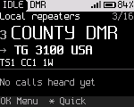
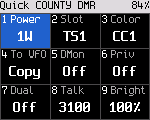
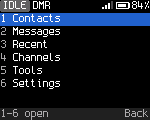

<!-- SPDX-License-Identifier: MIT -->
<!-- Copyright (c) 2026 The RadioFoundry Authors -->

# RadioFoundry user manual

This manual describes how to install RadioFoundry and use it on the radio. The chapters describe what RadioFoundry
does on every radio. The [Radio reference](23-radios.md) lists what differs from radio to radio: the keys, power
levels, battery, power switch, and display. Each release also carries this manual as a PDF, built from these files in
file-name order.

Start on the web site, [radiofoundry.org](https://radiofoundry.org). The **web installer** installs, updates, backs up,
and restores a radio. The **Codeplug Editor** edits channels, zones, and contacts. Both run in a Chromium-based
browser. The chapters name the command-line tools as alternatives.

## Contents

For which chapter to read first, see [How to use this manual](01-introduction.md#how-to-use-this-manual).

### Get started

1. [Introduction](01-introduction.md): what RadioFoundry does, the AMBE codec, conventions.
2. [Installing](02-installing.md): installing and updating with the web installer, backups, going back.
3. [First boot](03-first-boot.md): the built-in channels and the first checks.
4. [Programming the radio](04-programming.md): the Codeplug Editor, qdmr, files, and RadioID.net contacts.

### Use the radio

5. [Keys and navigation](05-keys-and-navigation.md): the five key rules, Find, temporary changes, key lock.
6. [The Home screen](06-home-screen.md): what each region shows while you receive and transmit.
7. [Channels, zones, and the VFO](07-channels-zones-vfo.md): including P25 and NXDN channels.
8. [FM](08-fm.md): squelch, monitor, tones, bandwidth, VOX, touch tones.
9. [DMR](09-dmr.md): talk targets, replies, Recent, contacts, privacy, roaming, trunked systems.
10. [Messages, call alert, and radio check](10-messages-and-signaling.md).
11. [Emergency](11-emergency.md).
12. [Scan and dual watch](12-scan.md).
13. [APRS](13-aprs.md): positions on FM and over DMR, beacons, KISS and iGate with a computer.
14. [Hotspot mode](14-hotspot.md): MMDVMHost, single-frequency repeaters, two radios as a duplex repeater.
15. [USB network mode](15-usb-network.md): IP over DMR and the services the radio offers to a computer.
16. [Battery and power](16-battery-and-power.md).

### Reference

17. [Settings](17-settings.md): every setting and its default.
18. [Moving from the original firmware](18-moving-from-stock.md): carrying a codeplug over from the manufacturer's
    firmware.
20. [Troubleshooting](20-troubleshooting.md): symptoms and fixes, including installer errors.
21. [FAQ](21-faq.md).
22. [Glossary](22-glossary.md).
23. [Radio reference](23-radios.md): keys, power levels, battery, power switch, display, and install values for each
    radio.

## Quick reference

Keys are named by their job. For which key does each job on your radio, see [Key roles](23-radios.md#key-roles).

| To | Press |
|---|---|
| Change channel | Channel knob, or **Up** / **Down** |
| Change zone | **Previous zone** / **Next zone**, or **OK**, **4**, then pick a zone |
| Open quick settings | **\*** |
| Open the menu (hub) | **OK** |
| Act on the last caller | **#** |
| Open Recent | **OK**, **3** |
| Talk to another talkgroup or ID | Hold **#** |
| Choose who to talk to | **Talk target** (DMR), or **\***, **8** |
| Monitor | Hold **Monitor** |
| Turn dual watch on or off | Hold **A/B**, or **\***, **7** |
| Turn scan on or off | **OK**, **6**, **1** |
| Undo temporary changes | **Back** on Home |
| Save changes to the channel | Hold **OK** |
| Go back to Home | Hold **Back** |
| Lock or unlock the keys | Hold **\*** |

For contributor documentation, see the [developer documentation](../dev/README.md).
