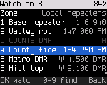
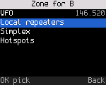
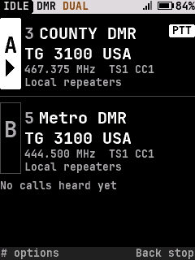
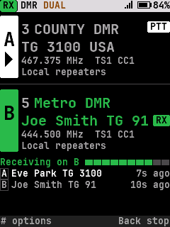
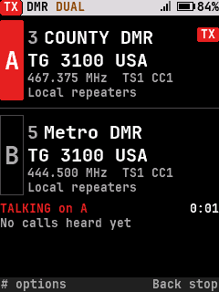
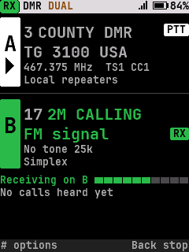
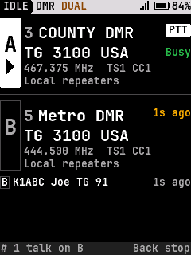
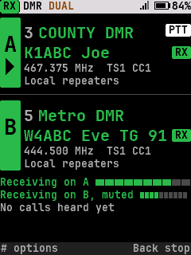
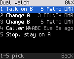
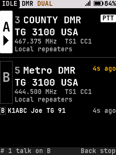

<!-- SPDX-License-Identifier: MIT -->
# Dual watch

Design for dual watch on Home ([#96](https://github.com/sfowlr/OpenDigitalRadio/issues/96)). Built with
`CONFIG_DUAL_WATCH` (on with `CONFIG_SCAN`; [build-config.md](../build-config.md)). Code: `core/ui/ui_dual.c` (behavior and
its screens), `ui_draw_home_dual` in `core/ui/ui_screens.c` (Home), `ui_svc_dual` (the radio).

## 1. What it is

The radio listens on two channels, **A** and **B**, and you talk on one of them. Each can be any channel of any zone,
or the VFO: dual watch is two frequencies, not the two timeslots of one DMR frequency.

- **A** is the channel you were on when dual watch started. **B** starts as the next channel of A's zone (else the
  first channel of a later zone, else the VFO). Change either the way you change the channel on Home: select it, then
  Up / Down, digits, Find, Zones or the VFO key; or **#** **2** / **3**.
- One of them is **selected**. PTT transmits on it, and the dual watch keeps going after the transmission. Up / Down,
  the knob, digits, Quick settings, the talk target and the menus act on it, as they act on the one channel of the
  normal Home, even while the receiver is on the other channel. A quick setting changed on the selected channel keeps
  the watch on.
- Each channel keeps its changes for now (power, squelch, width, tones, timeslot, color code, talk target, hear all)
  while the receiver goes back and forth. A changed channel loses its changes when it is replaced or the watch stops.
- **Only the user stops it** (section 5).
- A radio with one receiver (every radio today) alternates between A and B, so a call on one can be missed while it
  is on the other. Home doesn't say so: the mode in the strip implies it, and the user guide has the caveat. A radio
  with two receivers (`ui_svc_receivers()` > 1, `ui_svc_dual_rx(pane)`) hears both at once (section 3.1). No radio
  reports two yet. The AT-D578UV, which has two receiver chips ([hardware-anytone.md](../spec/hardware-anytone.md)),
  would be the first.
- What the radio core does with the pair (any zone or the VFO, PTT, retunes) is in
  [radio-features.md 2.1](../spec/radio-features.md#21-dual-watch). The UI refuses only a channel the radio can't
  read, or the same channel twice: "Can't watch that channel: pick another".

## 2. Turning it on and off

| How | Does |
|---|---|
| **\***, **7** (Quick tile **Dual watch**) | On with the last B (2 presses), the first time with the default B (section 1); off while it runs. The tile says On or Off |
| Hold **SK2** (every radio with an SK2; the DB25-D PRO's tone key) | The same: on with the last B / off |
| **A/B** key (DM-1801 Pro's A/B key and the DM-1701's SK2 on a press; a side key function elsewhere) | On: selects the other channel. Off: "Turn on dual watch first" ("Dual watch is off" where that doesn't fit); it never starts it |
| **Dual watch** key (DM-1801 Pro's A/B key held; a side key function elsewhere) | On (last B, or the default B) / off |
| **Back** twice on Home (within 2 s) | Off, staying on the selected channel. Back first clears what it clears on the normal Home (VFO entry, a banner, the reply target, hear all, changes for now); then the first press says "Press Back again to stop dual watch" |
| Tools › Scan, the **Scan** key function | A zone scan (the band in the VFO) in its place: dual watch stops on the selected channel, then the scan starts |
| **#** **3** while it runs | Another B (**Change B**, the picker) |

A zone scan is in Tools › Scan only (and on a side key set to Scan): tile 7 and SK2 hold are dual watch.

The **B picker** (**#** **3**; **#** **2** for A) lists the channels of a zone, with their frequency and mode. The first row is the zone: OK on it
lists the VFO (with its frequency) and the zones; a zone goes back to the picker on that zone. The other pane's channel is shown dimmed with its letter ("A" when you pick B) and can't be picked. When the pane has a channel in this zone, it is focused and marked as the current one. Digits find a channel by number
or name, as in the zone's channel list.

## 3. Home

Two panes of the same size, A over B: neither channel is second class. Each pane:

| Row | Shows |
|---|---|
| Tag | The letter in a box as tall as the pane; under the letter, an arrow (▶) on the selected pane only |
| 1 | Channel number and name (the VFO: its frequency); at the right, the PTT pill (selected pane) or TX |
| 2 | What PTT talks to (DMR: "TG 3100 USA"), or the frequency (FM); while a call comes in, the caller, and the RX pill at the right |
| 3 | Frequency, timeslot and color code, or tone and width (where there is room) |
| 4 | The zone (where there is room: B may be in another zone than A). Where row 3 has room, the zone sits at its right instead |

**Which channel PTT uses** (asked for: "easy to tell which one transmits"): the selected pane's tag is filled and has
the arrow, and its row 1 always has the **PTT** pill. The other pane has neither. While transmitting, the tag and pill
turn red and say **TX**, and the line under the panes says "TALKING on A" with the time.

**Where a call is coming in**: that pane's tag and text turn green, row 2 names the caller with an **RX** pill at its
right, and the line under the panes says "Receiving on B" with the meter. On the selected pane the pane shows both
PTT (row 1) and RX (row 2). The other pane dims.

**Under the panes**: the state line (TALKING or Receiving) when there is one, then the last calls, newest first, each with its pane's letter: "B Joe
Smith TG 91 10s ago". Each pane says how long ago its own last call ended, "Heard 7s ago" (or "7s ago") at the right
of its first row where it fits whole: amber on the pane of the newest call, dim on the other. On displays without room
for the list (128x64) and no room in the first row, the newest call's pane says "7s ago" at the right of its second
row instead. A pane's age clears when its channel changes. For 10 s
after a call on the other channel, the hint row says "# 1 talk on B  Back stop"; during talk back (section 4.2) "# 1
back to A  Back stop"; otherwise "# options  Back stop".

**The wait after a call** (one receiver): when a call or signal ends, the receiver stays on that channel for the
reply, 1 s by default (**Settings › Talk › Dual watch delay**, 0.5-5 s). During the wait it takes short looks at the
other channel. A signal found there is not played and doesn't take the receiver away from the reply: that pane says
**Busy** in green at the right of its second row (its tag outline turns green where it isn't the selected one). When
the wait ends the watch goes on and the busy channel is heard. Without this, the other channel went unheard for the
whole wait, and with a conversation on one channel it was seldom checked at all.

The status strip shows **DUAL** (amber) and the selected channel's mode (the radio's own mode alternates). It says RX while a call comes in on either pane. Every color comes with a word (P5).

**Large text** (Settings › Display): one line per channel, "A COUNTY DMR" / "B Metro DMR", as large as fits, the
selected one marked with an arrow at its left, green while a call comes in on it. The line receiving a call has its letter in a filled box.

### 3.1 Two receivers

With `ui_svc_receivers()` > 1, both panes can receive at once, each with its caller and RX pill. Under the panes there is
a line per receiving pane: "Receiving on A" with its meter, and "Receiving on B, muted" for the one that is not
heard; where there is room for one line only, "Receiving on A and B". The strip says RX. Gallery: `home_dual_two_rx`,
`home_dual_two_rx_large_text`. The simulator has `receivers:2`, `rxa:` / `rxb:` and the `rxaend` / `rxbend` tokens; uiFlowTest
checks a call on each, one ending (the other is then the one heard, and the ended call is listed), and talking on B.

### 3.2 Per display class

The layout picks the richest set of rows that fits, never a smaller font for a row than the normal Home uses for it,
and both names in one font (the largest both fit, never smaller than row 2; a longer name is shortened):

| Class | Rows per pane | Under the panes |
|---|---|---|
| 240x320, 240x320i10x5 (DM-32UV), 320x240 (GD-88) | name (medium or large), target (medium), details, zone | state and the last calls, as many as fit |
| 160x128 | name, target (medium) | one line: the state, or the last call |
| 160x120i5 (DM-1701) | name, target (small) | one line |
| 128x64 (GD-77) | name, target (small) | none: the last call's age is in its pane |

Every screen in every class is in the gallery (`docs/ux/screens/*/home_dual*.png`, `dual_*.png`).

## 4. Keys while it runs

| Key | Does |
|---|---|
| **PTT** | Transmits on the selected channel; dual watch goes on after |
| **Up / Down**, the knob | The selected channel moves through its zone (skipping the other one); on the VFO, a step. Nowhere to go: "Only one channel in this zone", or "No other channel here: A has it" |
| **Left / Right** (DM-1801 Pro, DM-32UV) | Selects A / B (a press; hold is the radio's user function) |
| **A/B** key | Selects the other channel |
| Zone keys (Next / Previous zone, the DM-1701's P1 / P2; Up / Down set to Zone in Settings › Keys) | The selected channel goes to the next / previous zone, on its first channel that isn't the other one ("A zone: Simplex"). A zone with no such channel is passed over. From the VFO: the zone the radio was last on. The knob still steps the channel |
| Home zone key | The selected channel goes to the first zone, the same way |
| **Monitor** (held) | Opens the squelch on the selected channel: the receiver goes there and the watch waits while the key is held. On a DMR channel a press is digital monitor, as without dual watch |
| **#** | Dual watch actions: **1** Talk on B (or A), **2** Change A, **3** Change B, **4** Caller (the last caller and how long ago; OK opens their actions; dim until a call was heard), **5** Stop, stay on A (or B). Change A and B open the picker |
| **\*** | Quick settings of the selected channel |
| **VFO** key | The selected channel becomes its own VFO ("A: VFO"); again, back to the channel it was ("Back to channels"). Each channel has its own VFO: with the other channel on one, this one gets the second |
| Copy to VFO | The selected channel is copied into its own VFO, which becomes the selected channel. With the other channel on a VFO, the copy goes to the second; the other's frequency doesn't change |
| Find, Channels, Zones | A channel picked there becomes the selected channel; the other channel picked selects it |
| **Back**, twice | Stops, staying on the selected channel (section 2) |

### 4.2 Talk back

**Settings › Talk › Dual watch talk back** (off by default). Off, a call on the other channel never moves PTT: "# 1
talk on B" is one press away. On, when a call ends on the other channel, that channel is selected ("Talk back on B")
so PTT answers there. The time starts over with each reply and each call there; 10 s after the last, the selection goes
back ("Talking on A"). **#** **1**, the A/B key or Left / Right go back at once and end it.

### 4.1 Per radio

SK2 held is Dual watch on every radio, and the DM-1801 Pro's A/B key is A/B (press) and Dual watch (hold). On the
DM-1701 a press of SK2 is A/B, so the pair is on one key; the talk target picker stays on hold #. Every side key can
take A/B or Dual watch in Settings › Keys (press or hold).

| Radio | Switch A / B | Start / stop |
|---|---|---|
| DM-1701 | **SK2** (a press), `#` **1** | `*` `7`, or hold SK2 |
| DM-1801 Pro | The **A/B** key, **Left** / **Right** | Hold **A/B**, `*` `7`, or hold SK2 (zones: hold Left / Right, or Zones) |
| DM-32UV | **Left** / **Right** | `*` `7`, or hold SK2 |
| MD-380 | `#` **1**, or a side key set to A/B | `*` `7`, or hold SK2 |
| DB25-D PRO (no number keys) | A side key set to A/B | Hold the tone key, or a side key set to Dual watch |
| Radios planned (GD-77 family, MD-UV380, MD-9600) | Not decided: A/B on a side key or mic key | |

## 5. Rules

- Dual watch is a kind of scan to the radio: starting it stops a zone scan, and a zone scan (Tools › Scan, the Scan
  key) stops it.
- Only the user stops it: Back twice, `*` `7`, hold SK2, the Dual watch key, # 5, a zone scan, or a scan stop over the
  debug link (`odr_debug.py radio scan stop`). Everything else keeps it going:

  | Event | Dual watch |
  |---|---|
  | A channel picked in Find, Channels or Zones, or set over the debug link | That channel becomes the selected one; the other channel picked selects it |
  | Dual watch started over the debug link (`radio scan dual POS`) | Home shows it and the same rules apply, as if started with `*` `7` ("Dual watch on") |
  | A or B selected over the debug link (`radio scan select a\|b`) | That one becomes the selected one ("Talking on B"), as with the A/B key: the debug link's channel, zone and frequency requests then change it |
  | Hotspot mode | Paused while it runs, then goes on |
  | A codeplug write | Goes on with the same channels, found again by number; a channel gone is replaced by the one the radio is on |
  | Power off and on | Starts again with the same A, B and selection |
  | A zone or band scan started over the debug link | Stops: "Dual watch off: scanning" |
  | A channel the radio can't watch any more | Stops and says where the radio is: "Dual watch off: on COUNTY DMR" |
- Quick settings, the talk target, hear all and Clear changes on the selected channel retune the receiver to it
  first, so they act on the right channel. Each channel's changes for now stay with it over each hop
  ([radio-features.md 2.1](../spec/radio-features.md#21-dual-watch)).
- A channel picked for A or B can't be the other one's.
- Stopped with B selected, the radio stays on B, which becomes A: the next start watches the same two channels, with
  the old A as B. A start on the last B's channel does the same.
- Changing A or B clears the calls listed for it (they were on the old channel).
- The last B is kept across power off (its channel number, or which VFO; settings-store.md 3), so `*` `7` starts with it
  at once. With the watch on at power off, the radio starts it again at power on, with the same selection. If its zone isn't known any more, the first zone holding that channel is used (A's zone first); a channel
  gone from the codeplug means the default B. The radio powers up on the selected channel, even when it was listening to
  the other one at the time.
- PTT is moved to the other channel by a call there only with talk back on (section 4.2), and only for its 10 s.

## 6. Press budgets (uiFlowTest)

| Task | Presses |
|---|---|
| Start with the last B (also after power off) | 2 (`* 7`), 1 (hold SK2) |
| Start, B the next channel (the first time) | 2 (`* 7`) |
| Start, then B by number | 6 (`* 7 # 3 5 OK`) |
| Start, B on the VFO | 5 (`* 7`, select B, VFO key) |
| Start, B in another zone | 5 (`* 7`, select B, next zone) |
| Talk on B | 1 (A/B key, Right) or 2 (`# 1`) |
| Stop | 1 (hold SK2), 2 (Back Back, `* 7`) |
| Zone scan | 3 (Tools › Scan: `OK 6 1`; was 2 with `* 7`) |
| Talk back on | 11 (Settings › Talk) |

## 7. Decisions

Asked in this design's first round and decided by the owner (2026-10-21):

1. Tile 7 is Dual watch; a zone scan is in Tools › Scan only.
2. SK2 held is Dual watch (it was Scan).
3. A call on B keeps PTT on A by default; talk back (section 4.2) is a setting.
4. The last B is kept across power off.
5. The DM-1801 Pro's A/B key is A/B on a press and Dual watch on a hold (it was Next zone).
6. The DM-1701's SK2 press is A/B (it was Talk target, which is also hold #). The A/B key with the watch off says
   "Turn on dual watch first" instead of starting it (owner, 2026-10-22).
7. The zone keys move the selected channel to another zone; they no longer end the watch (owner, 2026-10-22).
8. Nothing ends the watch but a deliberate stop, and power on resumes it (owner, 2026-10-22).
9. One Back doesn't stop it: two presses within 2 s do. A hold isn't used, since a long Back is Home from anywhere
   (owner, 2026-10-22).
